# 13 — Google Cloud Spanner (Interface PG) & AlloyDB (Référence Architecturale)

**Série :** Architectures PostgreSQL Multi-Maîtres & Active-Active  
**Auteur :** Jean-Marie Renouard (`jmrenouard`) — [LightPath](https://www.lightpath.fr)  
**Licence :** MIT License

---

| Attribut | Valeur |
| :--- | :--- |
| **ID Catalogue** | `#13` (`GCP Spanner PG & AlloyDB` dans `Ch. 01`, `Ch. 03b`, `Ch. 04`, `Ch. 07`) |
| **Statut Benchmark** | **Non benchmarké en direct (Exclusion Cloud Managé `APP-005`)** |
| **Famille / Niveau** | `T5 / Cloud` (Spanner Actif-Actif) vs `N1–N2 / Cloud` (AlloyDB Mono-Primaire Désagrégé) |
| **Versions** | `Cloud Spanner PostgreSQL Interface` (`PGAdapter`) ; `AlloyDB for PostgreSQL` (`PG 14–16+`) & `AlloyDB Omni` |
| **Profil CAP / PACELC** | `PC/EC` (Spanner TrueTime + Multi-Paxos) / `PC/EC` ou `PA/EL` (AlloyDB Mono-Primaire + Read Pools) |
| **Licence / Déploiement** | Services managés propriétaires GCP (`Spanner`, `AlloyDB`) & conteneur commercial (`AlloyDB Omni`) |

---

## 1. Description de la technologie et rôle

L'entrée `#13` regroupe deux architectures Google Cloud fondamentalement distinctes pour lever toute confusion (`Ch. 01`, `Ch. 03b`) :
- **Google Cloud Spanner (Interface PostgreSQL)** est un moteur relationnel distribué actif-actif `PC/EC` shardé à l'échelle mondiale. En combinant **Multi-Paxos** par *split* et les horloges matérielles **TrueTime** (GPS + horloges atomiques bornant l'incertitude $\varepsilon < 7\text{ ms}$), Spanner garantit une **cohérence externe (sérialisabilité stricte)** intercontinentale. Les pilotes PostgreSQL se connectent via le proxy gRPC **`PGAdapter`** sur le dialecte PostgreSQL de Spanner.
- **Google Cloud AlloyDB for PostgreSQL (et AlloyDB Omni)** n'est **PAS un système multi-maîtres actif-actif**. C'est un moteur PostgreSQL **mono-primaire** à haute performance reposant sur un stockage désagrégé **Log Processing Service (LPS)**, des **Read Pools** élastiques et un **moteur colonnaire** en mémoire (`AlloyDB Omni` porte cette pile en conteneur/Kubernetes auto-hébergé).

---

## 2. Architecture et flux de données

Spanner coordonne les écritures globales via **PGAdapter**, leaders **Multi-Paxos**, **2PC** et **TrueTime**, tandis qu'AlloyDB concentre les écritures sur un unique primaire vers le stockage désagrégé **LPS** partagé avec les **Read Pools** :

```mermaid
flowchart TB
    subgraph SPAN["Cloud Spanner (Interface PG — Actif-Actif PC/EC)"]
        CS["Client PG / ORM"] -->|"pgwire"| PGA["Sidecar PGAdapter<br/>pgwire -> gRPC Spanner"]
        TT["API TrueTime<br/>GPS + Horloges atomiques (eps < 7ms)"] -.->|"Attente commit 2*eps"| SP1["Leader Split A<br/>Multi-Paxos + Wound-Wait"]
        PGA -->|"Dialecte SQL gRPC"| SP1
        PGA -->|"Dialecte SQL gRPC"| SP2["Leader Split B<br/>Multi-Paxos + 2PC"]
        SP1 <-->|"2PC inter-splits"| SP2
        SP1 -->|"Réplicas Paxos"| COL1["Stockage Colossus"]
        SP2 -->|"Réplicas Paxos"| COL1
    end
    subgraph ALLOY["AlloyDB / AlloyDB Omni (Mono-Primaire Désagrégé)"]
        CA["Client PG"] -->|"SQL RW"| AP["Calcul Primaire Unique<br/>Heap lignes + Cache colonnaire"]
        CA -->|"SQL RO"| ARP["Read Pools élastiques<br/>Moteur colonnaire + Cache SSD"]
        AP -->|"Flux WAL seul"| LPS["Log Processing Service (LPS)<br/>Matérialisation pages async"]
        LPS --> COL2["Stockage partagé Colossus / Omni"]
        COL2 -->|"Pages partagées"| ARP
    end
```

La frontière est nette : Spanner distribue les écritures avec sérialisabilité stricte via Paxos + TrueTime, alors qu'AlloyDB préserve le modèle mono-écrivain PostgreSQL (parité extensions/triggers) et accélère lectures et HTAP.

---

## 3. Principes de fonctionnement et modes d'implémentation

1. **TrueTime et attente de commit (`2\varepsilon`) :** Les datacenters Google exposent un intervalle TrueTime $[t_{\text{earliest}}, t_{\text{latest}}]$ borné à $\varepsilon < 7\text{ ms}$. Avant de libérer ses verrous d'écriture, Spanner observe un **commit-wait** de $2\varepsilon$ pour garantir que toute transaction causale ultérieure reçoive un horodatage strictement supérieur, autorisant des **lectures cohérentes sans verrous** à l'échelle mondiale :

$$
L_{\text{Spanner-Write}} \approx L_{\text{quorum-Paxos}} + 2 \cdot \varepsilon_{\text{TrueTime}} + k_{\text{2PC}} \cdot \text{RTT}_{\text{2PC}}, \qquad \varepsilon_{\text{TrueTime}} < 7\text{ ms}
$$

2. **Limites du dialecte PG Spanner vs LPS AlloyDB :** Spanner emploie le contrôle **Wound-Wait**, des tables entrelacées (*Interleaved*), des séquences à bits inversés et des **Change Streams** (`~65 %` de parité PG : zéro extension C, aucun trigger, PK obligatoire). À l'inverse, AlloyDB décharge les checkpoints sur le **LPS** et accélère l'OLAP dans les Read Pools via son **moteur colonnaire**.

| Mode / Variante | Portée et mécanique | Chemin de commit et sync | Conflits / bascule | Compromis |
| :--- | :--- | :--- | :--- | :--- |
| **Spanner PG — Régional** | Splits `Multi-Paxos` multi-zones | Quorum Paxos + attente `2*eps` | Wound-Wait / aborts `40001` ; RTO `< 5 s` | Zéro extension C ; sous-ensemble dialecte PG |
| **Spanner PG — Multi-Régions** | Vote Paxos continental + témoins | Quorum leader/témoins + 2PC + TrueTime | Zéro split-brain (`RPO = 0`) | Plancher latence = RTT Paxos + `2*eps` |
| **Spanner PG — Lectures bornées** | Lecture `RO` à horodatage passé | Réplica local sans verrou à `ts` passé | Sans verrou ; zéro tour d'écriture Paxos | Lit un instantané passé borné |
| **AlloyDB for PostgreSQL** | Primaire unique + Read Pools + LPS | Le primaire n'expédie que le WAL au LPS | HA mono-écrivain managée (`RPO = 0`) | **Non multi-maîtres** ; verrouillage GCP |
| **AlloyDB Omni** *(Portable)* | PG conteneurisé / K8s + Colonnaire | Primaire unique + stockage local/partagé | HA mono-écrivain opérateur K8s/Patroni | Auto-hébergeable ; toujours mono-écrivain |

---

## 4. Forces et faiblesses

| Forces | Faiblesses et pièges opérationnels |
| :--- | :--- |
| **Cohérence externe absolue (Spanner) :** TrueTime + Multi-Paxos élimine les *Lost Updates* (`LWW`) et lectures périmées intercontinentales avec `RPO = 0`. | **Parité dialecte PG limitée (Spanner ~65 %) :** Exige le sidecar `PGAdapter` ; zéro extension C (`PostGIS`, `pgvector` C), aucun trigger, PL/pgSQL restreint et PK obligatoire. |
| **Lectures globales sans verrou (Spanner) :** Les transactions en lecture seule s'exécutent localement sans bloquer les écrivains inter-régions. | **TCO Cloud très élevé (`APP-005`) :** Nœuds Spanner dédiés, trafic réseau inter-régions et licences AlloyDB pèsent lourdement sur la facture. |
| **Stockage LPS + Colonnaire HTAP (AlloyDB) :** Supprime les tempêtes I/O de checkpoint sur le primaire et accélère les scans mixtes OLTP/OLAP en Read Pools. | **AlloyDB strictement mono-primaire :** Incapable d'accepter des écritures actives-actives multi-nœuds ou multi-régions ; les réplicas distants restent RO asynchrones. |
| **Option hybride portable (`AlloyDB Omni`) :** Apporte le moteur colonnaire et les optimisations AlloyDB sous Docker/Kubernetes hors GCP. | **Écart d'écosystème (Spanner) :** `LISTEN/NOTIFY` et `pgBackRest` sont remplacés par les Spanner Change Streams et le PITR managé. |

---

## 5. Exclusion architecturale (`APP-005`), comparatif des modes et base de référence

**Pourquoi `#13 GCP Spanner & AlloyDB` n'ont pas été benchmarkés en direct (`APP-005`) :** Selon `docs/RCA_REGISTER.md` (`APP-005`), Cloud Spanner repose sur le matériel propriétaire TrueTime (GPS/horloges atomiques) et Colossus/Borg, tandis qu'AlloyDB est un service managé GCP propriétaire (`AlloyDB Omni` étant sous licence commerciale). Aucun chiffre synthétique de TPS ou latence n'est inventé ici.

Dans notre base empirique (`results/benchmark_summary.csv`, `results/functional_limits_matrix.csv`), Spanner correspond à la famille `T5` (`PC/EC` Multi-Raft) et AlloyDB au mono-primaire `N1/N2` (la latence au 99e percentile n'est pas enregistrée dans `results/`) :

| Capacité / Référence | `#13 Spanner PG` *(Réf. Arch., `APP-005`)* | `#13 AlloyDB` *(Réf. Mono-Primaire)* | `#6 CockroachDB` *(PoC, `RF=3`)* | `#5 YugabyteDB` *(PoC, `RF=3`)* | `#15b pg17-sync-streaming` *(Témoin)* |
| :--- | :--- | :--- | :--- | :--- | :--- |
| **Consensus / Écrivains** | Multi-Paxos + TrueTime (Actif-Actif) | Primaire unique + LPS + Read Pools | Raft par plage (`RF=3`) + HLC | Raft par tablette (`RF=3`) + HLC | 1 Primaire + Standby Sync (`25006`) |
| **Parité PG / Extensions** | ~65 % (`PGAdapter`, zéro ext. C) | Haute parité PG + Colonnaire | ~75 % Go `pgwire` (zéro ext. C) | ~98 % Fork `PG 15` (`vector`) | **Cœur `PG 17.11` (`100 %`)** |
| **Sans PK / `LISTEN`** | PK requise / Change Streams | PG complet / Local au nœud | `rowid` caché / `42601` | `rowid` caché / `0A000` | PG complet / Local au primaire |
| **Ancre réf. (`A_single_rw`)** | Non benchmarké (`APP-005`) | Non benchmarké (`APP-005`) | `42.08 TPS` (`44` reprises `40001`) | `173.64 TPS` (`0` reprise) | `409.48 TPS` (`50.307 ms` `p95`) |
| **Ancre réf. (`F_wan_netem_25ms`)** | Non benchmarké (`2*eps` + RTT Paxos) | Non benchmarké (1 primaire) | `10.06 TPS` (`-76,1 %` Raft WAN) | `5.78 TPS` (`-96,7 %` Raft WAN) | `57.00 TPS` (`-86,1 %` WAL WAN) |

---

**Navigation :** [Index](../../../README.fr.md) · [Ch. 03b — Distribué, triggers et cloud](../03b_catalogue_distribue_triggers_cloud.md) · [Ch. 10 — Streaming vs Logique vs Multi-Maîtres](../10_comparatif_streaming_logique_multimaster.md) · [English version](../../en/solutions/gcp_spanner_alloydb.md)
