# 14 — Systèmes historiques à triggers et files : Slony-I, Londiste/PGQ & RubyRep (Référence Architecturale — EOL)

**Série :** Architectures PostgreSQL Multi-Maîtres & Active-Active  
**Auteur :** Jean-Marie Renouard (`jmrenouard`) — [LightPath](https://www.lightpath.fr)  
**Licence :** MIT License

---

| Attribut | Valeur |
| :--- | :--- |
| **ID Catalogue** | `#14` (`RubyRep / Slony-I / Londiste` dans `Ch. 01`, `Ch. 03b`, `Ch. 04`) |
| **Statut Benchmark** | **Non benchmarké en direct (Référence Architecturale — Historique / EOL)** |
| **Famille / Niveau** | `T4 / Historique` — Réplication asynchrone par triggers et files (`Niveau 4 / Historique`) |
| **Versions** | `Slony-I 2.2.x` (C/PLpgSQL) ; `Skytools 3 / Londiste + PGQ` (Python/C, EOL) ; `RubyRep 1.2.x` (JRuby, abandonné) |
| **Profil CAP / PACELC** | `PA/EL` — capture asynchrone par triggers (`Slony`/`Londiste` mono-origine ; `RubyRep` bidir. fragile) |
| **Licence / Déploiement** | Open Source (BSD / ISC / MIT) / Triggers SQL/C en base + tables files + daemon `slon`/`londiste`/`rubyrep` |
| **TDE / Chiffrement au repos** | Absent cœur PG ; files `_slony`/`pgq` en clair (`LUKS` + migrer hors EOL ; [Ch. 14](../14_chiffrement_transparent_tde.md)) |

---

## 1. Description de la technologie et rôle

Avant PG 9.0 (streaming) puis PG 9.4/10 (`pgoutput`), la réplication sélective utilisait des **triggers en base**. Ces triggers écrivaient dans des tables tampons lues par des daemons externes :
- **Slony-I :** Moteur C/PLpgSQL (`_slony.logTrigger`) avec un daemon `slon` par nœud. Il offre des arbres **en cascade mono-origine** et des migrations par verrous DDL `EXECUTE SCRIPT`.
- **Londiste (Skytools) + PGQ :** Système à files capturant les lignes par `pgq.logutriga` dans des tables **PGQ** rotatives. Le daemon **`pgq.ticker`** découpe les lots pour les workers `londiste`.
- **RubyRep :** Outil Ruby/JRuby combinant triggers (`rr_pending_changes`) et sommes de contrôle. Abandonné vers 2012, il reste inadapté à l'OLTP concurrent.

---

## 2. Architecture et flux de données

Ces systèmes interceptent le LMD dans les transactions par triggers SQL/C au lieu de lire le WAL. Cela double les écritures avant rejeu des lots :

```mermaid
flowchart TB
    subgraph SLONY["Slony-I (Arbre en cascade mono-origine)"]
        SM["Primaire Origine"] -->|"Trigger C _slony.logTrigger -> sl_log_1/2"| SD["Daemons C slon<br/>(Verrou DDL EXECUTE SCRIPT)"]
        SD -->|"Rejeu asynchrone"| SS1["Réplica cascade 1"]
        SD -->|"Cascade"| SS2["Réplica cascade 2"]
    end
    subgraph LOND["Londiste / Skytools + PGQ (Lots par file)"]
        LM["Nœud Source"] -->|"pgq.logutriga -> pgq.event_*"| TICK["Daemon pgq.ticker<br/>Découpe lots + Vacuum"]
        TICK -->|"Lots discrets"| LC["Worker Python londiste"]
        LC -->|"Application async"| LS["Nœud Abonné"]
    end
    subgraph RUBY["RubyRep (Diff bidirectionnel + Triggers — Abandonné)"]
        RA["Nœud A (rr_pending_changes)"] <-->|"Polling JRuby + Diff Checksum"| RB["Nœud B (rr_pending_changes)"]
    end
```

Contrairement à `pgoutput` (lecture WAL post-commit), le trigger s'exécute **dans** la transaction d'écriture. Cela double la charge heap/WAL et la pression `VACUUM`.

---

## 3. Principes de fonctionnement et modes d'implémentation

1. **Capture par trigger vs rejeu asynchrone :** Chaque écriture LMD écrit la table métier et le journal (`sl_log_1`, `pgq.event_*`, `rr_pending_changes`). Le daemon scrute ensuite périodiquement :

$$
\text{Coût}_{\text{trigger}} \approx W_{\text{heap}} + W_{\text{file}} + 2 \cdot W_{\text{WAL}} + V_{\text{vacuum-file}}, \qquad L_{\text{lot}} \ge \Delta t_{\text{tick}} + \frac{Q_{\text{lot}}}{\mu_{\text{worker}}}
$$

2. **Schéma et clé primaire :** Chaque table exige une `PRIMARY KEY` et le DDL reste manuel. `Slony-I` impose `EXECUTE SCRIPT` par `slonik`, tandis que `Londiste` et `RubyRep` exigent une coordination manuelle.

| Outil / Mode | Portée et mécanique | Chemin de commit et sync | Conflits / bascule | Compromis |
| :--- | :--- | :--- | :--- | :--- |
| **Slony-I** *(Cascade mono-origine)* | Schéma `_slony` + `logTrigger` + `slon` | Trigger avant-plan -> rejeu `slon` async | Écrivain unique par set (zéro conflit) | Forte complexité ; remplacé par streaming/`pg17-logical` |
| **Slony-I `EXECUTE SCRIPT`** | Changement schéma orchestré (`slonik`) | Pose des verrous globaux sur le set | Évite les désynchronisations de tuples | Gèle brièvement les écritures du set |
| **Londiste + PGQ** *(Lots par file)* | `pgq.logutriga` + `pgq.ticker` + Python | Trigger -> table PGQ -> lot de tick | Mono-origine par table (étoile/cascade OK) | Rotation propre à l'époque ; dette EOL Python/PGQ |
| **RubyRep** *(Diff bidirectionnel)* | `rr_pending_changes` + checksums tables | Trigger + polling JRuby et resync | LWW / hooks Ruby (risque horloge/verrou) | Abandonné (~2012) ; coût CPU et verrous de scan |

---

## 4. Forces et faiblesses

| Forces | Faiblesses et pièges opérationnels |
| :--- | :--- |
| **Migrations historiques sans coupure :** Slony-I et Londiste ont permis des bascules `PG 8.x -> 9.x -> 10` avant l'existence du décodage logique natif. | **Forte amplification d'écriture et bloat :** Chaque écriture crée des lignes de file, index supplémentaires, double WAL et risque chronique de `VACUUM` / wraparound XID. |
| **Filtrage par table et cascades :** Londiste/PGQ et Slony-I répliquaient des sous-ensembles choisis entre versions/OS hétérogènes (`PA/EL`). | **Zéro multi-maîtres sous Slony-I / RubyRep abandonné :** Slony-I est strictement mono-origine par set ; RubyRep n'est plus maintenu et reste risqué en OLTP concurrent. |
| **File événementielle réutilisable (`PGQ`) :** Skytools découplait la capture (`pgq.logutriga`) des consommateurs pour servir plusieurs workers indépendants. | **Latence de lots élevée & zéro Auto-DDL :** Le polling par ticks induit des centaines de ms de latence (comme `#9 Bucardo`) et tout `ALTER TABLE` brut casse le flux. |
| **Resynchronisation intégrée (`RubyRep`) :** Les empreintes par ligne réconciliaient de petites tables divergentes lors d'anciennes migrations. | **Obsolescence complète face à PG 17 :** `pgoutput` natif, `#2 pgEdge Spock 5` et `#10 SymmetricDS` remplacent avantageusement tous ces usages. |

---

## 5. Exclusion architecturale, comparatif des modes et base de référence

**Pourquoi `#14 Systèmes à triggers` restent hors benchmark direct :** Slony-I, Londiste/PGQ et RubyRep sont des outils historiques EOL (`env/multi-db-docker-env/` les exclut). Aucun chiffre synthétique de TPS ou latence n'est inventé ici.

**Désambiguïsation catalogue :** L'ID `#14` désigne ces systèmes historiques à triggers. La réplication logique native PostgreSQL 17 (`pg17-logical`) figure séparément sous `Niveau 3`.

À la place, ces architectures historiques à triggers se situent directement face aux références à triggers et logiques mesurées dans `results/benchmark_summary.csv`, `results/functional_limits_matrix.csv` et `results/extended_functional_matrix.csv` (la latence au 99e percentile n'est pas enregistrée dans `results/`) :

| Capacité / Référence | **Triggers historiques** *(Réf. Arch., EOL)* | `#9 Bucardo 5` *(PoC Témoin Triggers)* | `pg17-logical` *(PoC `N3` Remplaçant)* | `#1 pg-birep` *(PoC `N4` Natif)* | `#15a pg17-standalone` *(Témoin)* |
| :--- | :--- | :--- | :--- | :--- | :--- |
| **Mécanisme de capture** | Triggers SQL/C en base + tables files | Triggers PL/Perl (`bucardo_delta`) | Décodage WAL `pgoutput` (sans triggers) | WAL `pgoutput` (`origin=none`) | Primaire unique (`CA`) |
| **Support multi-maîtres** | Non (`Slony`/`Londiste`) ; fragile (`RubyRep`) | Oui (`bucardo_latest` `-531 620` dérive) | Non (Unidirectionnel `Pub -> Sub`) | Oui (arrêt `23505`, `-71 063` dérive) | Écrivain unique (`0` dérive) |
| **Sans PK / FK / DDL** | PK req. / Course FK / DDL manuel | PK req. / **`23503` `0/10`** / DDL manuel | `55000` sans PK / `10/10` FK / Manuel | `55000` sans PK / `10/10` FK / Manuel | PG 17 complet natif |
| **Ancre réf. (`A` / Lag `T15`)** | Non benchmarké (référence EOL) | `735.38 TPS` (`A`) / `548.74 ms` `p50` | `532.38 TPS` (`A`) / `1.68 ms` `p50` | `875.91 TPS` (`A`) / `1.47 ms` `p50` | `866.82 TPS` (`A`, `23.958 ms` `p95`) |
| **Cible de migration actuelle** | Remplacer par `N1–N4` / `#10 SymmetricDS` | Hooks Perl faible volume uniquement | **Upgrades natifs `PG 17` et sous-ensembles** | Actif-actif clé disjointe (`N4`) | Standard `80 %+` OLTP (`#15`) |

## 6. Popularité GitHub, présence Git et vitalité de maintenance (`results/project_popularity.csv`)

Télémétrie GitHub en direct (`2026-11-20T17:26:02Z`, `archived = false` sauf `N/A`) :

| Projet | Présence / Rôle Git | Dépôt (`Compte / Dépôts`) | Stars / Forks / Watch | Commits (`Tot / 12m`) | Contrib / Issues | Lang / SPDX | Tag / Dernier Push |
| :--- | :--- | :--- | :---: | :---: | :---: | :--- | :--- |
| **Slony-I (#14a)** | `Yes` -- `Primary (Maintainer Repo)` | [`ssinger/slony1-engine`](https://github.com/ssinger/slony1-engine) (`User / 36`) | 42 / 19 / 4 | 2569 / 0 | 23 / 6 | C / `NOASSERTION` | `REL_2_2_11` / `2024-03-11T01:27:53Z` |
| **PGQ Queue (#14b)** | `Yes` -- `Primary` | [`pgq/pgq`](https://github.com/pgq/pgq) (`Org / 13`) | 427 / 23 / 15 | 89 / 8 | 7 / 0 | PLpgSQL / `ISC` | `v3.5.2` / `2026-07-09T12:49:14Z` |
| **Londiste (#14c)** | `Yes` -- `Primary` | [`pgq/londiste`](https://github.com/pgq/londiste) (`Org / 13`) | 26 / 8 / 5 | 195 / 8 | 5 / 2 | Python / `ISC` | `v3.12` / `2026-07-22T11:29:04Z` |
| **RubyRep (#14d)** | `Yes` -- `Primary (Dormant)` | [`rubyrep/rubyrep`](https://github.com/rubyrep/rubyrep) (`User / 2`) | 179 / 74 / 6 | 556 / 0 | 2 / 58 | Ruby / `MIT` | `v2.0.0` / `2023-07-10T16:53:19Z` |

- **Niveau de maintenance :** **Niveau D (EOL / Dormant)** -- `slony1-engine` (`0`/12m) et `rubyrep` (`0`/12m, `58` issues) sont figés. `pgq/pgq` et `pgq/londiste` comptent `8` commits/12m chacun.
- **Fraîcheur / Actualité :** **Dormant / Maintenance minimale** -- Dernier push `2024-03-11T01:27:53Z` (`Slony-I`), `2023-07-10T16:53:19Z` (`RubyRep`), `2026-07-09T12:49:14Z` / `2026-07-22T11:29:04Z` (`PGQ`/`Londiste`), dernières versions `REL_2_2_11`, `v3.5.2`, `v3.12`, `v2.0.0`.
- **Maintenabilité opérationnelle :** **Ne pas déployer** -- Surcoût de triggers, fragilité FK/DDL et absence de support PG 17+ bloquent la production. Migrer vers `pgoutput` natif, `#2 pgEdge Spock 5` ou `#10 SymmetricDS`.

---

**Navigation :** [Index](../../../README.fr.md) · [Ch. 03b — Distribué, triggers et cloud](../03b_catalogue_distribue_triggers_cloud.md) · [Ch. 10 — Streaming vs Logique vs Multi-Maîtres](../10_comparatif_streaming_logique_multimaster.md) · [English version](../../en/solutions/legacy_triggers.md)
