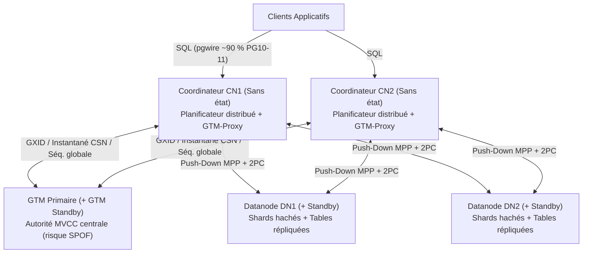

# 8 — OpenTenBase / Postgres-XL / Postgres-XC (MPP Shared-Nothing 2PC — Référence Architecturale)

**Série :** Architectures PostgreSQL Multi-Maîtres & Active-Active  
**Auteur :** Jean-Marie Renouard (`jmrenouard`) — [LightPath](https://www.lightpath.fr)  
**Licence :** MIT License

---

| Attribut | Valeur |
| :--- | :--- |
| **ID Catalogue** | `#8` (`OpenTenBase / Postgres-XL / Postgres-XC` dans `Ch. 01`, `Ch. 03b`, `Ch. 04`) |
| **Statut Benchmark** | **Non benchmarké en direct (Référence Architecturale)** |
| **Famille / Niveau** | `T5` / `Niveau 5` — MPP *shared-nothing* / GTM + 2PC distribué |
| **Versions** | `Postgres-XC` (retiré), `Postgres-XL 10` (gelé ~2018), `OpenTenBase` (fork actif PG 10–11 + rétroportages) |
| **Profil CAP / PACELC** | `CP / PC-EC` — GTM centralisé (`GXID` + instantanés MVCC globaux) + 2PC CN/DN |
| **Licence / Déploiement** | Open Source (PostgreSQL / licence Tencent Apache) / `GTM` (+ Standby/Proxy) + Coordinateurs + Datanodes |

---

## 1. Description de la technologie et rôle

**OpenTenBase**, **Postgres-XL** et leur ancêtre retiré **Postgres-XC** (initié par NTT) forment une lignée PostgreSQL **MPP *shared-nothing***. À la différence de `#7 Citus` (extension C pure sur PostgreSQL 17 standard), cette famille forke le noyau PostgreSQL pour séparer trois rôles : des **Coordinateurs (CN)** sans état, des **Datanodes (DN)** shardés par hachage et un **Global Transaction Manager (GTM)** centralisé.

Le GTM délivre les `GXID`, les instantanés `CSN` et les séquences globales. Le cluster garantit ainsi une isolation par instantané cohérente et des jointures parallèles (`HTAP`/`OLAP`). Aujourd'hui, **Postgres-XC** est retiré, **Postgres-XL** est gelé sur `PG 10` (~2018) et **OpenTenBase** (fork de TBase par Tencent sous l'OpenAtom Foundation) reste le seul descendant actif.

---

## 2. Architecture et flux de données

Un cluster OpenTenBase ou Postgres-XL route le SQL par des **Coordinateurs** sans état. Ceux-ci demandent `GXID` et instantanés au **GTM** (ou **GTM-Proxy**) puis valident en 2PC sur les **Datanodes** :

Chaque `BEGIN`, lecture et `COMMIT` 2PC dépend du GTM, ce qui alourdit la latence WAN. Citus mono-shard et les moteurs Raft/HLC (`#5`, `#6`) évitent ce point central.

---

## 3. Principes de fonctionnement et modes d'implémentation

1. **GTM centralisé (`GXID` / `CSN`) & `GTM-Proxy` :** Le GTM attribue des `GXID` strictement ordonnés et des instantanés globaux à tous les Coordinateurs et Datanodes. Les processus `GTM-Proxy` colocalisés sur CN/DN regroupent les requêtes concurrentes sur moins de sockets vers le GTM.
2. **Modèle de latence de commit :**

$$
L_{\text{N5-MPP-GTM}} \approx L_{\text{disque-DN}} + \text{RTT}_{\text{CN-GTM}} + 2 \cdot \text{RTT}_{\text{CN-DN}}
$$

3. **Distribution et lignée :** Utiliser `DISTRIBUTE BY HASH(col)` ou `MODULO(col)` pour le sharding MPP, et `DISTRIBUTE BY REPLICATION` pour les référentiels en 2PC. Toute `PK`/`UNIQUE` distribuée exige la clé de distribution (`Ch. 04`).

| Lignée / Mode | Statut & noyau | Mécanique et stratégie de clés | Impact conflit / bascule | Compromis |
| :--- | :--- | :--- | :--- | :--- |
| **Postgres-XC** *(NTT)* | Retiré (EOL) | Découpage GTM + CN + DN 2PC d'origine sur PG 9.x | SPOF GTM sans regroupement CSN moderne | Remplacé par XL et OpenTenBase |
| **Postgres-XL** *(Communauté)* | Gelé (~2018, `PG 10`) | Ajoute le planificateur MPP distribué + `GTM-Proxy` | Noyau PG 10 non maintenu ; HA manuelle | Écosystème figé ; inadapté en prod neuve |
| **OpenTenBase** *(Tencent / OpenAtom)* | Actif (fork `PG 10–11` + rétroportages) | Issu de TBase avec CSN, GTM Standby, HTAP/colonnaire | Standbys streaming GTM + DN (`RPO = 0`, `RTO 15–60 s`) | Coût d'exploitation élevé ; retard noyau PG 17 |
| **`DISTRIBUTE BY HASH` vs `REPLICATION`** | DDL shardé vs répliqué | Hachage répartit sur les DN ; Réplication copie la table entière | Impose clé de shard en `PK`/`UNIQUE` ; FK inter-DN limitées | Écritures répliquées verrouillent tous les DN (2PC) |
| **Regroupement `GTM-Proxy`** | Proxy local CN/DN | Agrège les appels RPC `GXID` et instantanés vers le GTM | Réduit la contention de sockets en HTAP LAN | N'élimine pas la pénalité `RTT` sur WAN |

---

## 4. Forces et faiblesses

| Forces | Faiblesses et pièges opérationnels |
| :--- | :--- |
| **Instantanés MVCC globaux (`GXID`/`CSN`) :** Le GTM fournit des instantanés cohérents sans attente d'horloge (`HLC`) sur jointures multi-shards. | **Goulot GTM en OLTP & WAN :** Chaque `BEGIN`/`COMMIT` court paie GTM + 2PC CN-DN ; le RTT WAN dégrade le débit plus vite que `#7 Citus`. |
| **Push-Down analytique MPP (`HTAP`/`OLAP`) :** OpenTenBase parallélise jointures par hachage et scans HTAP/colonnaires sur Datanodes et Coordinateurs. | **Lignée gelée & fork PG ancien :** Postgres-XC est retiré, Postgres-XL figé sur `PG 10` et OpenTenBase forke `PG 10–11` hors extensions `PG 17`. |
| **Topologies Standby `RPO = 0` (`DN` + `GTM` HA) :** Répliquer DN et GTM en streaming garantit `RPO = 0` (`RTO 15–60 s`) avec PITR par barrière `pg_rman`. | **Complexité d'exploitation très élevée :** Gérer 4 rôles (`GTM`, `GTM-Proxy`, `CN`, `DN` + standbys) et sauvegardes à barrière alourdit le MCO. |
| **Planificateur MPP & parité SQL :** Conserve `~90 %` de compatibilité filaire PostgreSQL, tables partitionnées et séquences `GTM Sequence`. | **Limites schéma & écosystème :** Clé de sharding obligatoire en `PK`/`UNIQUE`, FK inter-nœuds restreintes, moins d'extensions que `#7 Citus` sur PG 17. |

---

## 5. Exclusion architecturale, comparatif des modes et base de référence

**Pourquoi `#8 OpenTenBase / Postgres-XL / Postgres-XC` n'a pas été benchmarké en direct :** Le PoC Docker (`env/multi-db-docker-env/`, `Makefile` `PG_STACKS`) évalue 9 stacks centrés sur **PostgreSQL 17** et les moteurs SQL distribués actuels. Postgres-XC est retiré et Postgres-XL figé sur `PG 10`. OpenTenBase vise le MPP/HTAP intra-DC sur noyau `PG 10–11` plutôt que l'OLTP PG 17. Aucun chiffre synthétique de TPS ou latence n'est inventé ici.

À la place, `#8` se compare directement aux bases de référence `T5` (`CP / PC-EC`) et mono-nœud mesurées dans `results/benchmark_summary.csv` et `results/functional_limits_matrix.csv` (la latence au 99e percentile n'est pas enregistrée dans `results/`) :

| Capacité / Référence | `#8 OpenTenBase / PG-XL` *(Réf. Arch.)* | `#7 Citus` *(PoC, PG `17.10`)* | `#5 YugabyteDB` *(PoC, `RF=3`)* | `#6 CockroachDB` *(PoC, `RF=3`)* | `#15a pg17-standalone` *(Témoin)* |
| :--- | :--- | :--- | :--- | :--- | :--- |
| **Consensus / Autorité** | **GTM** central + 2PC | Coord 2PC (sans Raft worker) | Raft par tablet (`RF=3`) + HLC | Raft par range (`RF=3`) + HLC | Primaire unique (`CA`) |
| **Noyau PG & Extensions** | Fork `PG 10–11` (~90 % wire) | **Cœur `PG 17`** (haute parité) | Fork C `PG 15` (`YSQL`, `vector`) | Go `pgwire` (zéro ext. C) | **Cœur `PG 17.11` (`100 %`)** |
| **Contrainte de schéma clé** | Clé shard en `PK`/`UNIQUE` | **`0A000` sans clé (`L2`/`L4`)** | `23505` global ; `LISTEN` `0A000` | `TEMP` `XCEXF` ; `LISTEN` `42601` | Aucune (`23505` local) |
| **Ancre réf. (`A_single_rw`)** | Non benchmarké | `309.04 TPS` (`0` dérive) | `173.64 TPS` (`0` reprise) | `42.08 TPS` (`44` reprises) | `866.82 TPS` (`23.958 ms` `p95`) |
| **Ancre réf. (`D` / WAN `25 ms`)** | Non benchmarké (pénalité GTM + 2PC WAN) | `1691.45` (`D`) / `21.67 TPS` (`-93,0 %`) | `832.65` (`D`) / `5.78 TPS` (`-96,7 %`) | `471.61` (`D`) / `10.06 TPS` (`-76,1 %`) | `3128.63 TPS` (`D`) / N/A |

## 6. Popularité GitHub, présence Git et vitalité de maintenance (`results/project_popularity.csv`)

Télémétrie GitHub en direct (`2026-11-20T17:26:02Z`, `archived = false` sauf `N/A`) :

| Projet | Présence / Rôle Git | Dépôt (`Compte / Dépôts`) | Stars / Forks / Watch | Commits (`Tot / 12m`) | Contrib / Issues | Lang / SPDX | Tag / Dernier Push |
| :--- | :--- | :--- | :---: | :---: | :---: | :--- | :--- |
| **OpenTenBase (#8)** | `Yes` -- `Primary (PG-XL/XC Successor)` | [`OpenTenBase/OpenTenBase`](https://github.com/OpenTenBase/OpenTenBase) (`Org / 14`) | 816 / 636 / 112 | 817 / 14 | 64 / 421 | C / `NOASSERTION` | `v5.0` / `2026-11-09T13:23:30Z` |

- **Niveau de maintenance :** **Niveau C (Fragile / Maintenance)** -- `OpenTenBase/OpenTenBase` compte `14` commits/12m (`817` total, `64` contributeurs, `816` stars, `421` issues). Postgres-XC est retiré et Postgres-XL figé sur PG 10.
- **Fraîcheur / Actualité :** **Cadence faible** -- Dernier push `2026-11-09T13:23:30Z`, `14` commits/12m, dernière version `v5.0`.
- **Maintenabilité opérationnelle :** **Risque élevé** -- Noyau forké `PG 10–11` (`MulanPSL-2.0` / SPDX `NOASSERTION`) et pile 4 rôles GTM/CN/DN très lourds face à `#7 Citus`.

---

**Navigation :** [Index](../../../README.fr.md) · [Ch. 03b — Distribué, triggers et cloud](../03b_catalogue_distribue_triggers_cloud.md) · [Ch. 10 — Streaming vs Logique vs Multi-Maîtres](../10_comparatif_streaming_logique_multimaster.md) · [English version](../../en/solutions/opentenbase_pgxl.md)
