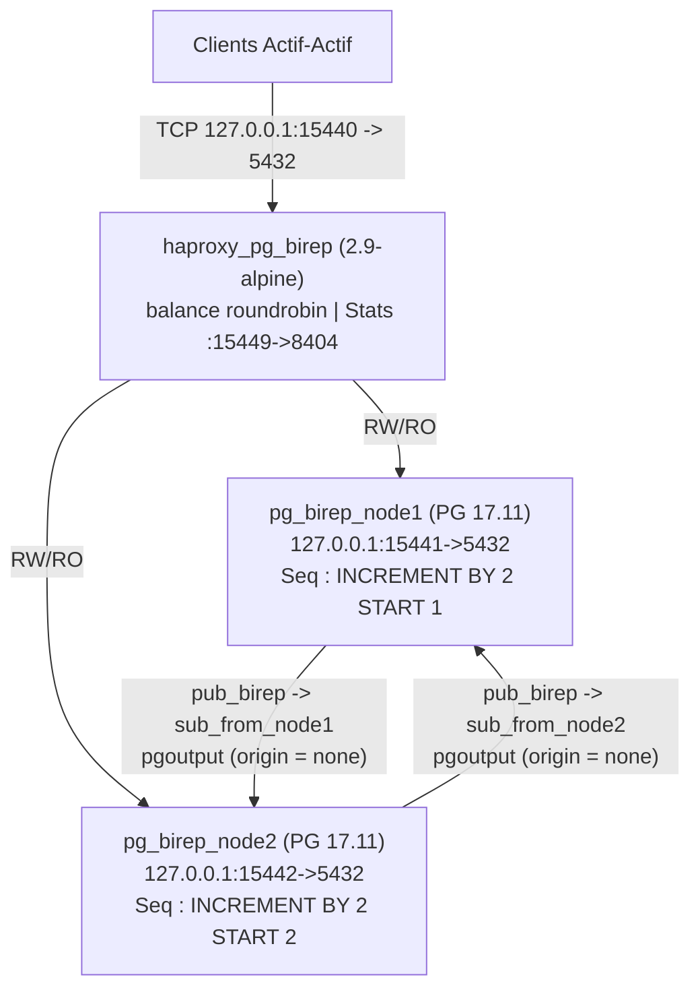

# 1 — PostgreSQL 17 Réplication Logique Bidirectionnelle Native (`pg-birep`)

**Série :** Architectures PostgreSQL Multi-Maîtres & Active-Active  
**Auteur :** Jean-Marie Renouard (`jmrenouard`) — [LightPath](https://www.lightpath.fr)  
**Licence :** MIT License

---

| Attribut | Valeur |
| :--- | :--- |
| **ID Catalogue** | `#1` (`PostgreSQL 17 Native Bidirectional (#1)` dans `results/functional_limits_matrix.csv`) |
| **ID Topologie Benchmark** | `pg-birep` (`results/*.csv`) |
| **Famille / Niveau** | `T4` / `Niveau 4` — Multi-maîtres logique natif |
| **Versions** | `PostgreSQL 17.11` (`postgres:17`), `HAProxy 2.9` (`haproxy:2.9-alpine`) |
| **Profil CAP / PACELC** | `AP / PA-EL` — maillage actif-actif asynchrone |
| **Licence / Déploiement** | PostgreSQL License / GPL-2.0 (HAProxy) / 3 conteneurs (`docker-compose-pg-birep.yml`) |
| **TDE / Chiffrement au repos** | Absent cœur (`pg_tde` opt.) ; tuples logiques en clair exigent TLS + LUKS ([Ch. 14](../14_chiffrement_transparent_tde.md)) |

---

## 1. Description de la technologie et rôle

La **réplication logique bidirectionnelle native PostgreSQL** (`pg-birep`) relie des primaires PostgreSQL 16/17/18 en maillage actif-actif avec `pgoutput` et `WITH (origin = none)`.

Introduite dans PostgreSQL 16, l'option `origin = none` filtre les modifications portant déjà un `pg_replication_origin` distant, coupant les boucles infinies `Nœud 1 -> Nœud 2 -> Nœud 1` sans extension tierce. Derrière **HAProxy TCP round-robin**, chaque nœud acquitte localement au rythme du disque. Sans **aucune résolution automatique de conflit**, `pg-birep` exige des **espaces de clés disjoints**.

---

## 2. Architecture et flux de données

Dans `env/multi-db-docker-env/docker-compose-pg-birep.yml`, HAProxy répartit les connexions TCP en round-robin vers `pg_birep_node1` et `pg_birep_node2` sur `pg_birep_net` :

---

## 3. Principes de fonctionnement et modes d'implémentation

1. **Suppression de boucle (`origin = none`) :** Les commits locaux gardent `origin = NULL` et sont diffusés. Les workers marquent les lignes reçues d'un `pg_replication_origin`, filtré au départ par `origin = none`.
2. **Modèle de latence de commit :**

$$
L_{\text{N4-birep}} \approx L_{\text{disque}} \quad (\text{fsync WAL local ; application asynchrone sur le pair})
$$

3. **Zéro résolution (`23505` / `55000`) :** `track_commit_timestamp = on` trace l'horodatage, mais tout conflit PK/`UNIQUE` gèle le worker (`apply_error_count`). Débloquer par suppression ou `ALTER SUBSCRIPTION ... SKIP (lsn = '...')`.

| Mode / Option | Portée | Mécanique et stratégie de clés | Impact conflit / bascule | Compromis |
| :--- | :--- | :--- | :--- | :--- |
| **`origin = none`** *(Obligatoire PoC)* | `CREATE SUBSCRIPTION` | Réplique uniquement les lignes locales (`origin = NULL`) | Empêche les boucles `A -> B -> A` | Requis sur chaque lien du maillage |
| **`copy_data = true` vs `false`** | Subscription / `REFRESH` | `true` sur schéma vide (`scripts/pg_birep/setup_birep.sh`) ; `false` si pré-peuplé | `true` sur tables peuplées provoque `23505` | Initialiser à vide ou utiliser `false` |
| **Séquences à pas (`INCREMENT BY 2`)** *(PoC)* | DDL (`START WITH 1` / `2`) | Partitionne IDs pairs/impairs sur 2 nœuds (`scripts/pg_birep/setup_birep.sh`) | Évite les collisions PK `23505` à l'insertion | Pas fixe ; rééquilibrage manuel si ajout nœud |
| **`UUIDv7` / IDs globaux** | Stratégie PK *(Arch.)* | UUID 128 bits ordonné dans le temps (`uuidv7()` PG 18 ; fonction SQL PG 17) | Zéro coordination sur `N` nœuds actifs | Index PK 16 octets vs `BIGINT` 8 octets |
| **`SERIAL` non coordonné** *(Anti-pattern)* | DDL défaut | Les deux pairs partent de `1` (`T18` `1\|false`) | Déclenche aussitôt `23505` et gèle l'apply (`L1`) | Dangereux sans pas ou UUIDv7 |
| **Arrêt + `SKIP (lsn=...)`** *(PG 16–18)* | Reprise erreur | Le worker s'arrête (`apply_error_count`) ; `SKIP` saute la tx | Préserve l'intégrité vs LWW silencieux ; runbook requis | PG 18 ajoute `pg_stat_subscription_stats` |
| **`REPLICA IDENTITY` (`DEFAULT` vs `FULL`)** | Table | `DEFAULT` envoie la PK ; `FULL` journalise toute la ligne | `UPDATE`/`DELETE` sans PK échoue `55000` (`L2`) | `FULL` requis sans clé primaire |

---

## 4. Forces et faiblesses

| Forces | Faiblesses et pièges opérationnels |
| :--- | :--- |
| **Actif-Actif natif sans extension :** S'appuie sur `postgres:17` `pgoutput` (`origin = none`), préservant toutes les extensions (`L6`). | **Divergence garantie sur clés partagées (`L3`, `B2`, `D`) :** `+100/-30` diverge (`n1=970.00` vs `n2=1100.00`, att. `1070.00`) ; `D` dérive de `-71063` (`851810`/`851747`) ; `B2` de `-4567`. |
| **Débit local insensible au WAN :** `875.91 TPS` (`A`), `824.04 TPS` sous `25ms` WAN (`-5,9 %`), `53072.52 TPS` (`C`), `65881 rows/s` (`T11`), `1.47 ms` p50 (`T15`). | **Gel silencieux de l'apply (`23505`) :** Toute collision `UNIQUE(email)` ou `SERIAL` incrémente `apply_error_count` (`0->1->2`) et bloque la réplication jusqu'à `SKIP (lsn=...)` (`L1`, `L4`). |
| **Convergence sur clés disjointes :** Dérive `0` sur `B1_disjoint_rw` (`820.09 TPS`), `E` (`1105.32 TPS`) et `H_append_only_insert` (`627.13 TPS`). | **DML sans PK (`55000`), zéro Auto-DDL (`L2`/`L5`) & piège Seq (`T18`) :** `ALTER TABLE` non répliqué ; `T12` `DELETE` gagne (`DELETED/DELETED`) ; `T18` `1\|false` -> `23505`. |
| **Reprise après panne pair (`L7`/`T16`) :** `node1` reste inscriptible (`54432B` WAL retenu ; rattrapage `5/5` ; `20/20` SIGKILL RPO=0). | **Pas de quorum / inflation WAL (`L7`/`L8`) :** Coupure prolongée gonfle le WAL sans `max_slot_wal_keep_size` ni timeouts de transaction. |

---

## 5. Résultats empiriques, limites fonctionnelles et spec PoC

Tests à `pg_scale = 2` (`retries_40001 = 0`). Seules `Avg`, `Stddev` (`0` pour `sysbench`) et `p95` sont mesurées (la latence p99 n'est pas mesurée).

### Tableau A — Charges principales et étendues (`benchmark_summary.csv`, `benchmark_extended_workloads.csv`)

| Suite | Cl / Dur | TPS | QPS | Avg / Stddev / p95 (ms) | Validées (Échecs) | Dérive | Statut |
| :--- | :---: | :---: | :---: | :---: | :---: | :---: | :--- |
| `A_single_rw` | 8 / 20s | 875.91 | N/A | 9.121 / 6.78 / 22.938 | 17512 (0) | 0 | `PASS_CONVERGED` |
| `B1_disjoint_rw` | 8 / 20s | 820.09 | N/A | 9.738 / 7.935 / 24.124 | 16395 (0) | 0 | `PASS_CONVERGED` |
| `B2_overlap_rw` | 8 / 20s | 1228.6 | N/A | 6.499 / 5.993 / 12.532 | 24563 (0) | -4567 | `EXPECTED_LIMITATION_DIVERGED` |
| `C_multinode_ro` | 16 / 20s | 53072.52 | N/A | 0.279 / 0.11 / 0.441 | 1060571 (0) | 0 | `PASS` |
| `D_hot_conflict` | 8 / 15s | 1231.15 | N/A | 6.476 / 5.517 / 13.007 | 18469 (0) | -71063 | `EXPECTED_LIMITATION_DIVERGED` |
| `E_sysbench_oltp_rw` | 8 / 20s | 1105.32 | 22192.83 | 7.23 / 0 / 10.84 | 22115 (96) | 0 | `PASS` |
| `E2_sysbench_oltp_ro` | 8 / 12s | 1658.72 | 26539.51 | 4.82 / 0 / 7.04 | 19914 (0) | 0 | `PASS` |
| `E3_sysbench_oltp_wo` | 8 / 12s | 1308.81 | 7907.06 | 6.11 / 0 / 10.84 | 15716 (163) | 0 | `PASS` |
| `E4_sysbench_point_select` | 16 / 12s | 141203.99 | 141203.99 | 0.11 / 0 / 0.27 | 1695873 (0) | 0 | `PASS` |
| `H_append_only_insert` | 8 / 12s | 627.13 | N/A | 12.717 / 11.294 / 32.793 | 7522 (0) | 0 | `PASS_CONVERGED` |
| `F_wan_netem_25ms` | 8 / 15s | 824.04 | N/A | 9.694 / 10.444 / 24.949 | 12354 (0) | 0 | `PASS_NETEM_25MS` |

*(Détails divergence : `B2` `exp=-189377`, `n1=-193944` vs `n2=-208996`. `D` `exp=922873`, `n1=851810` vs `n2=851747`.)*

### Tableau B — Balayages concurrence & WAN (`benchmark_concurrency_sweep.csv`, `benchmark_wan_sweep.csv`)

| Suite | Param | TPS | Avg / Stddev / p95 (ms) | Validées | Statut |
| :--- | :---: | :---: | :---: | :---: | :--- |
| `G_conc_c1` (8s) | 1 cl | 201.0 | 4.96 / 3.081 / 10.119 | 1607 | `PASS` |
| `G_conc_c4` (8s) | 4 cl | 196.63 | 20.011 / 35.612 / 54.679 | 1627 | `PASS` |
| `G_conc_c8` (8s) | 8 cl | 162.43 | 49.087 / 78.957 / 169.136 | 1303 | `PASS` |
| `G_conc_c16` (8s) | 16 cl | 337.61 | 47.265 / 157.109 / 112.233 | 2692 | `PASS` |
| `G_conc_c32` (8s) | 32 cl | 254.43 | 125.201 / 178.846 / 445.723 | 2037 | `PASS` |
| `F_wan_netem_10ms` (12s) | 10 ms | 274.53 | 29.098 / 29.698 / 84.045 | 3293 | `PASS_NETEM_10MS` |
| `F_wan_netem_25ms` (15s) | 25 ms | 824.04 | 9.694 / 10.444 / 24.949 | 12354 | `PASS_NETEM_25MS` |
| `F_wan_netem_50ms` (12s) | 50 ms | 223.32 | 35.751 / 30.676 / 92.48 | 2678 | `PASS_NETEM_50MS` |

### Tableau C — Limites fonctionnelles (`F1`, `L1–L8`) et sondes étendues (`T11–T18`)

| Sonde | Résultat empirique observé |
| :--- | :--- |
| `F1` Santé | `PASS: wal_level=logical track_commit_timestamp=on workers=1/1` |
| `L1` PK `SERIAL` | `EXPECTED_LIMITATION: apply halted (apply_error_count=1) SQLSTATE 23505` |
| `L2` Sans PK | `EXPECTED_LIMITATION: UPDATE/DELETE rejected SQLSTATE 55000; surrogate PK fixed` |
| `L3` *Lost Update* | `EXPECTED_LIMITATION: +100/-30 diverged n1=970.00 n2=1100.00 (expected 1070.00)` |
| `L4` Conflit `UNIQUE` | `EXPECTED_LIMITATION: apply stalled (errors 1->2) SQLSTATE 23505` |
| `L5` DDL & `SAVEPOINT` | `EXPECTED_LIMITATION: ALTER TABLE ADD COLUMN not propagated; TRUNCATE propagated` |
| `L6` Fonctions PG | `EXPECTED_LIMITATION: advisory_lock & LISTEN/NOTIFY node-local; TEMP session-local` |
| `L7` Panne nœud | `PASS: node1 writable; slot active=false WAL retained=54432B; caught up 5/5` |
| `L8` Quorum | `N/A: AP async continues without quorum` |
| `T11` Bulk 10k | `PASS: 65881 rows/s (152ms); peer_catchup=336.3ms` |
| `T12` Upd vs Del | `EXPECTED_LIMITATION: DELETE won silently n1=DELETED n2=DELETED` |
| `T13` Course FK | `PASS: 10/10 immediate cross-node child inserts consistent (0 FK errors)` |
| `T14` MD5 riche | `PASS: 2/2 identical md5=00493e3a (BYTEA=65536B JSONB/NULL/TS/UTF8)` |
| `T15` Lag visibilité | `p50=1.47ms p95=2.28ms max=2.31ms (n=30)` |
| `T16` SIGKILL RPO | `PASS: peer_surv=20/20 RPO=0 peer_write_OK; post_restart=21/21` |
| `T17` Tx longue | `PASS: NO_DIRTY_READ; side_tx_unblocked(122ms); post_commit_vis=201ms (ok=True)` |
| `T18` Seq (50) | `EXPECTED_LIMITATION: peer seq stuck at 1\|false -> insert hit SQLSTATE 23505` |
| **SQLSTATEs** | `L1–L8: 23505;55000` \| `T11–T18: 23505` |

### Tableau D — Spécification Docker & HAProxy PoC (`env/multi-db-docker-env/`)

| Paramètre | Configuration / Observation PoC |
| :--- | :--- |
| **Compose & Scripts** | `docker-compose-pg-birep.yml` + `scripts/pg_birep/setup_birep.sh` + `scripts/pg_birep/haproxy.cfg` |
| **Nœuds & Images** | `pg_birep_node1` (`127.0.0.1:15441:5432`), `pg_birep_node2` (`127.0.0.1:15442:5432`), `postgres:17` (`17.11`) |
| **HAProxy LB** | `haproxy_pg_birep` (`haproxy:2.9-alpine`), `127.0.0.1:15440:5432` (TCP RR `inter 2s fall 2 rise 2`), `127.0.0.1:15449:8404` (`/stats`) |
| **GUCs & Maillage** | `wal_level=logical`, `track_commit_timestamp=on`, `max_logical_replication_workers=8`, `wal_keep_size=128MB` ; `pub_birep FOR ALL TABLES` + `sub_from_node1`/`sub_from_node2` (`origin=none`, `copy_data=true`, `INCREMENT BY 2 START WITH 1/2`). |

## 6. Popularité GitHub, présence Git et vitalité de maintenance (`results/project_popularity.csv`)

Télémétrie GitHub en direct (`2026-11-20T17:26:02Z`, `archived = false` sauf `N/A`) :

| Projet | Présence / Rôle Git | Dépôt (`Compte / Dépôts`) | Stars / Forks / Watch | Commits (`Tot / 12m`) | Contrib / Issues | Lang / SPDX | Tag / Dernier Push |
| :--- | :--- | :--- | :---: | :---: | :---: | :--- | :--- |
| **PostgreSQL Core (#1/#15/#16)** | `Yes (Mirror)` -- `Mirror (canonical: git.postgresql.org)` | [`postgres/postgres`](https://github.com/postgres/postgres) (`Org / 6`) | 22894 / 6123 / 589 | 66091 / 3446 | 58 / 0 | C / `NOASSERTION` | `REL_19_0` / `2026-11-20T16:52:40Z` |

- **Niveau de maintenance :** **Niveau S (Cœur)** -- Le miroir `postgres/postgres` totalise `3 446` commits/12m (`66 091` total, `58` committeurs, `22 894` stars) sous gouvernance multi-éditeurs.
- **Fraîcheur / Actualité :** **À jour -- Actif au quotidien** -- Dernier push `2026-11-20T16:52:40Z`, `3 446` commits/12m, dernière version `REL_19_0`.
- **Maintenabilité opérationnelle :** **Risque élevé** -- Cœur Niveau S (`PostgreSQL License`), mais zéro résolution automatique de conflits : bloque sur `23505` hors clés disjointes.

---

**Navigation :** [Index](../../../README.fr.md) · [Ch. 03a — Solutions natives et extensions](../03a_catalogue_natif_et_extensions.md) · [Ch. 10 — Streaming vs Logique vs Multi-Maîtres](../10_comparatif_streaming_logique_multimaster.md) · [English version](../../en/solutions/pg17_bidirectional_logical.md)
