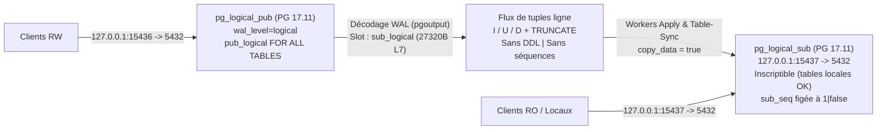

# 16 — PostgreSQL 17 Réplication Logique Native Unidirectionnelle (Pub/Sub)

**Série :** Architectures PostgreSQL Multi-Maîtres & Active-Active  
**Auteur :** Jean-Marie Renouard (`jmrenouard`) — [LightPath](https://www.lightpath.fr)  
**Licence :** MIT License

---

| Attribut | Valeur |
| :--- | :--- |
| **ID Catalogue** | `#16` (`CSV ref: #14 Baseline` — voir note de désambiguïsation ci-dessous) |
| **ID Topologie Benchmark** | `pg17-logical` (`results/*.csv`) |
| **Famille / Niveau** | `T3` / `Niveau 3` — Réplication logique native unidirectionnelle |
| **Version** | `PostgreSQL 17.11` (`postgres:17`, Debian `17.11-1.pgdg13+2`) |
| **Profil CAP / PACELC** | `AP / PA-EL (logique unidirectionnel)` |
| **Licence / Déploiement** | PostgreSQL License / 2 conteneurs (`docker-compose-pg-logical.yml`) |
| **TDE / Chiffrement au repos** | Absent cœur ; KEK indépendantes Pub/Sub (`pg_tde`) ou LUKS + `hostssl` ([Ch. 14](../14_chiffrement_transparent_tde.md)) |

> **Désambiguïsation (`#16` vs `#14`) :** `docs/fr/10_comparatif_streaming_logique_multimaster.md` attribue **`#16`** (`T3`) à `pg17-logical` et réserve `#14` aux systèmes à triggers historiques (`Slony-I / Londiste / RubyRep`). Certains tableaux CSV/chapitres (`results/functional_limits_matrix.csv`, `06`) mentionnent encore `#14 Baseline`.

---

## 1. Description de la technologie et rôle

La **réplication logique native unidirectionnelle** (`pg17-logical`) décode le WAL validé (`wal_level = logical`) en tuples `INSERT`/`UPDATE`/`DELETE` avec `pgoutput`. Elle diffuse le flux de l'**Éditeur** (`CREATE PUBLICATION`) vers l'**Abonné** (`CREATE SUBSCRIPTION`).

Contrairement au streaming physique (`#15b`), elle découple le stockage, l'OS/CPU et les versions majeures (`PG 15 -> 17 -> 18`). Elle permet les **upgrades majeurs sans coupure**, le filtrage et les abonnés inscriptibles.

---

## 2. Architecture et flux de données

Dans `env/multi-db-docker-env/docker-compose-pg-logical.yml`, les clients écrivent sur `pg_logical_pub` (`127.0.0.1:15436:5432`). L'abonné `pg_logical_sub` (`127.0.0.1:15437:5432`) applique le flux sur `pg_logical_net` avec le slot `sub_logical` :

---

## 3. Principes de fonctionnement et modes d'implémentation

1. **Décodage logique (`pgoutput`) :** Le *reorder-buffer* du `walsender` assemble les transactions validées (`BEGIN`..`COMMIT`, excluant les rollbacks) et émet les changements selon la `REPLICA IDENTITY`.
2. **Modèle de latence de commit :**

$$
L_{\text{N3-logique}} \approx L_{\text{disque}} \quad (\text{fsync WAL local éditeur ; application asynchrone})
$$

3. **Trois pièges opérationnels majeurs :** Sans PK, `UPDATE`/`DELETE` échoue (`55000`), et le DDL ne réplique pas. PG 15–17 ne synchronise pas non plus les séquences (`pub=50|true` vs `sub=1|false`), causant `23505` sans `setval()`.

| Mode / Option | Portée | Comportement et filtrage | Impact bascule / séquences | Compromis |
| :--- | :--- | :--- | :--- | :--- |
| **`FOR ALL TABLES` + `copy_data=true`** *(PoC)* | Pub / Sub | Copie initiale (`srsubstate='r'`) puis flux complet | Séquences abonné à `1\|false` (`23505` sans `setval()`) | Configuration simple ; PK requise partout |
| **Filtres Table / `WHERE` / Colonnes** | Publication *(Arch.)* | `FOR TABLE t WHERE (region='EU')` ou colonnes `(id, nom)` | Lignes filtrées absentes sur abonné | Sous-ensembles régionaux et masquage PII |
| **`copy_data = false`** | `REFRESH PUBLICATION` | Ignore le snapshot initial (tables déjà peuplées) | Évite `23505` sur cibles pré-chargées | L'opérateur doit garantir la parité initiale |
| **`pgoutput` vs `wal2json` / `test_decoding`** | Plugin sortie | Binaire natif `pgoutput` vs plugins CDC JSON | `pgoutput` sans extension externe | Plugins JSON adaptés à Kafka/CDC, pas à `SUBSCRIPTION` |
| **PG 17 `failover=true` + `synchronized_standby_slots`** | HA PG 17 *(Arch.)* | Sync des slots logiques vers standby physique (`sync_replication_slots=on`) | Préserve l'abonné après bascule du primaire | Exige un standby physique (absent du PoC 2 nœuds) |
| **`pg_createsubscriber`** *(PG 17)* | Outil migration *(Arch.)* | Convertit un standby physique en abonné logique | Évite le snapshot `copy_data` multi-To | Migration blue/green PG 17+ |
| **`REPLICA IDENTITY` (`DEFAULT` vs `FULL`)** | Table | `DEFAULT` envoie la PK ; `FULL` journalise toute l'ancienne ligne | Débloque `UPDATE`/`DELETE` sans PK (`55000`) | `FULL` gonfle le WAL et impose des scans séquentiels |

---

## 4. Forces et faiblesses

| Forces | Faiblesses et pièges opérationnels |
| :--- | :--- |
| **Upgrades inter-versions & OS :** Relie `PG 15 -> 17 -> 18`, CPU et `glibc` hétérogènes avec coupure quasi nulle. | **Piège des séquences (`L1`/`T18`) :** `sub_seq` reste à `1\|false` après `50` insertions (`pub=50\|true`), frappant `23505` à la bascule sans `setval()`. |
| **Filtrage fin & cible inscriptible :** Filtres `WHERE`, colonnes, et tables locales sur l'abonné. | **DML sans PK (`55000`) & zéro Auto-DDL (`L2`/`L5`) :** `UPDATE`/`DELETE` bloqué (`55000`) sans PK/`FULL` ; `ALTER TABLE` non propagé bloque l'apply. |
| **Résistance au WAN en async :** `654.11 TPS` à `25ms` WAN (`+22,9 %` vs `A` `532.38`) ; `42302.43 TPS` (`C`) et `146564.77 TPS` (`E4`). | **Dérive silencieuse & arrêt apply (`L3`/`L4`/`T12`) :** Écritures locales abonné divergent ou bloquent l'apply (`errors 0->2`, `23505`) ; `T12` diverge. |
| **Extensions libres :** Conserve 100 % des extensions éditeur (`L6`) ; `TRUNCATE` propagé (`L5`). | **Rétention WAL du slot (`L7`) :** Abonné coupé a retenu `27320B` dans `sub_logical` (illimité sans `max_slot_wal_keep_size`). |

---

## 5. Résultats empiriques, limites fonctionnelles et spec PoC

Tests à `pg_scale = 2` (`retries_40001 = 0`, `balance_drift = 0`). Seules `Avg`, `Stddev` (`0` pour `sysbench`) et `p95` sont mesurées (la latence p99 n'est pas mesurée).

### Tableau A — Charges principales et étendues (`benchmark_summary.csv`, `benchmark_extended_workloads.csv`)

| Suite | Cl / Dur | TPS | QPS | Avg / Stddev / p95 (ms) | Validées (Échecs) | Dérive | Statut |
| :--- | :---: | :---: | :---: | :---: | :---: | :---: | :--- |
| `A_single_rw` | 8 / 20s | 532.38 | N/A | 14.994 / 14.472 / 39.319 | 10658 (0) | 0 | `PASS_SINGLE_PRIMARY` |
| `B1_disjoint_rw` | 8 / 20s | 251.63 | N/A | 31.747 / 28.543 / 78.407 | 5038 (0) | 0 | `PASS_SINGLE_PRIMARY` |
| `B2_overlap_rw` | 8 / 20s | 355.57 | N/A | 22.475 / 29.148 / 77.992 | 7109 (0) | 0 | `PASS_SINGLE_PRIMARY` |
| `C_multinode_ro` | 16 / 20s | 42302.43 | N/A | 0.348 / 0.213 / 0.637 | 845078 (0) | 0 | `PASS` |
| `D_hot_conflict` | 8 / 15s | 2386.93 | N/A | 3.327 / 1.17 / 5.468 | 35747 (0) | 0 | `PASS_SINGLE_PRIMARY` |
| `E_sysbench_oltp_rw` | 8 / 20s | 595.81 | 11974.58 | 13.42 / 0 / 23.95 | 11926 (65) | 0 | `PASS` |
| `E2_sysbench_oltp_ro` | 8 / 12s | 1806.08 | 28897.23 | 4.42 / 0 / 5.77 | 21690 (0) | 0 | `PASS` |
| `E3_sysbench_oltp_wo` | 8 / 12s | 801.11 | 4830.94 | 9.97 / 0 / 21.5 | 9627 (73) | 0 | `PASS` |
| `E4_sysbench_point_select` | 16 / 12s | 146564.77 | 146564.77 | 0.11 / 0 / 0.27 | 1760391 (0) | 0 | `PASS` |
| `H_append_only_insert` | 8 / 12s | 1901.2 | N/A | 4.181 / 3.298 / 8.348 | 22778 (0) | 0 | `PASS_SINGLE_PRIMARY` |
| `F_wan_netem_25ms` | 8 / 15s | 654.11 | N/A | 12.207 / 9.064 / 30.581 | 9806 (0) | 0 | `PASS_NETEM_25MS` |

### Tableau B — Balayages concurrence & WAN (`benchmark_concurrency_sweep.csv`, `benchmark_wan_sweep.csv`)

| Suite | Param | TPS | Avg / Stddev / p95 (ms) | Validées | Statut |
| :--- | :---: | :---: | :---: | :---: | :--- |
| `G_conc_c1` (8s) | 1 cl | 306.11 | 3.255 / 1.127 / 5.323 | 2445 | `PASS` |
| `G_conc_c4` (8s) | 4 cl | 731.06 | 5.453 / 2.37 / 10.059 | 5841 | `PASS` |
| `G_conc_c8` (8s) | 8 cl | 736.27 | 10.843 / 8.357 / 27.946 | 5877 | `PASS` |
| `G_conc_c16` (8s) | 16 cl | 596.09 | 26.779 / 31.243 / 82.425 | 4760 | `PASS` |
| `G_conc_c32` (8s) | 32 cl | 706.65 | 45.111 / 53.971 / 145.974 | 5637 | `PASS` |
| `F_wan_netem_10ms` (12s) | 10 ms | 636.58 | 12.542 / 10.198 / 32.043 | 7634 | `PASS_NETEM_10MS` |
| `F_wan_netem_25ms` (15s) | 25 ms | 654.11 | 12.207 / 9.064 / 30.581 | 9806 | `PASS_NETEM_25MS` |
| `F_wan_netem_50ms` (12s) | 50 ms | 395.49 | 20.183 / 19.449 / 58.448 | 4749 | `PASS_NETEM_50MS` |

### Tableau C — Limites fonctionnelles (`F1`, `L1–L8`) et sondes étendues (`T11–T18`)

| Sonde | Résultat empirique observé |
| :--- | :--- |
| `F1` Santé | `PASS: wal_level=logical active_workers=1 uni-directional pub->sub` |
| `L1` PK `SERIAL` | `EXPECTED_LIMITATION`: piège séquence (`pub=50\|true sub=1\|false -> SQLSTATE 23505` sur bascule ; corrigé par `setval`) |
| `L2` Sans PK | `EXPECTED_LIMITATION`: `UPDATE`/`DELETE` rejetés (`SQLSTATE 55000`) ; corrigé par PK de substitution |
| `L3` *Lost Update* | `PASS` sur éditeur unique (`0` dérive) ; écritures locales abonné divergent silencieusement |
| `L4` Conflit `UNIQUE` | `EXPECTED_LIMITATION`: collision écriture abonné gèle worker (`errors 0->2 SQLSTATE 23505`) |
| `L5` DDL & `SAVEPOINT` | `EXPECTED_LIMITATION`: `ALTER TABLE ADD COLUMN` non propagé ; `TRUNCATE` propagé |
| `L6` Fonctions PG | `EXPECTED_LIMITATION`: `advisory_lock` & `LISTEN/NOTIFY` locaux au nœud ; `TEMP TABLE` locale à la session |
| `L7` Panne nœud | `PASS`: éditeur inscriptible ; slot logique `active=false`, WAL `27320B` ; rattrapage `5/5` |
| `L8` Quorum | `N/A`: `AP` async continue sans abonné (risque `RPO > 0`) |
| `T11` Bulk 10k | `PASS: 52816 rows/s (189ms); peer_catchup=332.9ms` |
| `T12` Upd vs Del | `EXPECTED_LIMITATION: DIVERGED pub=upd_n1 sub=DELETED` (`UPDATE` sur ligne absente ignoré) |
| `T13` Course FK | `PASS: 10/10 immediate cross-node child inserts consistent (0 FK errors)` |
| `T14` MD5 riche | `PASS: 2/2 identical md5=00493e3a (BYTEA=65536B JSONB/NULL/TS/UTF8)` |
| `T15` Lag visibilité | `p50=1.68ms p95=2.14ms max=2.16ms (n=30)` |
| `T16` SIGKILL RPO | `PASS: peer_surv=20/20 RPO=0 sub_writable_local; post_restart=21/21` |
| `T17` Tx longue | `PASS: NO_DIRTY_READ; side_tx_unblocked(107ms); post_commit_vis=120ms (ok=True)` |
| `T18` Seq (50) | `EXPECTED_LIMITATION: peer seq stuck at 1\|false -> insert hit SQLSTATE 23505` |
| **SQLSTATEs** | `L1–L8: 23505;55000` \| `T11–T18: 23505` |

### Tableau D — Spécification Docker PoC (`env/multi-db-docker-env/`)

| Paramètre | Configuration / Observation PoC |
| :--- | :--- |
| **Compose & Setup** | `docker-compose-pg-logical.yml` + `scripts/pg_logical/setup_pg_logical.sh` |
| **Conteneurs & Ports** | `pg_logical_pub` (`127.0.0.1:15436:5432`), `pg_logical_sub` (`127.0.0.1:15437:5432`), bridge `pg_logical_net` |
| **Image & Volumes** | `postgres:17` (`PG 17.11`) ; volumes `pg_logical_pub_data`, `pg_logical_sub_data` |
| **GUCs & Setup** | `wal_level=logical`, `max_wal_senders=10`, `max_replication_slots=10`, `max_logical_replication_workers=8`, `max_worker_processes=12`, `wal_keep_size=128MB`, `shared_buffers=128MB` ; `pub_logical FOR ALL TABLES` + `sub_logical` (`pgoutput`, `copy_data=true`). |

## 6. Popularité GitHub, présence Git et vitalité de maintenance (`results/project_popularity.csv`)

Télémétrie GitHub en direct (`2026-11-20T17:26:02Z`, `archived = false` sauf `N/A`) :

| Projet | Présence / Rôle Git | Dépôt (`Compte / Dépôts`) | Stars / Forks / Watch | Commits (`Tot / 12m`) | Contrib / Issues | Lang / SPDX | Tag / Dernier Push |
| :--- | :--- | :--- | :---: | :---: | :---: | :--- | :--- |
| **PostgreSQL Core (#1/#15/#16)** | `Yes (Mirror)` -- `Mirror (canonical: git.postgresql.org)` | [`postgres/postgres`](https://github.com/postgres/postgres) (`Org / 6`) | 22894 / 6123 / 589 | 66091 / 3446 | 58 / 0 | C / `NOASSERTION` | `REL_19_0` / `2026-11-20T16:52:40Z` |

- **Niveau de maintenance :** **Niveau S (Cœur)** -- Le miroir `postgres/postgres` totalise `3 446` commits/12m (`66 091` total, `58` committeurs, `22 894` stars) sous gouvernance multi-éditeurs.
- **Fraîcheur / Actualité :** **À jour -- Actif au quotidien** -- Dernier push `2026-11-20T16:52:40Z`, `3 446` commits/12m, dernière version `REL_19_0`.
- **Maintenabilité opérationnelle :** **Risque faible** -- Fonction native (licence PostgreSQL, zéro extension). Prévoir seulement `setval()` au basculement et `max_slot_wal_keep_size`.

---

**Navigation :** [Index](../../../README.fr.md) · [Ch. 03a — Solutions natives et extensions](../03a_catalogue_natif_et_extensions.md) · [Ch. 10 — Streaming vs Logique vs Multi-Maîtres](../10_comparatif_streaming_logique_multimaster.md) · [English version](../../en/solutions/pg17_logical_unidirectional.md)
