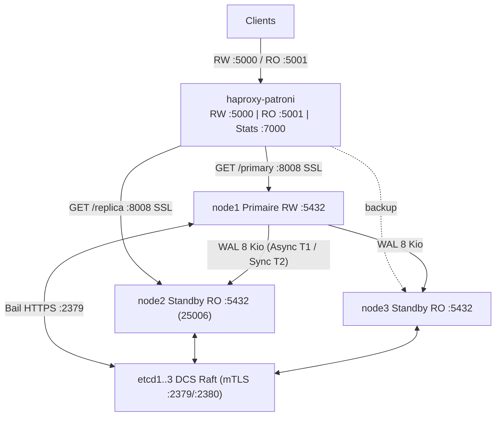

# 15b — PostgreSQL 17 Streaming Physique & Patroni HA

**Série :** Architectures PostgreSQL Multi-Maîtres & Active-Active  
**Auteur :** Jean-Marie Renouard (`jmrenouard`) — [LightPath](https://www.lightpath.fr)  
**Licence :** MIT License

---

| Attribut | Valeur |
| :--- | :--- |
| **ID Catalogue** | `#15b` (`#15 Baseline` dans `results/functional_limits_matrix.csv`) |
| **Topologies Benchmark** | `pg17-async-streaming`, `pg17-sync-streaming` (`results/*.csv`) ; HA : `docker-compose-patroni.yml` |
| **Famille / Niveau** | `T1` (`pg17-async-streaming`, `Niveau 1`) & `T2` (`pg17-sync-streaming`, `Niveau 2`) |
| **Versions** | `PostgreSQL 17.11` (`postgres:17`), `Patroni + etcd v3 + HAProxy` (`patroni-rhel8-*`) |
| **CAP / PACELC** | Async : `AP / PA-EL (async standby)` \| Sync : `CP / PC-EC (sync standby)` (`RPO = 0`) |
| **Licence / Stack** | PostgreSQL License / MIT (Patroni) / Apache-2.0 (etcd) / GPL-2.0 (HAProxy) |

---

## 1. Description de la technologie et rôle

La **réplication physique en streaming** est le mécanisme HA natif au niveau bloc de PostgreSQL. Un primaire unique (`walsender`) expédie octet par octet les blocs WAL 8 Kio vers des standbys chauds (`walreceiver`), qui rejouent pages heap, index, séquences et DDL en continu (`hot_standby = on`).

Elle opère en mode **asynchrone (`N1`/`T1`)** ou **synchrone (`N2`/`T2`)**, et s'associe en production à **Patroni + etcd + HAProxy** (`docker-compose-patroni.yml`) pour l'élection Raft, le fencing watchdog (`RTO ~ 10–30 s`) et le routage `/primary` vs `/replica`.

---

## 2. Architecture et flux de données

Le PoC sépare les benchmarks streaming bruts (`15434/15435`, `15432/15433`) du cluster Patroni 7 conteneurs (`patroni_net`, `etcd` mTLS, REST SSL `:8008`) :

Les standbys rejettent toute écriture (`SQLSTATE 25006`), éliminant tout conflit multi-écrivain.

---

## 3. Principes de fonctionnement et modes d'implémentation

1. **Slot physique & `pg_basebackup` :** Initialisation par `pg_basebackup -Fp -Xs -P -R -S slot_stream_standby` avec rétention WAL lors des coupures (`3088B` en `L7`).
2. **Modèle de latence de commit :**

$$
L_{\text{N1-async}} \approx L_{\text{disque}}, \qquad L_{\text{N2-sync}} \approx L_{\text{disque}} + \text{RTT}_{\text{standby}}
$$

3. **Bail DCS Patroni :** `node1..3` lancent `/usr/bin/patroni /etc/patroni.yml` via `supervisord`, renouvelant la clé Raft `etcd` (défauts standard `ttl=30`, `loop_wait=10`, `retry_timeout=10`) avec fencing OS.

| Mode / Paramètre | Portée | Chemin de commit | RPO / Blocage | Compromis |
| :--- | :--- | :--- | :--- | :--- |
| **`pg17-async-streaming`** (`N1`, PoC) | `synchronous_standby_names=''` | Flush WAL local ; envoi async | `RPO > 0` ; zéro gel primaire | `610.15 TPS` (`A`) ; insensible au WAN `25ms` (`599.61`) |
| **`pg17-sync-streaming`** (`N2`, PoC) | `synchronous_commit=on` | Flush disque primaire + standby | **`RPO = 0`** ; perte standby **gèle primaire** | `409.48 TPS` (`-52,8 %`) ; `57.0 TPS` sous `25ms` WAN |
| **`remote_write`** | Session / global *(Arch.)* | `write()` OS standby (sans `fsync`) | Survit crash PG ; `RPO > 0` coupure secteur | Latence moindre que `on` |
| **`remote_apply`** | Session / global *(Arch.)* | Rejeu WAL sur standby avant `COMMIT` | **`RPO = 0`** + lecture stricte sur RO | Latence synchrone maximale |
| **`off` / `local`** | Session *(Arch.)* | `off` : local async ; `local` : flush local | Relâche la synchro distante par tx | Chemin rapide non critique |
| **`FIRST 1` vs `ANY k`** | `synchronous_standby_names` | Priorité vs quorum `k`-sur-`N` | Évite le gel si `N >= 2` standbys | Exige >=2 standbys pour HA |
| **Patroni + etcd + HAProxy** | Plan de contrôle HA | Bail Raft, `/primary` & `/replica` (`3s/fall 3/rise 2`) | Bascule auto (`RTO ~ 10–30 s`) | Remplace `pg_promote()` manuel |

---

## 4. Forces et faiblesses

| Forces | Faiblesses et pièges opérationnels |
| :--- | :--- |
| **Parité PG & séquences 100 % :** Réplique DML sans PK (`L2`), DDL/`SAVEPOINT` (`L5`), séquences (`T18` : `66\|true`, `next_id=67`), `pg_largeobject`, extensions (`L6`). | **Couplage WAN & gel (`N2`) :** `25ms` WAN réduit `F` à `57.0 TPS` (`-86,1 %`), `50ms` à `25.79` ; perte de l'unique standby sync gèle le primaire (`L7`/`L8`). |
| **Dérive nulle (`0`) :** Zéro conflit (`A`–`D`), zéro retry `40001`, `RPO = 0` sur `SIGKILL` (`T16` : `20/20`). | **Pas d'écriture multi-maître :** Rejet `25006` sur standby (`T12`, `T13`) ; scaler en écriture exige sharding (`#7`) ou MM. |
| **Fort délestage lecture :** `45358.52` (async) / `54483.07 TPS` (sync) en `C` ; `148022.41` / `124105.25 TPS` en `E4`. | **Couplage binaire strict :** Impose même version majeure PG, CPU et `glibc` (pas d'upgrade PG 15 -> 17). |
| **HA clôturée (Patroni) :** Élection Raft `etcd` + coupure sessions HAProxy sans logique applicative. | **Inflation WAL sur slot (`L7`) :** Un slot déconnecté retient le WAL (`3088B` en test) sans `max_slot_wal_keep_size`. |

---

## 5. Résultats empiriques, limites fonctionnelles et spec PoC

Tests à `pg_scale = 2` (`retries_40001 = 0`, `balance_drift = 0`). Seules `Avg`, `Stddev` (`0` pour `sysbench`) et `p95` sont mesurées (`lat_p99_ms` non mesurée).

### Tableau A — Charges principales et étendues (`benchmark_summary.csv`, `benchmark_extended_workloads.csv`)

| Suite (Cl/Dur) | Async TPS | Async Avg/Std/p95 (ms) | Async Comm(Fail) | Sync TPS | Sync Avg/Std/p95 (ms) | Sync Comm(Fail) | Statut (Les deux) |
| :--- | :---: | :---: | :---: | :---: | :---: | :---: | :--- |
| `A_single_rw` (8/20s) | 610.15 | 13.094/10.073/33.928 | 12199(0) | 409.48 | 19.516/15.543/50.307 | 8192(0) | `PASS_SINGLE_PRIMARY` |
| `B1_disjoint_rw` (8/20s) | 627.39 | 12.731/6.053/24.346 | 12540(0) | 407.41 | 19.612/16.57/45.134 | 8152(0) | `PASS_SINGLE_PRIMARY` |
| `B2_overlap_rw` (8/20s) | 584.8 | 13.663/10.657/34.406 | 11686(0) | 465.22 | 17.171/18.922/46.194 | 9315(0) | `PASS_SINGLE_PRIMARY` |
| `C_multinode_ro` (16/20s) | 45358.52 | 0.325/0.147/0.557 | 906086(0) | 54483.07 | 0.271/0.091/0.427 | 1088619(0) | `PASS` |
| `D_hot_conflict` (8/15s) | 2081.26 | 3.82/1.843/6.117 | 31189(0) | 1370.1 | 5.827/1.424/8.725 | 20541(0) | `PASS_SINGLE_PRIMARY` |
| `E_sysbench_rw` (8/20s) | 962.84 | 8.3/0/10.27 | 19268(107) | 819.36 | 9.76/0/11.65 | 16397(118) | `PASS` (QPS `19353.12`/`16493.23`) |
| `E2_sysbench_ro` (8/12s) | 1804.13 | 4.43/0/5.99 | 21662(0) | 1693.64 | 4.72/0/6.55 | 20340(0) | `PASS` (QPS `28866.02`/`27098.18`) |
| `E3_sysbench_wo` (8/12s) | 1569.06 | 5.09/0/6.79 | 18844(179) | 370.71 | 21.56/0/49.21 | 4453(51) | `PASS` (QPS `9473.7`/`2241.22`) |
| `E4_point_sel` (16/12s) | 148022.41 | 0.11/0/0.27 | 1777606(0) | 124105.25 | 0.13/0/0.32 | 1490530(0) | `PASS` (`QPS = TPS`) |
| `H_append_only` (8/12s) | 2511.15 | 3.172/0.788/4.306 | 30095(0) | 1301.45 | 6.126/5.016/8.61 | 15573(0) | `PASS_SINGLE_PRIMARY` |
| `F_wan_netem_25ms` (8/15s) | 599.61 | 13.317/10.473/34.381 | 8991(0) | 57.0 | 139.564/98.831/353.493 | 866(0) | `PASS_NETEM_25MS` |

### Tableau B — Balayages concurrence & WAN (`benchmark_concurrency_sweep.csv`, `benchmark_wan_sweep.csv`)

| Suite | Param | Async TPS | Async Avg/Std/p95 (ms) | Async Comm | Sync TPS | Sync Avg/Std/p95 (ms) | Sync Comm |
| :--- | :---: | :---: | :---: | :---: | :---: | :---: | :---: |
| `G_conc_c1` (8s) | 1 cl | 336.82 | 2.959/0.99/4.256 | 2692 | 89.89 | 11.106/23.784/22.605 | 719 |
| `G_conc_c4` (8s) | 4 cl | 545.91 | 7.309/3.136/12.943 | 4357 | 238.15 | 16.768/22.183/49.238 | 1901 |
| `G_conc_c8` (8s) | 8 cl | 577.65 | 13.824/10.732/35.125 | 4599 | 410.8 | 19.428/15.823/51.894 | 3290 |
| `G_conc_c16` (8s) | 16 cl | 624.75 | 25.54/24.679/77.071 | 4993 | 424.67 | 37.536/35.542/106.896 | 3387 |
| `G_conc_c32` (8s) | 32 cl | 571.58 | 55.682/55.256/167.031 | 4573 | 424.98 | 74.902/89.331/227.512 | 3390 |
| `F_wan_netem_10ms` (12s) | 10 ms | 587.16 | 13.603/10.678/35.753 | 7044 | 121.75 | 65.492/47.958/162.898 | 1466 |
| `F_wan_netem_25ms` (15s) | 25 ms | 599.61 | 13.317/10.473/34.381 | 8991 | 57.0 | 139.564/98.831/353.493 | 866 |
| `F_wan_netem_50ms` (12s) | 50 ms | 619.37 | 12.897/9.903/33.368 | 7421 | 25.79 | 302.966/255.796/779.848 | 323 |

### Tableau C — Limites fonctionnelles (`F1`, `L1–L8`) et sondes étendues (`T11–T18`)

| Sonde | Async (`pg17-async-streaming`) | Sync (`pg17-sync-streaming`) |
| :--- | :--- | :--- |
| `F1` Santé | `PASS` : `wal_level=replica sync_state=async slot_active=t rec=f/t` | `PASS` : `sync_state=sync synchronous_commit=on` |
| `L1` PK `SERIAL` | `PASS` : WAL préserve seq sur `pg_promote` (`pri=50 stb=66 next=67`; 0 `23505`) | `N/A` : séquence primaire unique |
| `L2` Sans PK | `PASS` : WAL physique réplique `UPDATE`/`DELETE` sans PK | `PASS` : WAL réplique tout changement heap |
| `L3` *Lost Upd.* | `PASS` : verrous primaire (0 dérive) ; standby rejette (`25006`) | `PASS` : verrous sur primaire (0 dérive) |
| `L4` `UNIQUE` | `PASS` : `23505` sur primaire ; standby RO (`25006`) | `PASS` : `23505` sur primaire |
| `L5` DDL/Svp | `PASS` : réplique `ALTER TABLE ADD COLUMN` & `SAVEPOINT` | `PASS` : réplique DDL & `SAVEPOINT` |
| `L6` Fonct. PG | `EXPECTED_LIMITATION` : `adv_lock`/`LISTEN` locaux ; `TEMP` rejeté (`25006`) | `PASS` : `adv_lock`/`LISTEN` locaux ; standby RO |
| `L7` Panne | `PASS` : primaire ok ; slot `active=false`, WAL `3088B` ; rattrapage `10/10` | `EXPECTED_LIMITATION` : commits bloqués si standby sync hors ligne (`RPO=0`) |
| `L8` Quorum | `N/A` : `AP` async continue (risque `RPO > 0` si panne primaire) | `EXPECTED_LIMITATION` : perte `1/2` standby sync gèle écritures |
| `T11` Bulk10k | `PASS` : `28693 rows/s` (`349ms`) ; `peer_catchup=105.2ms` | `PASS` : `39697 rows/s` (`252ms`) ; `peer_catchup=114.6ms` |
| `T12` Upd/Del | `PASS` : `DELETE` standby rejeté (`25006`) ; primaire sérialisé (`DELETED`) | `PASS` : `DELETE` standby rejeté (`25006`) ; primaire sérialisé (`DELETED`) |
| `T13` FK Race | `EXPECTED_LIMITATION` : `0/10` ok ; `failures=25006x10` | `EXPECTED_LIMITATION` : `0/10` ok ; `failures=25006x10` |
| `T14` MD5 | `PASS` : `2/2` `md5=00493e3a` (`BYTEA=65536B` JSONB/NULL/TS/UTF8) | `PASS` : `2/2` `md5=00493e3a` (`BYTEA=65536B` JSONB/NULL/TS/UTF8) |
| `T15` Lag vis. | `p50=9.65ms p95=25.13ms max=57.44ms (n=30)` | `p50=1.88ms p95=2.74ms max=2.96ms (n=30)` |
| `T16` SIGKILL | `PASS` : `peer_surv=20/20 RPO=0 RO_standby` ; `post_restart=21/21` | `PASS` : `peer_surv=20/20 RPO=0 RO_standby` ; `post_restart=21/21` |
| `T17` Tx longue | `PASS` : `NO_DIRTY_READ` ; `side_tx(98ms)` ; `post_commit_vis=277ms (ok=True)` | `PASS` : `NO_DIRTY_READ` ; `side_tx(99ms)` ; `post_commit_vis=112ms (ok=True)` |
| `T18` Seq (50) | `PASS` : seq sync WAL (`last_value=66\|true` ; sûre sur `pg_promote`) | `PASS` : seq sync WAL (`last_value=66\|true` ; sûre sur `pg_promote`) |
| **SQLSTATEs** | `L1–L8: 25006` \| `T11–T18: 25006` | `L1–L8: 23505;25006` \| `T11–T18: 25006` |

### Tableau D — Stacks Docker PoC (`env/multi-db-docker-env/`)

| Stack | Compose & Setup | Conteneurs, Ports & Images | GUCs / Notes clés |
| :--- | :--- | :--- | :--- |
| **Streaming** | `docker-compose-pg-streaming.yml` + `setup_pg_streaming.sh` | `pg_stream_primary` (`15434:5432`), `pg_stream_standby` (`15435:5432`), `postgres:17` | `wal_level=replica`, `wal_keep_size=64MB`, slot `slot_stream_standby`, `hot_standby=on` |
| **Paire Sync** | `docker-compose-pg17-baseline.yml` + `setup_pg17_baseline.sh` | `pg17_sync_primary` (`15432:5432`), `pg17_sync_standby` (`15433:5432`), `postgres:17` | `synchronous_standby_names='pg17_sync_standby'`, `synchronous_commit='on'` |
| **Patroni HA** | `docker-compose-patroni.yml` + `conf/haproxy-patroni.cfg` | `etcd1..3` (`2379:2379` `etcd1`), `node1..3` (`5432`/`8008`), `haproxy-patroni` (`5000`/`5001`/`7000`), `patroni-rhel8-*` | mTLS `etcd`, `hostssl`/`verify-ca` ; `/etc/patroni.yml` intégré à l'image (défauts `ttl=30/loop_wait=10/retry_timeout=10`). `patroni_cluster.md` cite PgBouncer `:6432`, absent du compose. |

---

**Navigation :** [Index](../../README.fr.md) · [Ch. 03a — Solutions natives et extensions](../03a_catalogue_natif_et_extensions.md) · [Ch. 10 — Streaming vs Logique vs Multi-Maîtres](../10_comparatif_streaming_logique_multimaster.md) · [English version](../../en/solutions/pg17_physical_streaming_patroni.md)
