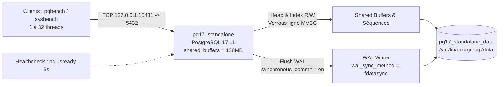

# 15a — PostgreSQL 17 Standalone (Ligne de base mono-écrivain)

**Série :** Architectures PostgreSQL Multi-Maîtres & Active-Active  
**Auteur :** Jean-Marie Renouard (`jmrenouard`) — [LightPath](https://www.lightpath.fr)  
**Licence :** MIT License

---

| Attribut | Valeur |
| :--- | :--- |
| **ID Catalogue** | `#15a` (`#15 Baseline` dans `results/functional_limits_matrix.csv`) |
| **ID Topologie Benchmark** | `pg17-standalone` (`results/*.csv`) |
| **Famille / Niveau** | `T0` / `Niveau 0` — Ligne de base mono-écrivain |
| **Version** | `PostgreSQL 17.11` (`postgres:17`, Debian `17.11-1.pgdg13+2`) |
| **Profil CAP / PACELC** | `Single-Node (CA)` — ACID local strict, zéro tolérance aux partitions |
| **Licence / Déploiement** | PostgreSQL License / Conteneur unique (`docker-compose-pg17-baseline.yml`) |

---

## 1. Description de la technologie et rôle

**PostgreSQL 17 Standalone** (`pg17-standalone`) est un serveur relationnel mono-instance dépourvu de standby physique, d'abonné logique, de coordinateur externe ou de consensus par quorum. Dans cette étude, il sert de **ligne de base empirique sans réplication** pour l'ensemble des comparatifs multi-nœuds.

En supprimant les allers-retours réseau, l'envoi du WAL, le décodage logique et les verrous distribués, `pg17-standalone` isole le **plafond matériel et moteur** : la latence locale de `fsync` sur le journal WAL ($L_{\text{disque}}$) et le débit MVCC sous verrous de ligne. Les pénalités de réplication sur la Suite A (ex. `-52,8 %` en streaming synchrone LAN à `409.48 TPS`, et `-93,4 %` en synchrone WAN `25 ms` à `57.0 TPS` par rapport au standalone à `866.82 TPS`, soit `-86,1 %` par rapport au synchrone LAN à `409.48 TPS`) sont mesurées à partir de cette référence.

---

## 2. Architecture et flux de données

Dans `env/multi-db-docker-env/docker-compose-pg17-baseline.yml`, les clients se connectent directement sur `127.0.0.1:15431`, mappé vers le conteneur `pg17_standalone:5432` sur le réseau bridge `pg17_baseline_net` :

Une image mémoire unique garantit une linéarisabilité immédiate (`catchup = 0 ms`), au prix d'une indisponibilité totale en cas d'arrêt du nœud.

---

## 3. Principes de fonctionnement et modes d'implémentation

PostgreSQL 17 garantit l'ACID local via le **Write-Ahead Logging (WAL)** et le **MVCC** :

1. **Commit WAL séquentiel :** Les enregistrements redo sont écrits dans les tampons WAL puis forcés sur disque (`fdatasync`) avant le retour du `COMMIT`.
2. **Sérialisation par ligne :** Les mises à jour concurrentes sur clés chaudes (`D_hot_conflict`, `B2_overlap_rw`) se sérialisent via les verrous de tuple (`xmax`), sans divergence ni ré-essais `40001`.
3. **Modèle de latence de commit :**

$$
L_{\text{N0-standalone}} \approx L_{\text{disque}} + L_{\text{CPU/MVCC}}
$$

La durabilité dépend de `synchronous_commit` et `wal_sync_method` (valeurs par défaut PG 17 Linux : `synchronous_commit = on` et `wal_sync_method = fdatasync`, non surchargées dans le PoC) :

| Mode / Paramètre | Portée | Chemin de durabilité | Fenêtre de perte (`RPO`) | Compromis latence / débit |
| :--- | :--- | :--- | :--- | :--- |
| **`synchronous_commit = on`** *(PoC)* | Session / global | Flush WAL via `wal_sync_method` avant `COMMIT` | **`RPO = 0`** (`20/20` sur `SIGKILL`, `T16`) | Référence (`866.82 TPS` Suite A ; `p95 = 23.958 ms`) |
| **`synchronous_commit = local`** | Session / global | Identique à `on` sans standby déclaré | **`RPO = 0`** | Aucune différence en standalone |
| **`synchronous_commit = off`** | Session / global *(Arch.)* | Retour dès le tampon WAL ; `walwriter` écrit selon `wal_writer_delay` (`200 ms`) | **`RPO > 0`** (~`600 ms` max ; zéro corruption) | Débit accru sur disques lents ; supprime l'attente `fsync` |
| **`wal_sync_method`** (`fdatasync`, `open_datasync`, `fsync`) | Serveur | Appel système Linux de flush WAL (`fdatasync` évite les métadonnées inode) | **`RPO = 0`** avec `on` | `fdatasync` / `open_datasync` plus rapides que `fsync` |
| **`fsync = off`** *(Dangereux)* | Serveur | Désactive tous les appels `fsync()` | **Risque de corruption** sur coupure électrique | Proscrit en production ; exclu des benchmarks |

---

## 4. Forces et faiblesses

| Forces | Faiblesses et pièges opérationnels |
| :--- | :--- |
| **Plafond mono-nœud maximal :** `55614.16 TPS` (`C_multinode_ro`), `143147.96 TPS` (`E4`), `52496 rows/s` en bulk (`T11`). | **Point unique de défaillance (`SPOF`) :** Toute panne hôte/conteneur coupe `100 %` des lectures et écritures (`L7`/`L8`). |
| **Parité PostgreSQL à 100 % :** DML sans PK (`L2`), DDL transactionnel/`SAVEPOINT` (`L5`), `LISTEN/NOTIFY`, verrous consultatifs, `TEMP TABLE`, extensions (`L6`). | **Zéro scalabilité horizontale :** Lectures et écritures partagent le CPU, la RAM et les IOPS d'un seul nœud. |
| **Dérive nulle (`0`) :** Les verrous empêchent les *Lost Updates* (`B2`, `D`), lectures sales (`T17`) et courses FK (`T13` : `10/10`). | **Aucune HA ni PRA multi-sites :** Contrainte `23505` locale (`L4`), mais toute maintenance exige une coupure. |
| **Zéro surcoût de réplication :** Aucun slot WAL bloquant, aucune dérive de séquence (`T18` `next_id = 51`), reprise nette (`T16`). | **Plafond vertical :** Requiert `#15b` (streaming) ou `#16` (logique) pour la HA ou l'upgrade sans coupure. |

---

## 5. Résultats empiriques, limites fonctionnelles et spec PoC

Tests exécutés à `pg_scale = 2` (`retries_40001 = 0`). Seules les latences `Avg`, `Stddev` (`0` pour `sysbench`) et `p95` sont mesurées (la latence p99 n'est pas mesurée). La suite `F_wan_netem_*` est `N/A` (aucun pair distant).

### Tableau A — Charges principales et étendues (`results/benchmark_summary.csv`, `benchmark_extended_workloads.csv`)

| Suite | Cl / Dur | TPS | QPS | Avg / Stddev / p95 (ms) | Validées (Échecs) | Dérive | Statut |
| :--- | :---: | :---: | :---: | :---: | :---: | :---: | :--- |
| `A_single_rw` | 8 / 20s | 866.82 | N/A | 9.216 / 9.408 / 23.958 | 17328 (0) | 0 | `PASS_SINGLE_PRIMARY` |
| `B1_disjoint_rw` | 8 / 20s | 920.07 | N/A | 8.679 / 4.625 / 16.543 | 18397 (0) | 0 | `PASS_SINGLE_PRIMARY` |
| `B2_overlap_rw` | 8 / 20s | 879.01 | N/A | 9.088 / 7.091 / 23.395 | 17577 (0) | 0 | `PASS_SINGLE_PRIMARY` |
| `C_multinode_ro` | 16 / 20s | 55614.16 | N/A | 0.257 / 0.068 / 0.355 | 1110839 (0) | 0 | `PASS` |
| `D_hot_conflict` | 8 / 15s | 3128.63 | N/A | 2.541 / 0.965 / 3.946 | 46888 (0) | 0 | `PASS_SINGLE_PRIMARY` |
| `E_sysbench_oltp_rw` | 8 / 20s | 1129.51 | 22687.48 | 7.05 / 0 / 7.56 | 23387 (112) | 0 | `PASS` |
| `E2_sysbench_oltp_ro` | 8 / 12s | 1774.04 | 28384.66 | 4.5 / 0 / 6.09 | 21300 (0) | 0 | `PASS` |
| `E3_sysbench_oltp_wo` | 8 / 12s | 1784.36 | 10770.03 | 4.48 / 0 / 6.79 | 21424 (192) | 0 | `PASS` |
| `E4_sysbench_point_select` | 16 / 12s | 143147.96 | 143147.96 | 0.11 / 0 / 0.27 | 1718999 (0) | 0 | `PASS` |
| `H_append_only_insert` | 8 / 12s | 3108.22 | N/A | 2.556 / 0.768 / 3.481 | 37246 (0) | 0 | `PASS_SINGLE_PRIMARY` |

*(Les `tx_failed` `112` en `E` et `192` en `E3` sont des `ignored errors` Sysbench sous contention d'index ; zéro erreur `SQLSTATE` sous `pgbench`.)*

### Tableau B — Balayage de concurrence (`results/benchmark_concurrency_sweep.csv`, `8s` RW)

| Suite | Clients | TPS | Avg / Stddev / p95 (ms) | Validées | Statut |
| :--- | :---: | :---: | :---: | :---: | :--- |
| `G_conc_c1` | 1 | 298.4 | 3.342 / 1.861 / 5.134 | 2386 | `PASS` |
| `G_conc_c4` | 4 | 524.95 | 7.597 / 7.82 / 16.649 | 4174 | `PASS` |
| `G_conc_c8` | 8 | 630.17 | 12.674 / 14.94 / 34.489 | 5032 | `PASS` |
| `G_conc_c16` | 16 | 739.61 | 21.588 / 23.539 / 64.954 | 5903 | `PASS` |
| `G_conc_c32` | 32 | 801.27 | 39.775 / 42.674 / 122.2 | 6392 | `PASS` |

### Tableau C — Limites fonctionnelles (`F1`, `L1–L8`) et sondes étendues (`T11–T18`)

| Sonde | Résultat empirique observé |
| :--- | :--- |
| `F1` Santé | `PASS: PG 17.11 single writer ready` |
| `L1` Collision PK `SERIAL` | `N/A: single sequence` |
| `L2` Table sans PK | `PASS: native UPDATE/DELETE works without PK` |
| `L3` *Lost Update* solde | `PASS: serialized via row locks (0 drift)` |
| `L4` Conflit `UNIQUE` email | `PASS: local 23505 unique constraint` |
| `L5` DDL & `SAVEPOINT` | `PASS: transactional DDL and SAVEPOINT atomic` |
| `L6` Fonctions / Ext. PG | `PASS: advisory_lock LISTEN/NOTIFY TEMP TABLE extensions OK` |
| `L7` Panne nœud / WAL | `N/A: single node full outage on stop` |
| `L8` Perte quorum | `N/A: no replication quorum` |
| `T11` Bulk 10k & rattrapage | `PASS: 52496 rows/s (190ms); catchup=0ms (single-view)` |
| `T12` `UPDATE` vs `DELETE` | `PASS: primary row-lock serialized (final=DELETED)` |
| `T13` Course FK | `PASS: 10/10 immediate cross-node child inserts consistent (0 FK errors)` |
| `T14` Fidélité MD5 riche | `PASS: 1/1 identical md5=00493e3a (BYTEA=65536B JSONB/NULL/TS/UTF8)` |
| `T15` Lag visibilité brut | `p50=1.15ms p95=1.55ms max=1.56ms (n=30)` |
| `T16` Crash `SIGKILL` RPO | `PASS: WAL crash recovery 20/20 (RPO=0); restart+write OK (21/21)` |
| `T17` Tx longue ouverte | `PASS: NO_DIRTY_READ; side_tx_unblocked(115ms); post_commit_vis=144ms (ok=True)` |
| `T18` Sync séquence (50) | `PASS: single sequence safe (next_id=51)` |
| **SQLSTATE vérifiés** | `L1–L8: 23505` \| `T11–T18: NONE` |

### Tableau D — Spécification Docker PoC (`env/multi-db-docker-env/`)

| Paramètre | Configuration / Observation PoC |
| :--- | :--- |
| **Compose & Service** | `docker-compose-pg17-baseline.yml` -> service `pg17_standalone` |
| **Image & Version** | `postgres:17` (`PostgreSQL 17.11 (Debian 17.11-1.pgdg13+2)`) |
| **Port & Réseau** | `127.0.0.1:15431:5432`, réseau bridge `pg17_baseline_net` |
| **Volume & Santé** | `pg17_standalone_data:/var/lib/postgresql/data` ; `pg_isready` (`3s` / `15` essais) |
| **GUCs & Initialisation** | Flags : `shared_buffers=128MB`, `max_connections=100`, `log_error_verbosity=verbose` ; défauts : `synchronous_commit=on`, `wal_sync_method=fdatasync`. Aucun script setup pour `pg17_standalone` (la paire sync utilise `ALTER SYSTEM` dans `scripts/bench_pg_v2_runner.sh` / `scripts/bench_pg_multimaster.sh`, ou `scripts/setup_pg17_baseline.sh` du dépôt parent). |

## 6. Popularité GitHub, présence Git et vitalité de maintenance (`results/project_popularity.csv`)

Télémétrie GitHub en direct (`2026-11-20T17:26:02Z`, `archived = false` sauf `N/A`) :

| Projet | Présence / Rôle Git | Dépôt (`Compte / Dépôts`) | Stars / Forks / Watch | Commits (`Tot / 12m`) | Contrib / Issues | Lang / SPDX | Tag / Dernier Push |
| :--- | :--- | :--- | :---: | :---: | :---: | :--- | :--- |
| **PostgreSQL Core** | `Yes (Mirror)` -- Miroir (`git.postgresql.org`) | [`postgres/postgres`](https://github.com/postgres/postgres) (`Org / 6`) | 22894 / 6123 / 589 | 66091 / 3446 | 58 / 0 | C / `NOASSERTION` | `REL_19_0` / `2026-11-20T16:52:40Z` |

- **Niveau de maintenance :** **Niveau S (Cœur)** -- `postgres/postgres` (`3446` commits/12m, `22894` stars, `6123` forks, `58` committeurs miroir).
- **Fraîcheur / Actualité :** **Actuel -- Actif au quotidien** -- Dernier push `2026-11-20T16:52:40Z`, `3446` commits/12m, dernière version `REL_19_0`.
- **Maintenabilité opérationnelle :** **Risque faible** -- Gouvernance cœur multi-éditeurs ; le `SPOF` mono-nœud reste structurel.

---

**Navigation :** [Index](../../../README.fr.md) · [Ch. 03a — Solutions natives et extensions](../03a_catalogue_natif_et_extensions.md) · [Ch. 10 — Streaming vs Logique vs Multi-Maîtres](../10_comparatif_streaming_logique_multimaster.md) · [English version](../../en/solutions/pg17_standalone.md)
