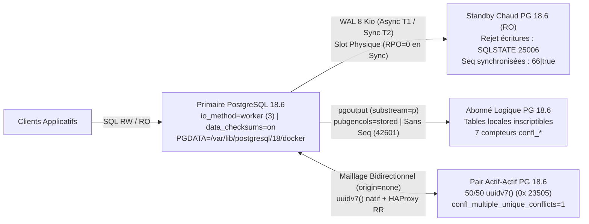

# #17 — PostgreSQL 18.6 Clustering Natif (AIO, uuidv7, Streaming & Logique)

**Série :** Architectures PostgreSQL Multi-Maîtres & Active-Active  
**Auteur :** Jean-Marie Renouard (`jmrenouard`) — [LightPath](https://www.lightpath.fr)  
**Licence :** MIT License  
**Langue :** [English version](../../en/solutions/pg18_native_clustering.md)

---

| Attribut | Valeur |
| :--- | :--- |
| **ID Catalogue** | `#17` (`PostgreSQL 18.6 Native Clustering` sur les 5 niveaux natifs) |
| **Topologies Benchmark** | `pg18-standalone`, `pg18-async-streaming`, `pg18-sync-streaming`, `pg18-logical`, `pg18-birep` (`results/benchmark_pg18.csv`, 87 lignes) |
| **Version Moteur** | `PostgreSQL 18.6 (Debian 18.6-1.pgdg13+2)` (`postgres:18`) |
| **Profil CAP / PACELC** | `Single-Node (CA)` \| `AP / PA-EL` (async, logique, birep) \| `CP / PC-EC` (streaming synchrone, `RPO = 0`) |
| **Stockage & AIO par défaut** | `PGDATA=/var/lib/postgresql/18/docker` (`VOLUME /var/lib/postgresql`), `io_method=worker` (`io_workers=3`), `data_checksums=on` |
| **Moteur Logique & Conflits** | `uuidv7()` natif, `substream=p`, `publish_generated_columns=stored` (`s`), 7 compteurs `confl_*` (`pg_stat_subscription_stats`) |
| **Licence / Stacks Docker** | PostgreSQL License / `docker-compose-pg18-streaming.yml`, `docker-compose-pg18-logical.yml`, `docker-compose-pg18-birep.yml` |

---

## 1. Présentation et principes de fonctionnement (PG 16 vs PG 17 vs PG 18)

**PostgreSQL 18.6** modernise le stockage, les E/S et la réplication logique sans changer la physique de la réplication. Il ajoute un **sous-système AIO** (`io_method=worker`, `io_workers=3`), active **`data_checksums=on`** à l'`initdb`, place Docker sous `PGDATA=/var/lib/postgresql/18/docker`, intègre **`uuidv7()`** (RFC 9562) pour les PK actif-actif, active **`substream=p`**, ajoute **`publish_generated_columns=stored`** (`s`) et étend **`pg_stat_subscription_stats`** à **7 compteurs `confl_*`** dont `confl_multiple_unique_conflicts`.

Sur les sondes A/B (`pg18-standalone`), l'écart AIO $\Delta_{\text{AIO}}$ et le gain $S_{18/17}$ s'écrivent :

$$
\Delta_{\text{AIO}} = \frac{t_{\text{worker}} - t_{\text{sync}}}{t_{\text{sync}}} \times 100\%, \qquad S_{18/17} = \frac{\text{TPS}_{\text{PG18}}}{\text{TPS}_{\text{PG17}}}
$$

- **Réalité A/B AIO :** `io_method=worker` réduit les scans froids de **$-18,5\%$** (`829.4 ms` vs `1,018.3 ms` `sync`), tandis que le cache OS chaud (`385.0 ms` vs `352.5 ms`) et `pgbench` (`290.75` vs `323.98 TPS`) paient un léger surcoût IPC et `data_checksums=on`. `io_method=io_uring` échoue (`EPERM`) sous le seccomp Docker par défaut.
- **`uuidv7()` et limites natives :** `uuidv7()` converge à **50/50 en actif-actif** (`0` `SQLSTATE 23505`, `0` inversion B-tree) vs `SERIAL`. Mais **la sync logique des séquences reste absente en PG 18.6** : `FOR ALL SEQUENCES` et `REFRESH SEQUENCES` lèvent **`SQLSTATE 42601`** (reporté à PG 19), laissant l'abonné à `1|false` -> `SQLSTATE 23505` sans `setval()`. Aucun LWW/CRDT ni DDL auto.

| Capacité / Défaut | PostgreSQL 16 | PostgreSQL 17 (`17.11`) | PostgreSQL 18 (`18.6`) |
| :--- | :--- | :--- | :--- |
| **`PGDATA` Docker & Checksums** | `/var/lib/postgresql/data`, `off` | `/var/lib/postgresql/data`, `off` | **`/var/lib/postgresql/18/docker`**, **`data_checksums=on`** |
| **E/S Asynchrones (`io_method`)** | `sync` uniquement | `sync` uniquement | **`worker` (`io_workers=3`)** (`-18.5%` scan froid) ; `io_uring` `EPERM` Docker |
| **Génération PK Actif-Actif** | `SERIAL` à pas / ext | Pas / `snowflake` | **`uuidv7()` natif** (convergence `50/50`, `0` `23505`) |
| **Télémétrie Conflits (`pg_stat_subscription_stats`)** | Compteur erreur apply | 6 compteurs `confl_*` | **7 compteurs `confl_*`** (+`confl_multiple_unique_conflicts=1` live) |
| **Apply Logique & Col. Générées** | `streaming=on` opt-in | `streaming=parallel` opt-in | **`substream=p` par défaut** ; `publish_generated_columns=stored` (`s`) |
| **Sync Séquences Logiques (`T18`)** | Absent (piège `23505`) | Absent (piège `23505`) | **Toujours absent (`SQLSTATE 42601` ; reporté à PG 19)** |
| **Birep LWW / CRDT / DDL** | Manuel (`origin=none`) | Manuel (`origin=none`) | **Manuel** : zéro LWW/CRDT auto, zéro DDL (`TRUNCATE` seul) |

---

## 2. Architecture et flux de données

PostgreSQL 18.6 unifie les cinq topologies natives au-dessus du même pool de workers AIO et du stockage protégé par sommes de contrôle :

---

## 3. Modes d'implémentation et topologies

| Mode | CAP / PACELC | Commit / RPO / Conflits | Stack Docker PG 18.6 |
| :--- | :--- | :--- | :--- |
| **`pg18-standalone`** | `Single-Node (CA)` | `fsync` WAL local, `RPO = 0` sur crash (`T16` `20/20`) ; aucun conflit de réplication | `docker-compose-pg18-streaming.yml` (référence primaire seul) |
| **`pg18-async-streaming`** | `AP / PA-EL` | Flush WAL local, standby physique asynchrone ; risque `RPO > 0` ; standby RO (`25006`) | `docker-compose-pg18-streaming.yml` (`wal_level=replica`, `sync_state=async`) |
| **`pg18-sync-streaming`** | `CP / PC-EC` | Flush WAL synchrone (`synchronous_commit=on`), **`RPO = 0`** ; perte standby bloque (`SyncRep`) | `docker-compose-pg18-streaming.yml` (`sync_state=sync`, slot `slot_pg18_standby`) |
| **`pg18-logical`** | `AP / PA-EL` | `pgoutput` async (`substream=p`, `pubgencols=stored`) ; 7 `confl_*` ; seq `42601`/`23505` | `docker-compose-pg18-logical.yml` (1 Publisher + 1 Subscriber) |
| **`pg18-birep`** | `AP / PA-EL` | Actif-actif `origin=none` + `uuidv7()` (`0` collision PK) ; clés partagées divergent (zéro LWW/CRDT) | `docker-compose-pg18-birep.yml` (2 pairs PG 18.6 + HAProxy TCP RR) |

---

## 4. Résultats empiriques et limites vérifiées (`results/benchmark_pg18.csv` & `results/functional_limits_pg18.csv`)

Les 87 lignes ont été mesurées séquentiellement à `pg_scale = 2` (`retries_40001 = 0`). Seules `Avg`, `Stddev` (`0` pour `sysbench`) et `p95` sont enregistrées (la latence `p99` n'est pas mesurée).

| Topologie | `A_single_rw` TPS (`p95`) | `C_multinode_ro` TPS | `E_sysbench_oltp_rw` TPS | `E3_wo` TPS | `H_append_only_insert` TPS | `F_wan_netem_25ms` TPS | `T11` Bulk 10k (`rows/s`) |
| :--- | :---: | :---: | :---: | :---: | :---: | :---: | :---: |
| **`pg18-standalone`** | 784.43 (`25.372 ms`) | 42,373.67 | 1,046.67 | 1,382.15 | 1,956.76 | N/A | 80,108 (`125ms`) |
| **`pg18-async-streaming`** | 558.34 (`36.662 ms`) | 47,548.05 | 980.72 | 1,809.82 | 1,423.07 | 554.93 | 87,903 (`114ms`, `88.4ms`) |
| **`pg18-sync-streaming`** | 497.94 (`40.98 ms`) | 32,258.16 | 767.63 | 1,184.57 | 1,760.26 | 41.56 (`p95 529.136 ms`) | 75,629 (`132ms`, `99.8ms`) |
| **`pg18-logical`** | 314.26 (`79.055 ms`) | 45,862.68 | 1,027.84 | 1,582.39 | **3,518.49** (`+85.1%`) | 844.10 | 69,827 (`143ms`, `316.0ms`) |
| **`pg18-birep`** | 514.28 (`40.902 ms`) | 42,190.66 | 1,055.55 | 1,492.99 | **2,066.70** (`3.30x`, `uuidv7()`) | 747.42 | 70,470 (`142ms`, `321.2ms`) |

| Sonde / Limite vérifiée | Résultat empirique PG 18.6 (`results/functional_limits_pg18.csv`) |
| :--- | :--- |
| **AIO & Stockage (`pg18-standalone`)** | `io_method=worker` (`workers=3`), `data_checksums=on` ; scan froid `829.4 ms` vs `1,018.3 ms` `sync` (`-18.5%`) ; `io_uring=EPERM` |
| **`uuidv7()` & Séquences (`L1`/`T18`)** | `pg18-birep` `50/50` `uuidv7()` convergé (`0x 23505`) ; WAL physique synchronise les seq (`66|true`, `next_id=67`) ; logique `FOR ALL SEQUENCES` / `REFRESH SEQUENCES` lève **`SQLSTATE 42601`** (`1|false` -> **`23505`**) |
| **7 compteurs `confl_*`** | Vérifiés : `confl_insert_exists=2`, `confl_update_origin_differs=1/2`, `confl_update_missing=1`, `confl_delete_missing=1`, `confl_delete_origin_differs=1`, **`confl_multiple_unique_conflicts=1`** (`pg18-birep`) |
| **Dérive clés partagées (`B2`/`D`/`L3`/`T12`)** | `pg18-birep` diverge `-338` (`B2`), `-83,252` (`D`), `+100/-30` (`n1=970.00` vs `n2=1100.00`), `T12` `DELETE` gagne (`DELETED/DELETED`) ; `pg18-logical` `T12` diverge `upd_n1`/`DELETED` |
| **Sans PK (`L2`), DDL (`L5`) & FK (`T13`)** | Logique/birep rejettent `UPDATE`/`DELETE` sans PK (**`55000`**) et ne répliquent pas `ALTER TABLE ADD COLUMN` (`TRUNCATE` OK) ; `pg18-birep` `T13` course FK `2/10 ok` (**`23503x8`**) ; standby RO (**`25006`**) |
| **Panne (`L7`), Lag (`T15`), Crash (`T16`)** | `L7` WAL retenu `3,008 B` (`async`), blocage `SyncRep` (`sync`), `19,448 B` (`logical`), `352,664 B` (`birep`) ; `T15` p50/p95 `4.41/5.80` (`async`), `1.47/2.07` (`sync`), `1.46/1.68` (`logical`), `1.25/1.75 ms` (`birep`) ; 5/5 `md5=00493e3a` & `20/20` `RPO=0` |
| **SQLSTATEs vérifiés** | `23505` (PK/`UNIQUE`), `25006` (standby RO), `42601` (DDL séquences non supporté), `55000` (DML logique sans PK), `23503` (course FK `pg18-birep`) |

---

## 5. Forces et faiblesses

| Forces | Faiblesses et pièges opérationnels |
| :--- | :--- |
| **`uuidv7()` natif + bond 3,30x en append-only :** Résout la génération de PK actif-actif nativement (`50/50`, `0` `23505`, `2,066.70 TPS` en `pg18-birep`, `3,518.49 TPS` en `pg18-logical`). | **Sync séquences logiques reportée à PG 19 (`42601`) :** `FOR ALL SEQUENCES` / `REFRESH SEQUENCES` échouent en `SQLSTATE 42601` ; `setval()` scripté reste impératif au basculement. |
| **Scans froids AIO et checksums par défaut :** `io_method=worker` réduit la latence à froid de `-18.5%` (`829.4` vs `1,018.3 ms`), et `data_checksums=on` protège contre la corruption silencieuse. | **Zéro résolution automatique de conflit ni DDL :** `pg18-birep` diverge sur clés partagées (`B2` `-338`, `D` `-83,252`, `T13` `23503x8`) et gèle l'apply sur `23505` sans Spock/PGD/CRDT. |
| **Observabilité complète sur 7 compteurs :** `pg_stat_subscription_stats` expose `confl_multiple_unique_conflicts` et les 6 compteurs PG 17 pour les alertes et runbooks `SKIP (lsn=...)`. | **Rupture Docker et surcoût micro-TX :** `PGDATA=/var/lib/postgresql/18/docker` casse les montages PG 17 ; `io_uring` lève `EPERM` ; les micro-commits en cache paient `-8,5%` à `-10,3%`. |
| **Zéro extension & chargement massif rapide :** 100 % licence PostgreSQL, `T11` atteint `69,827–87,903 rows/s` et le lag `T15` tombe à `1.25–4.41 ms` p50. | **Physique WAN synchrone inchangée :** `pg18-sync-streaming` chute à `41.56 TPS` sous `25ms` WAN (`p95 529.136 ms`) et bloque le primaire (`wait_event=SyncRep`) si son unique standby tombe. |

---

## 6. Popularité GitHub, présence Git et vitalité de maintenance (`results/project_popularity.csv`)

Télémétrie REST/GraphQL GitHub capturée en direct le `2026-11-20T17:26:02Z` (`results/project_popularity.csv`) :

| Projet | Présence / Rôle Git | Dépôt (Compte / Dépôts publics) | Stars / Forks | Commits (Total / 12m) | Contributeurs | Dernier Tag | Dernier Push |
| :--- | :--- | :--- | :---: | :---: | :---: | :---: | :---: |
| **PostgreSQL Core (`#1/#15/#16/#17`)** | Miroir de `git.postgresql.org` | `postgres/postgres` (`Org / 6`) | 22,894 / 6,123 | 66,091 / **3,446** | 58* | `REL_19_0` | `2026-11-20` |
| **Patroni HA (`#15b` compagnon)** | Primaire | `patroni/patroni` (`Org / 1`) | 8,847 / 1,049 | 2,713 / 142 | 246 | `v4.1.5` | `2026-11-20` |

- **Maintenance et fraîcheur :** **Niveau S (Cœur)** — `postgres/postgres` atteint ~9,4 commits/j (`3,446`/12m, push `2026-11-20`, `REL_19_0`) ; `58*` compte les committeurs du miroir officiel `git.postgresql.org`. `patroni/patroni` (`v4.1.5`, `246` contributeurs, MIT) assure la HA (`142`/12m).
- **Maintenabilité opérationnelle :** Risque *bus factor* minimal (gouvernance multi-éditeurs, zéro extension propriétaire). Adapter seulement les volumes PG 18 (`PGDATA=/var/lib/postgresql/18/docker`), seccomp pour `io_uring`, et `setval()` jusqu'à PG 19.

---

**Navigation :** [Index](../../../README.fr.md) · [Ch. 03a — Catalogue natif et extensions](../03a_catalogue_natif_et_extensions.md) · [Ch. 11 — Popularité et vitalité](../11_popularite_et_vitalite_ecosysteme.md) · [Ch. 12 — Clustering PG 18 et benchmarks](../12_clustering_postgresql_18_et_benchmarks.md) · [PG 17 Streaming](pg17_physical_streaming_patroni.md) · [PG 17 Logique](pg17_logical_unidirectional.md) · [PG 17 BiRep](pg17_bidirectional_logical.md) · [English version](../../en/solutions/pg18_native_clustering.md)
