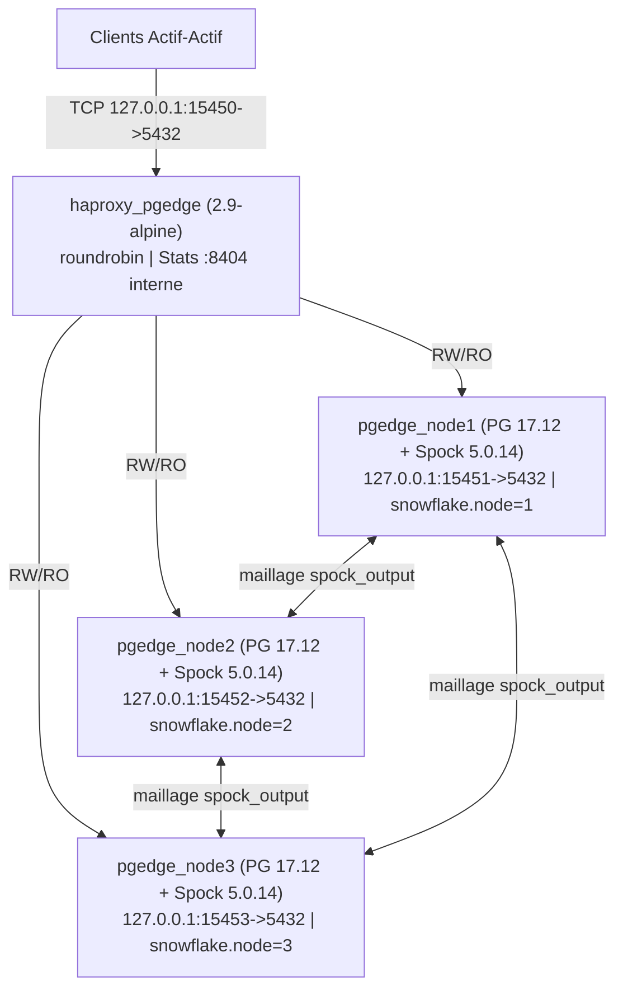

# 2 — Plateforme pgEdge & Spock v5 (Logique Multi-Maîtres + CRDT Delta-Apply)

**Série :** Architectures PostgreSQL Multi-Maîtres & Active-Active  
**Auteur :** Jean-Marie Renouard (`jmrenouard`) — [LightPath](https://www.lightpath.fr)  
**Licence :** MIT License

---

| Attribut | Valeur |
| :--- | :--- |
| **ID Catalogue** | `#2` (`pgEdge / Spock (#2)` dans `results/functional_limits_matrix.csv`) |
| **Topologies Benchmark** | `pgedge` (LWW défaut), `pgedge-delta-apply` (CRDT sur `D_hot_conflict`) |
| **Famille / Niveau** | `T4` / `Niveau 4` — Multi-maîtres par extension logique |
| **Versions** | `PostgreSQL 17.12` (`pgedge-postgres:17-spock5-minimal`), `Spock 5.0.14`, `Snowflake 2.6.1`, `HAProxy 2.9` (`haproxy:2.9-alpine`) |
| **Profil CAP / PACELC** | `AP / PA-EL` — maillage actif-actif asynchrone à 3 nœuds (LWW ou CRDT) |
| **Licence / Stack** | PostgreSQL License / GPL-2.0 (HAProxy) / 4 conteneurs (`docker-compose-pgedge.yml`) |

---

## 1. Description de la technologie et rôle

**pgEdge Platform / Spock** est une architecture multi-maîtres open source pour PostgreSQL 15–17 (fork de `pglogical`) fondée sur des extensions C natives. Chaque nœud exécute `spock` (`5.0.14`) pour le maillage bidirectionnel, la résolution de conflits et le DDL auto-répliqué, associé à `snowflake` (`2.6.1`) pour générer des clés primaires globales K-triables sur 64 bits sans verrou.

Contrairement à `#1 pg-birep` qui gèle l'apply sur `23505`, Spock maintient tous les nœuds inscriptibles via `last_update_wins` (`transdiscard`) ou des colonnes CRDT `spock.delta_apply`. L'écosystème inclut aussi `lolor` pour `pg_largeobject` (`Ch. 03a`), mais `lolor` n'est ni chargé (`shared_preload_libraries=spock,snowflake`) ni testé dans le PoC.

---

## 2. Architecture et flux de données

Dans `env/multi-db-docker-env/docker-compose-pgedge.yml`, HAProxy répartit les connexions TCP en round-robin sur trois primaires (`pgedge_node1..3`) reliés en maillage complet à 6 souscriptions sur `pgedge_net` (`:8404/stats` reste interne au conteneur) :

Les tirs multi-flux (`B1`–`D`, `H`) sollicitent `node1` et `node2` tandis que `node3` réplique passivement (`conv_chk` vérifie les 3 nœuds ; `tc netem` retarde `node2` et `node3`).

---

## 3. Principes de fonctionnement et modes d'implémentation

1. **Plugin WAL (`spock_output`) :** Six liens `spock.sub_create` (`2/2` actifs) décodent le WAL via `spock_output`. L'image Rocky UBI minimal impose `output_plugin_libraries=pgoutput,spock_output` + `host replication all all scram-sha-256` (correctif `42501`).
2. **Modèle de latence de commit :**

$$
L_{\text{N4-pgedge}} \approx L_{\text{disque}} \quad (\text{fsync WAL local ; apply et fusion } \Delta \text{ asynchrones})
$$

3. **LWW, CRDT & Auto-DDL :** Avec `track_commit_timestamp=on`, `last_update_wins` arbitre les écritures concurrentes (`spock.resolutions`) et `transdiscard` journalise les `23505` dans `spock.exception_log`. Les colonnes `log_old_value=true, delta_apply_function=spock.delta_apply` fusionnent $\Delta = v_{\text{new}} - v_{\text{old}}$ de façon commutative.

| Mode / Option | Portée | Mécanique et stratégie de clés | Impact conflit / bascule | Compromis |
| :--- | :--- | :--- | :--- | :--- |
| **`last_update_wins` + `transdiscard`** *(Défaut PoC)* | `spock.conflict_resolution` / `exception_behaviour` | Compare les timestamps de commit ; rejette la tx en échec dans `spock.exception_log` | Pairs toujours inscriptibles ; pertes (`B2`, `D`, `L3`) & divergence `23505` (`L4`) | Disponibilité au prix de la cohérence |
| **`spock.delta_apply` CRDT** *(`pgedge-delta-apply` PoC)* | Colonne (`log_old_value=true`) | Envoie $\Delta = v_{\text{new}} - v_{\text{old}}$ sur `accounts.balance` / `abalance` | **Dérive nulle (`0`)** (`D` : `1391780` exact ; `L3` : `1070.00` x3) | `-19,4 %` TPS (`2280.11 -> 1837.64`) ; numérique seul |
| **Auto-DDL** *(PoC)* | `enable_ddl_replication=on`, `include_ddl_repset=on` | Event triggers sur `ALTER TABLE` ; `TRUNCATE` transmis nativement via WAL (`L5`) | Réplique le DDL sans wrapper manuel | Pas de verrou Raft global si DDL simultané |
| **`snowflake.nextval`** *(PoC)* | Extension `snowflake` (`2.6.1`, `node=1..3`) | ID K-triable 64 bits (`ts + node + compteur`) | Évite les collisions PK `23505` (piège `T18`) | `snowflake.node` unique par serveur |
| **`default_insert_only`** *(PoC Sans PK)* | `spock.tables` | Tables sans PK placées dans `default_insert_only` (`L2`) | `INSERT` répliqué ; `UPDATE`/`DELETE` **ignorés silencieusement** | Ajouter une PK pour DML complet |
| **`lolor`** *(Écosystème — Hors PoC)* | `pg_largeobject` | Réplique les LOB (`Ch. 03a`) | **Non chargé** (`shared_preload_libraries=spock,snowflake`) | Installation explicite requise |
| **`discard` / `sub_disable`** *(Arch.)* | `spock.exception_behaviour` | Ignore la requête ou coupe la souscription | `sub_disable` gèle l'apply (`23505`) comme `pg-birep` | Plus sûr sur contrainte `UNIQUE` |

---

## 4. Forces et faiblesses

| Forces | Faiblesses et pièges opérationnels |
| :--- | :--- |
| **CRDT à dérive nulle (`pgedge-delta-apply`) :** Supprime `-278698` (`16,0 %`) de perte sur `D_hot_conflict` (`1837.64 TPS`, dérive `0` x3) et converge `L3` (`1070.00` x3). | **Pertes LWW & `transdiscard` (`B2`/`D`/`L4`) :** LWW perd `-66328` (`B2`) et `-278698` (`D`) ; `L4` écrit `23505` dans `spock.exception_log=1` et diverge (`n1=u1` vs `n2=u2`). |
| **Maillage résilient WAN & Auto-DDL :** Stable à `10/25/50 ms` WAN (`644.63`/`646.77`/`687.0 TPS`), `T15` `p50=1.16 ms`, `T13` FK `10/10`, `L5` auto-DDL + `TRUNCATE`. | **DML sans PK (`L2`) & `SQL_ASCII` (`T14`) :** Tables sans PK en `default_insert_only` (`UPDATE`/`DELETE` non répliqués) ; `SQL_ASCII` UBI lève `54000` sur `chr(20013)`. |
| **IDs globaux & reprise panne :** `snowflake.nextval` évite `T18` `23505` ; `L7` retient `309560 B` WAL (`5/5`) ; `T16` SIGKILL garde `20/20` RPO=0 (`21/21` post-redémarrage). | **`output_plugin_libraries` & `lolor` absent :** UBI omet `spock_output` (`42501`) ; `lolor` absent du PoC ; `ignored errors` `sysbench` (`114` `E`/`160` `E3`) = bruit Lua standalone (`112` `E`/`192` `E3`). |
| **Débit lecture/insertion :** `54124.99 TPS` (`C`), `140124.63 TPS` (`E4`), `2206.6 TPS` (`H` x3) et `67406 rows/s` (`T11`, `350.0 ms` rattrapage). | **Verrous locaux & zéro quorum (`L6`/`L8`) :** `advisory_lock`/`LISTEN` locaux, `TEMP` local ; `transdiscard` masque la divergence sans suivi de `spock.exception_log`. |

---

## 5. Résultats empiriques, limites fonctionnelles et spec PoC

Tests à `pg_scale = 2` (`retries_40001 = 0`). Seules `Avg`, `Stddev` (`0` pour `sysbench`) et `p95` sont mesurées (la latence p99 n'est pas mesurée).

### Tableau A — Charges principales et étendues (`benchmark_summary.csv`, `benchmark_extended_workloads.csv`)

| Suite | Cl / Dur | TPS | QPS | Avg / Stddev / p95 (ms) | Validées (Échecs) | Dérive | Statut |
| :--- | :---: | :---: | :---: | :---: | :---: | :---: | :--- |
| `A_single_rw` | 8 / 20s | 556.06 | N/A | 14.368 / 13.796 / 38.157 | 11122 (0) | 0 | `PASS_CONVERGED` |
| `B1_disjoint_rw` | 8 / 20s | 346.95 | N/A | 23.028 / 18.442 / 52.575 | 6944 (0) | 0 | `PASS_CONVERGED` |
| `B2_overlap_rw` | 8 / 20s | 818.65 | N/A | 9.759 / 11.037 / 28.907 | 16366 (0) | -66328 | `EXPECTED_LIMITATION_LOST_UPDATE` |
| `C_multinode_ro` | 16 / 20s | 54124.99 | N/A | 0.273 / 0.089 / 0.431 | 1081446 (0) | 0 | `PASS` |
| `D_hot_conflict` *(LWW)* | 8 / 15s | 2280.11 | N/A | 3.492 / 3.187 / 5.311 | 34175 (0) | -278698 | `EXPECTED_LIMITATION_LOST_UPDATE` |
| `D_hot_conflict` *(`pgedge-delta-apply`)* | 8 / 15s | 1837.64 | N/A | 4.336 / 4.186 / 9.347 | 27545 (0) | 0 | `PASS_CONVERGED` |
| `E_sysbench_oltp_rw` | 8 / 20s | 888.56 | 17873.46 | 8.99 / 0 / 15.27 | 17834 (114) | 0 | `PASS` |
| `E2_sysbench_oltp_ro` | 8 / 12s | 1754.57 | 28073.19 | 4.55 / 0 / 6.09 | 21068 (0) | 0 | `PASS` |
| `E3_sysbench_oltp_wo` | 8 / 12s | 1279.51 | 7729.6 | 6.24 / 0 / 7.7 | 15492 (160) | 0 | `PASS` |
| `E4_sysbench_point_select` | 16 / 12s | 140124.63 | 140124.63 | 0.11 / 0 / 0.28 | 1682576 (0) | 0 | `PASS` |
| `H_append_only_insert` | 8 / 12s | 2206.6 | N/A | 3.607 / 1.848 / 5.074 | 26449 (0) | 0 | `PASS_CONVERGED` |
| `F_wan_netem_25ms` | 8 / 15s | 646.77 | N/A | 12.324 / 11.513 / 32.402 | 9737 (0) | 0 | `PASS_NETEM_25MS` |

*(Détails dérive : `B2` `exp=-78525`, `n1/n2/n3=-144853` ; `D` LWW `exp=1737102`, `n1/n2/n3=1458404` ; `D` CRDT `exp=1391780`, `n1/n2/n3=1391780`.)*

### Tableau B — Balayages concurrence & WAN (`benchmark_concurrency_sweep.csv`, `benchmark_wan_sweep.csv`)

| Suite | Param | TPS | Avg / Stddev / p95 (ms) | Validées | Statut |
| :--- | :---: | :---: | :---: | :---: | :--- |
| `G_conc_c1` (8s) | 1 cl | 312.94 | 3.183 / 1.137 / 4.969 | 2501 | `PASS` |
| `G_conc_c4` (8s) | 4 cl | 616.09 | 6.467 / 3.116 / 11.799 | 4914 | `PASS` |
| `G_conc_c8` (8s) | 8 cl | 672.46 | 11.869 / 8.935 / 29.606 | 5363 | `PASS` |
| `G_conc_c16` (8s) | 16 cl | 676.05 | 23.6 / 22.774 / 70.967 | 5403 | `PASS` |
| `G_conc_c32` (8s) | 32 cl | 575.54 | 55.336 / 66.012 / 183.941 | 4612 | `PASS` |
| `F_wan_netem_10ms` (12s) | 10 ms | 644.63 | 12.386 / 9.132 / 30.828 | 7718 | `PASS_NETEM_10MS` |
| `F_wan_netem_25ms` (15s) | 25 ms | 646.77 | 12.324 / 11.513 / 32.402 | 9737 | `PASS_NETEM_25MS` |
| `F_wan_netem_50ms` (12s) | 50 ms | 687.0 | 11.62 / 8.57 / 29.072 | 8234 | `PASS_NETEM_50MS` |

### Tableau C — Limites fonctionnelles (`F1`, `L1–L8`) et sondes étendues (`T11–T18`)

| Sonde | Résultat empirique observé |
| :--- | :--- |
| `F1` Santé | `PASS: 3 nodes 2/2 replicating; snowflake.node=1/2/3; LWW+DDL=on` |
| `L1` PK `SERIAL` | `EXPECTED_LIMITATION: LWW silent overwrite (spock.resolutions=1 winner=from_n2)` |
| `L2` Sans PK | `EXPECTED_LIMITATION: default_insert_only skips UPDATE/DELETE silently; PK fixed` |
| `L3` *Lost Update* | `EXPECTED_LIMITATION (LWW=970.00)` \| `PASS (spock.delta_apply=1070.00 on all 3 nodes)` |
| `L4` Conflit `UNIQUE` | `EXPECTED_LIMITATION: transdiscard SQLSTATE 23505 (exception_log=1) diverged n1=u1 n2=u2` |
| `L5` DDL & `SAVEPOINT` | `PASS: ALTER TABLE ADD COLUMN & TRUNCATE auto-replicated to n2/n3` |
| `L6` Fonctions PG | `EXPECTED_LIMITATION: advisory_lock & LISTEN/NOTIFY node-local; TEMP session-local` |
| `L7` Panne nœud | `PASS: slot active=false WAL retained=309560B; caught up 5/5` |
| `L8` Quorum | `N/A: AP async continues without quorum` |
| `T11` Bulk 10k | `PASS: 67406 rows/s (148ms); peer_catchup=350.0ms` |
| `T12` Upd vs Del | `EXPECTED_LIMITATION: n1/n2/n3=DELETED/DELETED/DELETED (spock.resolutions=0)` |
| `T13` Course FK | `PASS: 10/10 immediate cross-node child inserts consistent (0 FK errors)` |
| `T14` MD5 riche | `PASS: 3/3 identical md5=f798eb5a (SQL_ASCII chr()=54000; UTF-8 escaped)` |
| `T15` Lag visibilité | `p50=1.16ms p95=1.63ms max=1.71ms (n=30)` |
| `T16` SIGKILL RPO | `PASS: peer_surv=20/20 RPO=0 peer_write_OK; post_restart=21/21` |
| `T17` Tx longue | `PASS: NO_DIRTY_READ; side_tx_unblocked(104ms); post_commit_vis=115ms` |
| `T18` Seq (50) | `EXPECTED_LIMITATION: std seq 1\|false -> SQLSTATE 23505 (use snowflake.nextval)` |
| **SQLSTATEs** | `L1–L8: 23505` \| `T11–T18: 23505;54000` |

### Tableau D — Spécification Docker & HAProxy PoC (`env/multi-db-docker-env/`)

| Paramètre | Configuration / Observation PoC |
| :--- | :--- |
| **Compose & Scripts** | `docker-compose-pgedge.yml` + `scripts/pgedge/setup_pgedge.sh` + `scripts/pgedge/haproxy.cfg` + `tests/test_pgedge.sh` |
| **Nœuds & Image** | `pgedge_node1..3` (`127.0.0.1:15451..15453:5432`), `ghcr.io/pgedge/pgedge-postgres:17-spock5-minimal` (`PG 17.12`, Rocky UBI) |
| **HAProxy LB** | `haproxy_pgedge` (`haproxy:2.9-alpine`), `127.0.0.1:15450:5432` (TCP RR `inter 2s fall 2 rise 2`) ; `:8404/stats` interne seul |
| **GUCs & Maillage** | `shared_preload_libraries=spock,snowflake`, `output_plugin_libraries=pgoutput,spock_output`, `track_commit_timestamp=on`, `spock.conflict_resolution=last_update_wins`, `spock.exception_behaviour=transdiscard` (défaut), `spock.enable_ddl_replication=on`, `spock.include_ddl_repset=on`, `spock.save_resolutions=on`, `snowflake.node=1..3`. |

---

**Navigation :** [Index](../../../README.fr.md) · [Ch. 03a — Solutions natives et extensions](../03a_catalogue_natif_et_extensions.md) · [Ch. 10 — Streaming vs Logique vs Multi-Maîtres](../10_comparatif_streaming_logique_multimaster.md) · [English version](../../en/solutions/pgedge_spock.md)
