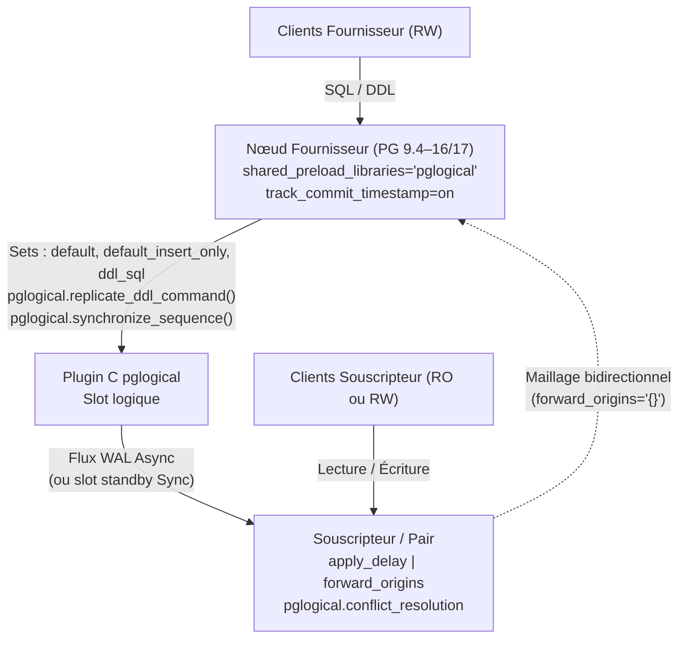

# 3 — pglogical 2 (Réplication Logique par Extension — Référence Architecturale)

**Série :** Architectures PostgreSQL Multi-Maîtres & Active-Active  
**Auteur :** Jean-Marie Renouard (`jmrenouard`) — [LightPath](https://www.lightpath.fr)  
**Licence :** MIT License

---

| Attribut | Valeur |
| :--- | :--- |
| **ID Catalogue** | `#3` (`pglogical 2` dans `Ch. 01`, `Ch. 03a`, `Ch. 04`, `Ch. 07`) |
| **Statut Benchmark** | **Non benchmarké en direct (Référence architecturale)** |
| **Famille / Niveau** | `T3 / T4` — Extension de réplication logique (`Niveau 3 / 4`) |
| **Versions** | `pglogical 2.4.x` (`PG 9.4–16/17` ; statut maintenance sous PG 17) |
| **Profil CAP / PACELC** | `AP / PA-EL` — réplication logique asynchrone (commit synchrone optionnel) |
| **Licence / Déploiement** | PostgreSQL License (2ndQuadrant / EDB) / extension C (`shared_preload_libraries = 'pglogical'`) |

---

## 1. Description de la technologie et rôle

**pglogical 2** est l'extension C fondatrice de réplication logique développée par 2ndQuadrant avant l'arrivée de `pgoutput` dans PostgreSQL 10. Chargée via `shared_preload_libraries = 'pglogical'`, elle exécute un plugin de sortie WAL dédié et des workers superviseurs/d'application pour diffuser sélectivement les lignes sur des clusters homogènes ou hétérogènes en version majeure (`PG 9.4` à `PG 16/17`).

Elle a introduit les **Replication Sets** (`default`, `default_insert_only`, `ddl_sql`), les réplicas différés (`apply_delay`), la résolution de conflits (`pglogical.conflict_resolution`) et les migrations sans coupure depuis PG 9.x. Historiquement, 2ndQuadrant a contribué `pgoutput` au cœur PG 10+, **pgEdge (`#2 Spock`)** a forké `pglogical` vers un moteur CRDT/Auto-DDL open source, et **EDB (`#4 PGD`)** a poursuivi la lignée commerciale BDR.

---

## 2. Architecture et flux de données

Dans un déploiement `pglogical`, `pglogical.create_node(...)` et `pglogical.create_subscription(...)` relient le plugin de sortie du fournisseur aux workers du souscripteur via des ensembles de réplication et le filtrage d'origine :

En mode maillé bidirectionnel (`forward_origins = '{}'`), chaque nœud agit simultanément comme fournisseur et souscripteur, s'appuyant sur `track_commit_timestamp = on` pour arbitrer les conflits par horodatage.

---

## 3. Principes de fonctionnement et modes d'implémentation

1. **Ensembles de réplication et souscriptions :** Les tables rejoignent `default` (`INSERT`/`UPDATE`/`DELETE`), `default_insert_only` (tables sans PK) ou `ddl_sql`. Les souscriptions gèrent `synchronize_structure`, `synchronize_data`, `apply_delay` et le filtre anti-boucle `forward_origins`.
2. **Modèle de latence de commit :**

$$
L_{\text{pglogical2-async}} \approx L_{\text{disque}}, \qquad L_{\text{pglogical2-sync}} \approx L_{\text{disque}} + \text{RTT}_{\text{souscripteur}}
$$

3. **Politiques de conflit, DDL & séquences :** Avec `track_commit_timestamp = on`, `pglogical.conflict_resolution` applique cinq règles (`error`, `apply_remote`, `keep_local`, `last_update_wins`, `first_update_wins`), **sans CRDT (`delta_apply`)**. Le DDL brut n'est pas répliqué et doit passer par `pglogical.replicate_ddl_command('...')` ; `pglogical.synchronize_sequence()` synchronise par lots sans empêcher les collisions PK multi-écrivains.

| Mode / Option | Portée | Mécanique et stratégie de clés | Impact conflit / bascule | Compromis |
| :--- | :--- | :--- | :--- | :--- |
| **Fournisseur -> Souscripteur Async** *(Principal)* | `create_subscription(forward_origins='{}')` | Diffuse tables/lignes filtrées (`PG 9.4–16/17`) | Écrivain unique sans conflit (`RPO > 0` async) | Pont de montée de version sans coupure (`PG 9.x -> 17`) |
| **Bidirectionnel / Maillage** *(Multi-maîtres)* | Souscriptions croisées (`forward_origins='{}'`) | Filtre les origines relayées contre les boucles `A -> B -> A` | Exposé aux *Lost Updates* (`LWW`) et dérive d'horloge | Impose séquences à pas ou UUID ; zéro CRDT |
| **Commit synchrone** *(Option `PC/EC`)* | `synchronous_commit=on` + `synchronous_standby_names` | Cible le slot `pglogical` pour flush synchrone | Garantit `RPO = 0` ; bloque l'écrivain si pair coupé | Paie le `RTT` par commit ; rare en multi-maîtres |
| **Réplica différé** *(`apply_delay`)* | `create_subscription(apply_delay := '1 hour')` | Retient l'application des changements décodés | Protège contre un `DROP`/`DELETE` accidentel | Retard volontaire de la fenêtre `RPO` |
| **Résolution de conflit** *(`pglogical.conflict_resolution`)* | `error`, `apply_remote`, `keep_local`, `last_update_wins`, `first_update_wins` | Exige `track_commit_timestamp=on` | `error` gèle comme `#1 pg-birep` ; `LWW` écrase en silence | Sensible à la dérive NTP ($\Delta t_{\text{skew}}$) |
| **Aides DDL & Séquences** *(Manuel)* | `replicate_ddl_command`, `synchronize_sequence` | Encapsulation explicite et resynchro périodique | `SERIAL` multi-écrivains collisionne (`23505`) sans pas | Discipline d'encapsulation requise |

---

## 4. Forces et faiblesses

| Forces | Faiblesses et pièges opérationnels |
| :--- | :--- |
| **Pont d'upgrade pré-PG-10 (`PG 9.4–16/17`) :** Permet la migration en ligne depuis d'anciens clusters `PG 9.4–9.6` dépourvus de `pgoutput` natif. | **Fonctionnellement supplanté sur PG 17 :** `pgoutput` natif (`#16`), `origin=none` (`#1`) et le fork `#2 Spock v5` couvrent ce besoin sur PG 17. |
| **Replication Sets fins & `apply_delay` :** Filtrage par table/colonne/DML et réplicas de récupération différés intégrés. | **Zéro CRDT & pertes LWW silencieuses :** Sans `spock.delta_apply`, le mode `LWW` à chaud subit les mêmes pertes silencieuses que `#2 pgEdge LWW`. |
| **Modes de conflit configurables :** Offre l'arrêt strict `error` (intégrité) ou l'arbitrage temporel `last_update_wins` / `first_update_wins` (disponibilité). | **Pièges DDL manuel & séquences :** Un `ALTER TABLE` brut casse le flux sans `pglogical.replicate_ddl_command` ; `synchronize_sequence` reste mono-écrivain. |
| **Forte compatibilité d'extensions PG :** Préserve `~95–100 %` des extensions PostgreSQL standard sur chaque nœud. | **Pas de `pg_largeobject` & maintenance :** Pas de réplication LOB (`lolor` chez pgEdge), `pgBackRest` par nœud seul, R&D migrée vers `Spock` / `EDB PGD`. |

---

## 5. Exclusion architecturale, comparatif des modes et base de référence

**Pourquoi `pglogical 2` n'a pas été benchmarké en direct :** Le PoC Docker (`env/multi-db-docker-env/`) cible **PostgreSQL 17**, où `pglogical 2` est en mode maintenance et dépassé sur chacun de ses rôles :
1. **Rôle unidirectionnel & montée de version :** Remplacé par `pgoutput` natif PG 17 (`#16 pg17-logical`), intégrant filtres `WHERE`, listes de colonnes (PG 15+), `pg_createsubscriber` et slots `failover=true` sans extension.
2. **Rôle bidirectionnel sans extension :** Remplacé par `origin = none` natif PG 16+ (`#1 pg-birep`).
3. **Rôle multi-maîtres avancé :** Remplacé par son fork open source direct **`#2 pgEdge / Spock 5`** (`pgedge` / `pgedge-delta-apply`), ajoutant les CRDT `spock.delta_apply` (`0` dérive vs `-278698` en Suite D), les IDs `snowflake` 64 bits et l'Auto-DDL.

Partageant le même moteur PostgreSQL (`wal_level = logical`, `track_commit_timestamp = on`), son comportement se projette directement sur les références N3/N4 benchmarkées ci-dessous (aucun chiffre synthétique n'est inventé pour `pglogical 2`) :

| Capacité / Référence | `#3 pglogical 2` *(Réf. Arch.)* | `#16 pg17-logical` *(PoC)* | `#1 pg-birep` *(PoC)* | `#2 pgEdge / Spock 5` *(Fork PoC)* |
| :--- | :--- | :--- | :--- | :--- |
| **Versions PG supportées** | `PG 9.4–16/17` (pont upgrade) | `PG 10–18` (`17.11` PoC) | `PG 16–18` (`17.11` PoC) | `PG 15–17` (`17.12`, Spock `5.0.14`) |
| **Gestion des conflits** | `error` / `apply_remote` / `keep_local` / `LWW` / `FUW` | Arrêt apply (`23505` / `55000`) | Arrêt apply (`23505`, `L1`/`L4`) | `LWW` + `transdiscard` \| **CRDT `spock.delta_apply`** |
| **Protection *Lost Update*** | Aucune (risque de dérive LWW) | Écrivain unique (`0` dérive) | Aucune (`-71063` dérive en `D`) | **`0` dérive en `D` (`1837.64 TPS`)** |
| **Réplication DDL** | Manuel `replicate_ddl_command()` | Aucune (`L5` échoue) | Aucune (`L5` échoue) | **Automatique (`enable_ddl_replication=on`)** |
| **Réplica différé** | Paramètre natif `apply_delay` | PG 16+ `min_apply_delay` | PG 16+ `min_apply_delay` | PG 16+ `min_apply_delay` |
| **Ancre empirique de réf.** | Non benchmarké (maintenance) | `917.28 TPS` (`A`), `1.39 ms` (`T15`) | `875.91 TPS` (`A`), `1.47 ms` (`T15`) | `556.06 TPS` (`A`), `1.16 ms` (`T15`) |

---

**Navigation :** [Index](../../../README.fr.md) · [Ch. 03a — Solutions natives et extensions](../03a_catalogue_natif_et_extensions.md) · [Ch. 10 — Streaming vs Logique vs Multi-Maîtres](../10_comparatif_streaming_logique_multimaster.md) · [English version](../../en/solutions/pglogical2.md)
