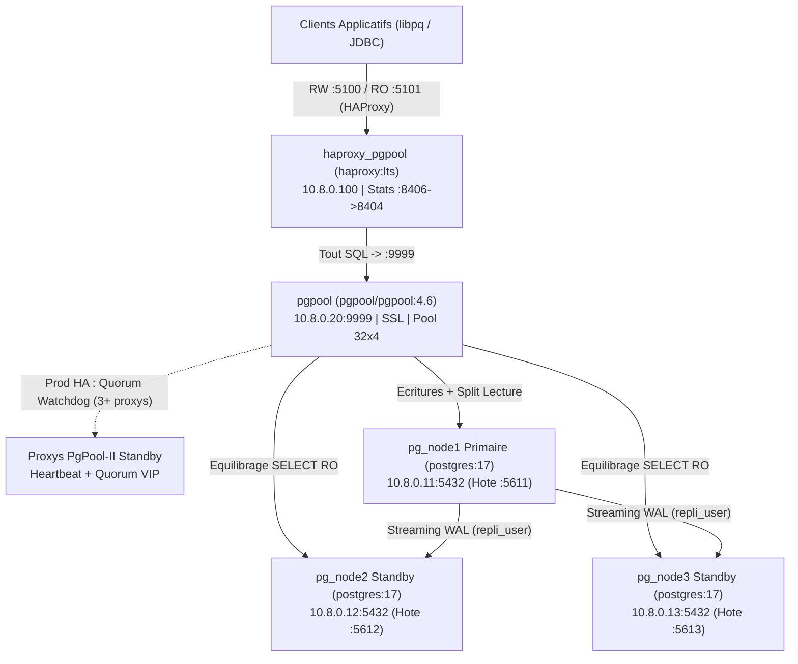

# 11 — PgPool-II (Proxy de pooling, répartition de charge et diffusion SQL — Référence Architecturale)

**Série :** Architectures PostgreSQL Multi-Maîtres & Active-Active  
**Auteur :** Jean-Marie Renouard (`jmrenouard`) — [LightPath](https://www.lightpath.fr)  
**Licence :** MIT License

---

| Attribut | Valeur |
| :--- | :--- |
| **ID Catalogue** | `#11` (`PgPool-II` dans `Ch. 01`, `Ch. 03b`, `Ch. 04`, `Ch. 07`) |
| **Statut Benchmark** | **Non benchmarké en direct (Référence Architecturale)** ; PoC Streaming dans `env/multi-db-docker-env/docker-compose-pgpool.yml` |
| **Famille / Niveau** | `Famille 6` — Middleware & Proxy SQL (`T1/T2` Streaming LB vs Diffusion SQL / SI) |
| **Versions** | `PgPool-II 4.6` (`pgpool/pgpool:4.6`), `PostgreSQL 17` (`postgres:17`), `HAProxy LTS` (`haproxy:lts`) |
| **Profil CAP / PACELC** | Streaming : mono-primaire WAL \| Mode SI : `CP / PC-EC` \| Diffusion native : pseudo-synchrone fragile |
| **Licence / Déploiement** | Open Source BSD / MIT / Couche proxy (`3+` nœuds Watchdog en prod) + backends PostgreSQL |

---

## 1. Description de la technologie et rôle

**PgPool-II** est un proxy middleware écrit en C compatible avec le protocole filaire PostgreSQL (`libpq`), intercalé entre les applications et les serveurs PostgreSQL. Il assure le pooling de connexions (`num_init_children * max_pool`), le routage lecture/écriture par analyse SQL, la détection de pannes, les scripts de bascule, la réintégration en ligne (`pcp_recovery_node`) et un quorum **Watchdog** multi-proxys.

Point critique : PgPool-II couvre des modes de réplication incompatibles qu'il ne faut jamais confondre. En production moderne (**mode Streaming Replication**, utilisé dans le PoC Docker compagnon), PgPool-II pilote un **primaire unique** et des standbys en lecture seule (`pas multi-maîtres`). Seuls ses modes historiques **Native Replication** (diffusion d'instructions SQL) et **Snapshot Isolation (SI)** tentent l'écriture multi-nœuds côté proxy.

---

## 2. Architecture et flux de données

Dans `env/multi-db-docker-env/docker-compose-pgpool.yml`, `haproxy_pgpool` (`10.8.0.100`) expose RW (`:5100`), RO (`:5101`) et stats (`:8406`) vers `pgpool` (`10.8.0.20:9999`), qui répartit les requêtes sur `pg_node1..3` (`10.8.0.11..13:5432`) en mode `streaming_replication` (la production ajoute un anneau Watchdog à 3 proxys) :

---

## 3. Principes de fonctionnement et modes d'implémentation

1. **Pooling et routage par parseur SQL :** PgPool-II pré-forke `num_init_children` (`32` dans le PoC) processus, chacun conservant jusqu'à `max_pool` (`4`) connexions backend par couple utilisateur/base (`connection_cache = on`). En `streaming_replication` avec `load_balance_mode = on`, le parseur envoie `INSERT`/`UPDATE`/`DELETE`/DDL et transactions `BEGIN` d'écriture au primaire tout en équilibrant les `SELECT` dans la limite de retard `sr_check_period` (`5 s`).
2. **Modèle de latence Streaming vs Diffusion :**

$$
L_{\text{PgPool-Stream-RW}} \approx L_{\text{disque}} + L_{\text{proxy}}, \qquad L_{\text{PgPool-Diffusion/SI}} \approx L_{\text{disque}} + \text{RTT}_{\text{max-backend}} + L_{\text{verrou/SI}}
$$

3. **Quorum Watchdog et réintégration en ligne :** En production, `>= 3` nœuds PgPool-II avec `use_watchdog = on` suppriment le SPOF proxy et les bascules split-brain, tandis que `pcp_recovery_node` (`pg_basebackup`) resynchronise un standby déchu.

| Mode (`backend_clustering_mode`) | Topologie d'écriture | Mécanique et stratégie | Conflit / Non-déterminisme / RPO | Compromis |
| :--- | :--- | :--- | :--- | :--- |
| **`streaming_replication`** *(PoC par défaut)* | Primaire unique + Standbys RO | Split SQL R/W + `sr_check_period=5s` + `health_check_period=10s` | Zéro conflit multi-écrivains ; `RPO` selon WAL async/sync | **Pas multi-maîtres** ; mode le plus sûr |
| **`replication`** *(Diffusion SQL native)* | Diffusion multi-nœuds par proxy | Rejoue chaque SQL d'écriture sur tous les backends + `insert_lock` | **Casse en silence** sur `NOW()`, `RANDOM()`, triggers, `nextval()` | Risque majeur de divergence silencieuse |
| **`snapshot_isolation`** *(Mode SI)* | Multi-nœuds coordonné par proxy | Ordre de commit et visibilité inter-nœuds centralisés | Évite le *read skew* ; reste sensible aux divergences SQL | Forte sérialisation proxy et coût `2*RTT` |
| **`logical_replication`** / **`raw`** | Souscription logique / Bascule brute | Pooling/LB sur réplication logique ou bascule sans LB | Aucune reprise en ligne logique ; `raw` sans LB | Préférer `pgoutput` natif + `PgBouncer` |
| **Watchdog (`use_watchdog=on`)** *(HA Prod)* | `>= 3` nœuds PgPool-II | Heartbeat distribué, consensus quorum, bascule VIP | Supprime le SPOF proxy et le split-brain de promotion | Empreinte de 3 proxys à exploiter |

---

## 4. Forces et faiblesses

| Forces | Faiblesses et pièges opérationnels |
| :--- | :--- |
| **Pooling + routage R/W unifié :** Combine cache `num_init_children * max_pool`, répartition de `SELECT` et bascule sans modifier les pilotes clients (mode `Streaming`). | **Divergence SQL non déterministe (`replication`) :** `NOW()`, `CURRENT_TIMESTAMP`, `RANDOM()`, `gen_random_uuid()`, triggers et `nextval()` concurrents désynchronisent les nœuds (`Ch. 07` anti-pattern 5). |
| **Compatibilité PostgreSQL 17 à 100 % :** Opère en externe sur `pgwire` (port `9999`), préservant tables heap, extensions C et PITR `pgBackRest` en `streaming_replication`. | **Nœud dégénéré et blocages proxy :** En `replication` / `snapshot_isolation`, un écart met un backend hors service et `insert_lock` sérialise les insertions à séquences. |
| **Watchdog et reprise en ligne (`pcp`) :** Le quorum multi-proxys évite les promotions concurrentes et `pcp_recovery_node` automatise la reconstruction (`RTO ~ 5–15 s`). | **Coût par processus vs `PgBouncer` :** L'analyse SQL par session consomme plus de RAM/CPU qu'un pool transactionnel `PgBouncer` derrière `HAProxy` (`#15b`). |
| **Suite fonctionnelle PoC validée :** `tests/test_pgpool.sh` valide `25` assertions `PASS` d'exécution sur `18` groupes (`24` documentées dans `pgpool_cluster.md` ; `pgpool/pgpool:4.6`, SSL, HAProxy `5100`/`5101`/`8406`, DDL et isolation RO). | **SPOF proxy sans Watchdog :** Un unique conteneur `pgpool` (comme dans le compose de labo) reste un point unique de défaillance sans 3 nœuds Watchdog. |

---

## 5. Exclusion architecturale, spécification PoC et base de référence

**Pourquoi `#11 PgPool-II` n'a pas été benchmarké en direct :** Dans `ClusterPostgreSQL-Series` (`Makefile` `PG_STACKS`, `stacks/README.md`), les 10 stacks benchmarkées isolent les moteurs de réplication natifs (`#15b Patroni`, `pg17-async-streaming`, `pg17-sync-streaming`, `#1`–`#9`) sans mélanger le coût d'un proxy middleware ni la diffusion SQL déconseillée dans `results/*.csv`. Le PoC compagnon (`env/multi-db-docker-env/docker-compose-pgpool.yml`) valide uniquement le mode fonctionnel `streaming_replication` (`pgpool/pgpool:4.6`, `num_init_children=32`, `max_pool=4`, `connection_cache=on`, `load_balance_mode=on`, `sr_check_period=5`, `health_check_period=10`, `health_check_max_retries=3`, `failover_on_backend_error=off`, `pg_node1..3` sur `5611..5613`, HAProxy `5100`/`5101`/`8406`). Aucun chiffre synthétique de TPS ou latence n'est inventé pour `#11` (et la latence au 99e percentile n'est pas enregistrée dans `results/`).

Les profils Streaming vs écriture multi-nœuds de PgPool-II s'ancrent directement sur les références mesurées de `results/benchmark_summary.csv` :

| Capacité / Référence | `#11 PgPool-II` *(Réf. Arch. / PoC Streaming)* | `#15b pg17-async-streaming` *(PoC)* | `#15b pg17-sync-streaming` *(PoC)* | `#1 pg-birep` *(PoC Multi-Écrivains)* |
| :--- | :--- | :--- | :--- | :--- |
| **Autorité d'écriture** | Streaming : `1` Primaire \| Diffusion : `N` nœuds | `1` Primaire (standby RO `25006`) | `1` Primaire (standby RO `25006`) | `N` Écrivains actifs (`origin=none`) |
| **Risque conflit / dérive** | Streaming : `0` \| Diffusion : **Forte dérive SQL** | `0` (mono-primaire) | `0` (mono-primaire) | Arrêt `23505` ; dérive `-71 063` (`D`) |
| **Pooling & Split R/W** | Parseur SQL natif (pool `32 x 4`, `:9999`) | Externe (`HAProxy` + `Patroni` `:5000/:5001`) | Externe (`HAProxy` + `Patroni`) | `HAProxy` round-robin (`:5000`) |
| **Ancre réf. (`A_single_rw`)** | Non benchmarké (`25/25` contrôles d'exécution ; `24` documentés) | `610.15 TPS` (`p95=33.928 ms`) | `409.48 TPS` (`p95=50.307 ms`) | `875.91 TPS` (`0` dérive sur `A`) |
| **Ancre réf. (`F_wan_netem_25ms`)** | Non benchmarké (diffusion sync sensible WAN) | `599.61 TPS` (`-1,7 %` vs LAN) | `57.0 TPS` (`-86,1 %`, `p95=353.493 ms`) | `824.04 TPS` (`-5,9 %` vs LAN) |

---

**Navigation :** [Index](../../../README.fr.md) · [Ch. 03b — Distribué, triggers et cloud](../03b_catalogue_distribue_triggers_cloud.md) · [Ch. 10 — Streaming vs Logique vs Multi-Maîtres](../10_comparatif_streaming_logique_multimaster.md) · [English version](../../en/solutions/pgpool_ii.md)
