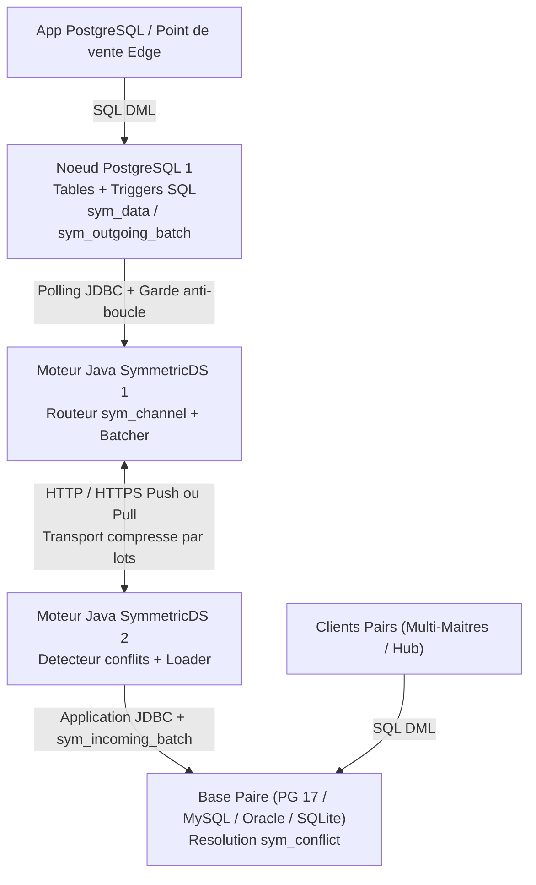

# 10 — SymmetricDS (Réplication Asynchrone Hétérogène par Triggers — Référence Architecturale)

**Série :** Architectures PostgreSQL Multi-Maîtres & Active-Active  
**Auteur :** Jean-Marie Renouard (`jmrenouard`) — [LightPath](https://www.lightpath.fr)  
**Licence :** MIT License

---

| Attribut | Valeur |
| :--- | :--- |
| **ID Catalogue** | `#10` (`SymmetricDS` dans `Ch. 01`, `Ch. 03b`, `Ch. 04`, `Ch. 07`) |
| **Statut Benchmark** | **Non benchmarké en direct (Référence Architecturale)** |
| **Famille / Niveau** | `Famille 5 / T4` — Daemon asynchrone par triggers / Synchro Edge hétérogène (`Niveau 4`) |
| **Versions** | `SymmetricDS 3.x` (moteur Java JVM + pilotes JDBC ; compatible `PostgreSQL 17`) |
| **Profil CAP / PACELC** | `AP / PA-EL` — capture asynchrone par triggers et transport par lots HTTP/HTTPS |
| **Licence / Déploiement** | Open Source LGPL / GPLv3 & Pro commercial (JumpMind) / Nœuds Java externes + triggers SQL |

---

## 1. Description de la technologie et rôle

**SymmetricDS** est un moteur Java de réplication et synchronisation asynchrone conçu pour les topologies **multi-maîtres**, **en étoile multi-niveaux (*hub-and-spoke*)** et **hétérogènes**. Plutôt que de décoder le journal WAL PostgreSQL, SymmetricDS se connecte via JDBC et installe des déclencheurs SQL (`INSERT`/`UPDATE`/`DELETE`) sur les tables suivies de chaque base participante.

Son atout majeur est la **portabilité multi-SGBD et la résilience hors-ligne** : un nœud SymmetricDS synchronise PostgreSQL avec MySQL, MariaDB, Oracle, SQL Server, SQLite ou DB2 via HTTP/HTTPS (Push ou Pull), en tamponnant localement les lots compressés durant des heures ou jours de coupure réseau (*retail POS*, sites distants) sans retenir de slots WAL PostgreSQL.

---

## 2. Architecture et flux de données

Chaque nœud associe un moteur Java `SymmetricDS` à des tables de métadonnées internes (`sym_data`, `sym_channel`, `sym_outgoing_batch`, `sym_incoming_batch`, `sym_conflict`), échangeant des lots par HTTP/HTTPS :

Des gardes anti-boucle dans les déclencheurs identifient les sessions entrantes (`source_node_id`) afin d'éviter toute ré-émission cyclique infinie.

---

## 3. Principes de fonctionnement et modes d'implémentation

1. **Capture par triggers, canaux et transport par lots :** Les écritures déclenchent des triggers `AFTER` écrivant l'image CSV des lignes dans `sym_data`. Des tâches de routage regroupent les événements par `sym_channel` (priorité, `max_batch_size`, chargeur) en lots `sym_outgoing_batch` transmis par HTTP/HTTPS Push ou Pull et suivis côté cible dans `sym_incoming_batch`.
2. **Modèle de latence de commit :**

$$
L_{\text{SymmetricDS-local}} \approx L_{\text{disque}} + L_{\text{trigger}}, \qquad T_{\text{lag-synchro}} \approx T_{\text{routage}} + T_{\text{lot-HTTP}} + T_{\text{apply}}
$$

3. **Détection, résolution de conflits, chargement initial et DDL :** `sym_conflict` combine des modes de détection (`USE_PK_DATA`, `USE_CHANGED_DATA`, `USE_TIMESTAMP`, `USE_VERSION`) et de résolution (`FALLBACK`, `NEWER_WINS`, `MANUAL` en quarantaine, `IGNORE`), sans CRDT delta-apply natif (`spock.delta_apply`). Le chargement initial passe par `symadmin reload-node` et la propagation DDL par `symadmin send-schema`.

| Mode / Politique | Portée | Mécanique et stratégie de clés | Impact conflit / bascule | Compromis |
| :--- | :--- | :--- | :--- | :--- |
| **Hub & Edge multi-niveaux** *(Push/Pull HTTP)* | POS / Agence -> Central | File locale `sym_data` hors-ligne ; reprise Push/Pull | Zéro saturation WAL `pg_replication_slots` | Latence par lots (`secondes`), non temps réel |
| **Maillage bidirectionnel** | PG <-> PG ou multi-SGBD | Garde anti-boucle + pas décalés / offset nœud / UUID | Commits locaux disponibles (`PA/EL`) ; `RPO > 0` | Exposé aux *Lost Updates* sans CRDT |
| **Synchro hétérogène multi-moteurs** | PG <-> MySQL / Oracle / SQLite | Traduction de dialecte et types dans le chargeur Java | Permet migrations multi-SGBD sans coupure | Plus petit dénominateur commun SQL/types |
| **Détection (`sym_conflict`)** | `USE_PK_DATA`, `USE_CHANGED_DATA`, `USE_TIMESTAMP`, `USE_VERSION` | Compare PK, colonnes modifiées, horodatage ou version | `USE_CHANGED_DATA` évite faux conflits inter-colonnes | `USE_TIMESTAMP` sensible à la dérive NTP |
| **Résolution (`sym_conflict`)** | `FALLBACK`, `NEWER_WINS`, `MANUAL`, `IGNORE` | Écrase, retient le plus récent, met en erreur ou ignore | `MANUAL` bloque le lot dans `sym_incoming_error` (`23505`) | `NEWER_WINS`/`FALLBACK` perd les `+delta` |
| **Charge initiale & DDL (`symadmin`)** | `reload-node` / `send-schema` | Extraction snapshot ou envoi explicite de schéma XML | Aligne les schémas hétérogènes manuellement | Aucune capture automatique `ALTER TABLE` |

---

## 4. Forces et faiblesses

| Forces | Faiblesses et pièges opérationnels |
| :--- | :--- |
| **Référence hétérogène et Edge hors-ligne :** Synchronise PostgreSQL <-> MySQL, Oracle, SQL Server et SQLite sur HTTP/HTTPS, survivant à des coupures multi-jours sans saturer les slots WAL (`L7`). | **Amplification d'écriture et latence :** Chaque `INSERT`/`UPDATE`/`DELETE` écrit dans `sym_data` (surcoût `VACUUM`) et paie la sérialisation JVM/HTTP impropre à l'OLTP intensif. |
| **Politiques de conflit par colonne :** `USE_CHANGED_DATA`, `USE_VERSION` et mise en quarantaine `MANUAL` affinent la résolution au-delà de `#1 pg-birep` (`23505`) ou `#9 Bucardo` (`bucardo_latest`). | **Zéro CRDT Delta-Apply (*Lost Updates*) :** Les incréments concurrents (`balance = balance + delta`) sous `NEWER_WINS` ou `FALLBACK` perdent des mises à jour comme `#9 Bucardo` (`-531 620`) et `#2 pgEdge LWW` (`-278 698`). |
| **Indépendant des slots WAL et du noyau :** Opère sur diverses versions PostgreSQL ou instances cloud managées restreignant `wal_level = logical` ou extensions C (`Spock`). | **Empreinte JVM et exploitation :** Exige l'exploitation d'agents JVM (`sym`), la purge de `sym_data` et l'orchestration manuelle `symadmin send-schema`. |
| **100 % d'extensions PostgreSQL locales :** Préserve stockage heap, `PostGIS`, `pgvector` et triggers locaux (via garde de session) sur chaque pair PostgreSQL. | **Pièges sans PK et ordre des FK :** Requiert une PK (`USE_PK_DATA`) pour les mises à jour et un regroupement strict dans `sym_channel` contre les erreurs FK (`23503`). |

---

## 5. Exclusion architecturale, comparatif des modes et base de référence

**Pourquoi `#10 SymmetricDS` n'a pas été benchmarké en direct :** Le PoC Docker (`env/multi-db-docker-env/`, `Makefile` `PG_STACKS`) évalue des piles homogènes **PostgreSQL 17** actives-actives et SQL distribuées. SymmetricDS cible la **synchronisation hétérogène multi-moteurs** et les **topologies Edge intermittentes HTTP/HTTPS** plutôt que le débit OLTP homogène PG 17, et ne dispose pas de stack Compose dans `env/multi-db-docker-env/`. Aucun chiffre synthétique de TPS ou latence n'est inventé pour `#10` (et la latence au 99e percentile n'est pas enregistrée dans `results/`).

La physique Famille 5 de SymmetricDS (`PA/EL`, amplification par triggers, latence de lots et pertes LWW) se projette directement sur les bases Famille 5 / Niveau 4 mesurées dans `results/benchmark_summary.csv` et `results/extended_functional_matrix.csv` :

| Capacité / Référence | `#10 SymmetricDS` *(Réf. Arch.)* | `#9 Bucardo 5` *(PoC, Daemon Triggers)* | `#2 pgEdge / Spock 5` *(PoC, Logique)* | `#1 pg-birep` *(PoC, Natif)* |
| :--- | :--- | :--- | :--- | :--- |
| **Capture & Transport** | Triggers SQL (`sym_data`) + HTTP/HTTPS Java | Triggers `PL/pgSQL` (`bucardo_delta`) + Perl | Flux WAL logique `spock_output` | WAL `pgoutput` (`origin=none`) |
| **Bases hétérogènes** | **Oui (PG/MySQL/Oracle/MSSQL/SQLite)** | Non (PG-vers-PG `source:source`) | Non (PG-vers-PG uniquement) | Non (PG-vers-PG uniquement) |
| **Impact panne prolongée** | Tampon `sym_data` (**zéro rétention WAL**) | Tampon `bucardo_delta` (zéro WAL) | Rétention slot WAL (`309 560 o` en `L7`) | Rétention slot WAL (`54 432 o` en `L7`) |
| **Protection *Lost Update*** | Aucune (`NEWER_WINS`/`FALLBACK` perd `+delta`) | Aucune (`-531 620` dérive en `D`) | **`spock.delta_apply` (`0` dérive, `1837.64 TPS`)** | Aucune (`-71 063` dérive en `D`) |
| **Ancre réf. (`A` / Lag `T15`)** | Non benchmarké (triggers + lots HTTP) | `735.38 TPS` (`A`), `p50=548.74 ms` (`T15`) | `556.06 TPS` (`A`), `p50=1.16 ms` (`T15`) | `875.91 TPS` (`A`), `p50=1.47 ms` (`T15`) |

---

**Navigation :** [Index](../../../README.fr.md) · [Ch. 03b — Distribué, triggers et cloud](../03b_catalogue_distribue_triggers_cloud.md) · [Ch. 10 — Streaming vs Logique vs Multi-Maîtres](../10_comparatif_streaming_logique_multimaster.md) · [English version](../../en/solutions/symmetricds.md)
