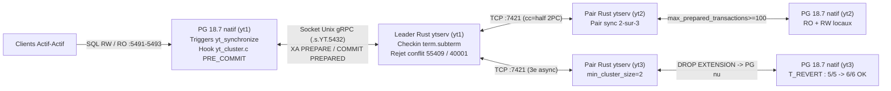

# #18 — YT Cluster & YT Cluster Lite (PG natif + ytserv)

**Série :** Architectures PostgreSQL Multi-Maîtres & Active-Active  
**Auteur :** Jean-Marie Renouard (`jmrenouard`) — [LightPath](https://www.lightpath.fr)  
**Licence :** MIT License  
**Langue :** [English version](../../en/solutions/yt_cluster_lite.md)

---

| Attribut | Valeur |
| :--- | :--- |
| **ID Catalogue** | `#18` (`YT Cluster & YT Cluster Lite` — DBinvent, ex-YaXAHA) |
| **Topologies Benchmark** | `yt-cluster` (défaut `cc=half`, `sc=NO_SC`), `yt-cluster-async` (`cc=nodes>=0`, `sc=NO_SC`) (`results/benchmark_yt_cluster.csv`, 22 lignes) |
| **Version Moteur** | `PostgreSQL 18.7 (Debian 18.7-1.pgdg13+5) + yt_cluster 1.21` ([`dbinvent/yt:1.21.3`](https://hub.docker.com/r/dbinvent/yt)) |
| **Profil CAP / PACELC** | Écritures `PC/EC` (défaut `cc=half` 2PC XA 2/3, `RPO=0`) + lectures éventuelles `EL` (`NO_SC`) ; option async `PA/EL` (`cc=nodes>=0`) |
| **Mécanisme** | Triggers par table `yt_synchronize` + hook `yt_cluster.c` `XACT_EVENT_PRE_COMMIT` -> gRPC Unix -> démon Rust `ytserv` Leader `checkin` + XA `PREPARE`/`COMMIT PREPARED` (`max_prepared_transactions >= 100`) |
| **Séparation Licence** | Cœur embarqué **MIT** (`DBinvent/yt-cluster-lite` : extension `ytpgc` + Protobuf + feuille mono-BD `yt-lite`) vs `ytserv` + `ytctl` fermés (**PolyForm Noncommercial 1.0.0 / Commercial**, [`agent.md`](https://dbinvent.com/agent.md)) |
| **Stack Docker PoC** | `docker-compose-yt-cluster.yml` (3 nœuds actif-actif [`dbinvent/yt:1.21.3`](https://hub.docker.com/r/dbinvent/yt) `yt1`/`yt2`/`yt3`, ports `5491-5493`, `min_cluster_size=2`) |
| **TDE / Chiffrement au repos** | Absent cœur PG 18.7 ; LUKS OS sur PG + `ytserv`, mTLS pairs + sauvegardes AES ([Ch. 14](../14_chiffrement_transparent_tde.md)) |

---

## 1. Présentation et principes de fonctionnement (Licence MIT, nuance Jepsen et réversibilité)

**YT Cluster** (DBinvent) transforme PostgreSQL 14–19 en cluster actif-actif par une extension C (`yt_cluster`) et un démon Rust (`ytserv`). Les triggers (`yt_synchronize`) envoient les images par socket Unix gRPC (`.s.YT.<port>`) à `ytserv`. Au `XACT_EVENT_PRE_COMMIT`, `yt_complete(true)` arbitre les conflits (`55409` ou `40001`) puis valide en XA 2PC PostgreSQL (`max_prepared_transactions >= 100`).

$$
L_{\text{YT-half}} \approx L_{\text{trig}} + \text{RTT}_{\text{leader}} + 2 \cdot L_{\text{2PC-fsync}}, \qquad L_{\text{YT-async}} \approx L_{\text{trig}} + \text{RTT}_{\text{leader}} + L_{\text{disque}}
$$

- **Séparation CRITIQUE MIT vs double licence :** `DBinvent/yt-cluster-lite` (**MIT**) fournit `yt-core-proto`, `ytpgc` et `yt-lite` (nœud feuille pour `ytserv >= 1.21` rejetant le multi-BD en `0A000`). Il **ne peut pas former seul un cluster pair-à-pair**. Un vrai cluster exige l'image fermée `ytserv` + `ytctl` ([`dbinvent/yt:1.21.3`](https://hub.docker.com/r/dbinvent/yt), [`dbinvent.com/agent.md`](https://dbinvent.com/agent.md)) sous **PolyForm Noncommercial 1.0.0** et **licence commerciale DBinvent**.
- **Nuance du test chaos Jepsen (`https://dbinvent.com/cluster/articles/jepsen`) :** **Auto-exécuté par DBinvent** (pas un audit indépendant Jepsen LLC / Kyle Kingsbury) sur 5 nœuds `1.20.1` (`Jepsen 0.3.14` + Elle), vérifié sur **Elle `cursor-stability` uniquement** (lectures à cohérence à terme tolérées, pas de sérialisabilité stricte). La build initiale `1.20.1` a échoué chaque run avec **51 anomalies**. Cela inclut **24 sévères** (double leader `#42`, insertion dupliquée `#1`, écriture échouée survivante `#40`, verrous 2PC), **21 alertes**, **6 faibles** et **0 critique**. Les 51 sont annoncées corrigées et retestées au vert (**49/49**).
- **Preuve de réversibilité `T_REVERT` :** Le test en direct exécute `DROP EXTENSION yt_cluster CASCADE;` sur `yt3` (`ext=0`, `triggers=0`). Il conserve les `5/5` lignes validées et accepte les écritures PostgreSQL (`6/6`).

---

## 2. Architecture et flux de données

---

## 3. Modes d'implémentation

| Mode | CAP / PACELC | Commit / RPO / Conflits | Portée et compromis |
| :--- | :--- | :--- | :--- |
| **`yt-cluster` (`cc=half`, `NO_SC`)** *(Défaut PoC)* | Écritures `PC/EC` / lect. `EL` | XA 2PC synchrone 2-sur-3, **`RPO=0`**, dérive `0` (rejet `55409`/`40001`) | Sûreté par défaut élevée, mais `20.63 TPS` (`A`), `2.25 TPS` WAN `25ms` |
| **`yt-cluster-async` (`cc=nodes>=0`, `NO_SC`)** | `PA/EL` asynchrone | `checkin` Leader + apply pair async (risque `RPO > 0`) ; dérive `0` | `2,0x` (`41.45` `A`) à `5,1x` (`55.03` `B2`) plus rapide ; `4.78 TPS` WAN |
| **`cc=all` + `SC` (`sequential_consistency`)** | `PC/EC` strict | 2PC synchrone sur tous les nœuds + barrière de lecture séquentielle | Latence maximale ; toute perte de nœud bloque les écritures |
| **Feuille `yt-lite` (`DBinvent/yt-cluster-lite`)** | Feuille amont (MIT) | Feuille mono-BD TLS 1.3 sur `yt_outbox` vers `ytserv >= 1.21` | Cœur MIT, jamais Leader, zéro multi-maîtres P2P seul (`0A000` multi-BD) |

---

## 4. Résultats empiriques et limites vérifiées (`results/benchmark_yt_cluster.csv` & `results/functional_limits_yt_cluster.csv`)

Les 36 lignes (18 `yt-cluster` + 18 `yt-cluster-async`) ont été mesurées à `pg_scale = 2` sur `dbinvent/yt:1.21.3` (`balance_drift = 0`). Voir [`chart_11`](../../../assets/charts/chart_11_yt_cluster_vs_multimaster_log.png) et [Ch. 09](../09_methodologie_benchmarks_et_graphiques.md). Seules `Avg`, `Stddev` (`0` pour `sysbench`) et `p95` sont enregistrées (la latence `p99` n'est pas mesurée).

| Suite (`PG_SCALE=2`) | `yt-cluster` (`cc=half`) TPS | `cc=half` Avg / p95 (ms) | `cc=half` Retries / Échecs | `yt-cluster-async` (`cc=nodes>=0`) TPS | `async` Avg / p95 (ms) |
| :--- | :---: | :---: | :---: | :---: | :---: |
| **`A_single_rw`** (8c/15s) | **20.63** | 384.867 / 1,330.433 | 185 / 0 | **41.45** | 185.733 / 758.357 |
| **`B1_disjoint_rw`** (8c/15s) | 36.14 | 220.597 / 663.403 | 197 / 0 | **88.19** | 90.398 / 252.257 |
| **`B2_overlap_rw`** (8c/15s) | **10.69** | 565.791 / 1,741.838 | 284 (`33`/`251`) / 14 | **55.03** | 130.887 / 538.021 |
| **`C_multinode_ro`** (16c/15s) | **48,787.74** | 0.305 / 0.504 | 0 / 0 | **40,774.49** | 0.367 / 0.682 |
| **`D_hot_conflict`** (8c/12s) | **67.76** (dérive `0`) | 117.401 / 249.196 | 32 (`55409`) / 0 | **163.01** (dérive `0`) | 48.819 / 152.900 |
| **`E_sysbench_oltp_rw`** (8c/15s) | **28.48** (`582.89 QPS`) | 280.34 / 530.08 | 0 / 12 | **124.05** (`2,519.71 QPS`) | 64.46 / 108.68 (`34` err) |
| **`E2_ro` / `E3_wo`** (8c/12s) | 2,122.68 / 26.43 | 3.76 / 4.33 ; 301.54 / 846.57 | 0 / 0 ; 0 / 8 | 2,083.85 / **133.55** | 3.83 / 4.57 ; 59.77 / 81.48 |
| **`E4_point_select`** (16c/12s) | **165,472.75** | 0.10 / 0.24 | 0 / 0 | **177,442.88** | 0.09 / 0.23 |
| **`H_append_only_insert`** (`uuidv7()`) | **110.53** | 72.217 / 135.582 | 0 / 0 | **224.93** | 35.538 / 60.944 |
| **`F_wan_netem_25ms`** (`10`/`25`/`50ms`) | **2.25** (`4.81`/`2.25`/`1.41`) | 2,708.087 / 5,557.313 | 7 / 0 | **4.78** (`8.47`/`4.78`/`2.90`) | 1,356.434 / 4,136.144 |
| **`G_conc_c1..c32`** (1/4/8/16/32c) | **28.07 -> 4.60** | 35.61 -> 3,542.782 | 0..91 / 0 | **53.94 -> 91.68 -> 44.20** | 18.52 -> 431.504 |

| Sonde / Limite vérifiée | Résultat empirique YT Cluster 1.21.3 (`results/functional_limits_yt_cluster.csv`) |
| :--- | :--- |
| **`AA`, `L1` & Séquences `T18`** | `AA` `30/30` (`sum=300`, dérive `0`) ; `SERIAL` concurrent collisionne (`yt2=55409`, `1:yt1`), `uuidv7()` converge `60/60/60` ; `T18` seq synchronisée (`50|true`, `next_id=51`) |
| **`L2` Sans PK, `L3` Lost Upd & `L4` Unique** | DML sans PK synchronisé (`1/1/1`, `upd/upd/upd`, `0/0/0` ; copie de nœud requiert PK) ; `L3` bloque `+100/-30` (`55409`), retry converge **`1070.00`** (`0` dérive) ; `L4` rejette doublon en **`40001`** |
| **`L5` DDL/`SAVEPOINT` & `L6` Fonctions** | `ALTER TABLE` non propagé (`1/0/0`), `TRUNCATE` OK ; **rollback `SAVEPOINT` sur écritures échoue au `COMMIT` en `0A000`** (`rows=0`) ; `advisory_lock`/`LISTEN` locaux ; `TEMP` & `ENUM` OK |
| **`L7` Panne & `L8` Quorum** | `1/3` HS (`yt3`) : `10/10` écritures OK (`yt1+yt2`), rattrapage `78 ms` ; `2/3` HS (`min_cluster_size=2`) : bloqué (**`57P03`**, `YT-E1852 Not enough working nodes`), reprise propre |
| **`T11` Bulk 10k, `T12` & `T13` FK** | `T11` : **`86 rows/s`** (`115,961 ms`, trigger/ligne + 2PC ; rattrapage `yt2=111 ms`, `yt3=12,059 ms`) ; `T12` `DELETED/DELETED/DELETED` ; `T13` `10/10` FK cohérentes |
| **`T14–T17` & Preuve `T_REVERT`** | `T14` `3/3` `md5=00493e3a` ; `T15` `p50=82.14`, `p95=101.29`, `max=104.38 ms` ; `T16` `20/20`, **`RPO=0`**, `57P03` pendant bascule 8s (risque pidfile `YT-E1104`) ; `T17` `NO_DIRTY_READ` (`78/79 ms`) ; **`T_REVERT`** : `DROP EXTENSION` -> `ext=0`, `triggers=0`, `5/5` -> `6/6` PG nu OK |
| **SQLSTATEs vérifiés** | `0A000` (rollback `SAVEPOINT`), `40001` (`UNIQUE`/conflit), `55000` (quarantaine `recon` async sur tables réutilisées), `55409` (rejet checkin YT), `57P03` (quorum / bascule `YT-E1852`) |

---

## 5. Forces et faiblesses

| Forces | Faiblesses et pièges opérationnels |
| :--- | :--- |
| **Actif-actif zéro dérive sur PG natif :** Dérive `0` sur `A`/`B1`/`B2`/`D`/`L3` (`1070.00`), `T13` `10/10` FK, `RPO=0` (`T16`), DML sans PK (`L2`) et séquences sync (`T18`). | **Plafond d'écriture 2PC sévère (`20,6–41,5 TPS`) :** Triggers par ligne + Leader + XA 2PC limitent `A` à `20.63 TPS` (`41.45` async), `T11` à **`86 rows/s`** et WAN `25ms` à `2.25–4.78 TPS`. |
| **Réversibilité prouvée (`T_REVERT`) :** `DROP EXTENSION yt_cluster CASCADE;` retire extension et triggers en laissant les tables intactes (`5/5` -> `6/6` PG nu), limitant le verrouillage des données. | **Coordinateur fermé et bus factor = 1 :** `ytserv`/`ytctl` sont fermés (PolyForm Noncommercial / Commercial) ; `yt-cluster-lite` MIT n'a que `2` contributeurs (`vkrinitsyn` 18 commits + bot) et 7 jours d'âge. |
| **Lectures locales natives & PG 18.7 :** Les lectures évitent le 2PC (`48,787.74 TPS` `C`, `165,472.75 TPS` `E4`), préservant `uuidv7()`, `ENUM` et `TEMP TABLE`. | **Pièges protocole et exploitation :** Rollback `SAVEPOINT` échoue (`0A000`), zéro DDL auto (`L5`), Jepsen auto-exécuté en `cursor-stability` seule, et risque pidfile `YT-E1104` après `SIGKILL`. |
| **Signalement explicite (`55409`/`40001`) :** Rejette les écritures concurrentes en conflit au lieu d'écraser silencieusement ou de geler un worker logique. | **Hygiène retry et XA obligatoire :** Les clients doivent rejouer `55409`/`40001` (`284–2,173` retries en `B2`/`D`), régler `max_prepared_transactions >= 100` et vider `pg_prepared_xacts`. |

---

## 6. Popularité GitHub, présence Git et vitalité de maintenance (`results/project_popularity.csv`)

Télémétrie GitHub en direct (`2026-11-20T17:26:02Z`, `archived = false` sauf `N/A`) :

| Projet | Présence / Rôle Git | Dépôt (`Compte / Dépôts`) | Stars / Forks / Watch | Commits (`Tot / 12m`) | Contrib / Issues | Lang / SPDX | Tag / Dernier Push |
| :--- | :--- | :--- | :---: | :---: | :---: | :--- | :--- |
| **YT Cluster Lite (MIT Core) (`#18`)** | `Yes (MIT Core; ytserv dual-licensed)` -- `Primary (MIT leaf/ext; ytserv PolyForm Noncommercial/Commercial)` | [`DBinvent/yt-cluster-lite`](https://github.com/DBinvent/yt-cluster-lite) (`Org / 10`) | 15 / 0 / 1 | 21 / 21 | 2 / 0 | Rust / `MIT` | `v1.21` / `2026-11-20T00:05:13Z` |

- **Niveau de maintenance :** **Niveau C (Fragile / Jeune)** -- Dépôt créé le `2026-11-13` (`15` stars, `0` fork, `21` commits total / `21` sur 12m, `0` issue ouverte, `2` contributeurs : auteur unique `vkrinitsyn` + bot).
- **Fraîcheur / Actualité :** **À jour -- Jeune** -- Dernier push `2026-11-20T00:05:13Z`, `21` commits/12m, dernière version `v1.21`.
- **Maintenabilité opérationnelle :** **Risque élevé** -- Extension réversible, mais double licence fermée `ytserv`, bus factor = 1, plafond `20,6-41,5 TPS` et limite `0A000` restreignent l'adoption en production.

---

**Navigation :** [Index](../../../README.fr.md) · [Ch. 03a — Catalogue natif et extensions](../03a_catalogue_natif_et_extensions.md) · [Ch. 11 — Popularité et vitalité](../11_popularite_et_vitalite_ecosysteme.md) · [PG 18.6 Natif](pg18_native_clustering.md) · [pgEdge Spock](pgedge_spock.md) · [YugabyteDB](yugabytedb.md) · [English version](../../en/solutions/yt_cluster_lite.md)
