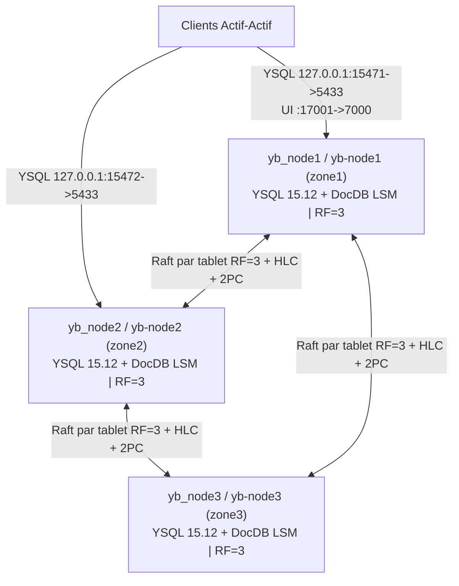

# 5 — YugabyteDB (SQL distribué : fork PG YSQL + Raft par tablet DocDB)

**Série :** Architectures PostgreSQL Multi-Maîtres & Active-Active  
**Auteur :** Jean-Marie Renouard (`jmrenouard`) — [LightPath](https://www.lightpath.fr)  
**Licence :** MIT License

---

| Attribut | Valeur |
| :--- | :--- |
| **ID Catalogue** | `#5` (`YugabyteDB 2026.1.3 DocDB Raft (#5)` dans `results/functional_limits_matrix.csv`) |
| **Topologie Benchmark** | `yugabyte` (`results/*.csv`) |
| **Famille / Niveau** | `T5` / `Niveau 5` — SQL distribué à consensus |
| **Versions** | `YugabyteDB 2026.1.3.0-b100`, YSQL `15.12-YB-2026.1.3.0-b0` (fork C `PG 15` + C++ `DocDB`) |
| **Profil CAP / PACELC** | `CP / PC-EC` (`3 (RF=3 YSQL)` — Raft par tablet `RF=3`, HLC bornée) |
| **Licence / Déploiement** | Apache 2.0 (Open Source) / 3 conteneurs (`docker-compose-yugabyte.yml`) |
| **TDE / Chiffrement au repos** | **Intégré OSS (`DocDB`)** : clé universelle + DEK tablet, WAL & `yb_backup` chiffrés ([Ch. 14](../14_chiffrement_transparent_tde.md)) |

---

## 1. Description de la technologie et rôle

**YugabyteDB** est une base SQL distribuée open source. Elle associe une **couche requête PostgreSQL 15 C forkée (`YSQL`)** à **DocDB**, un stockage C++ sur **RocksDB** avec consensus **Raft** par *tablet* (`RF = 3`). Chaque nœud exécute `yb-master` et `yb-tserver`, acceptant des lectures/écritures actif-actif routées vers le leader Raft de chaque tablet.

À la différence de `#6 CockroachDB` (moteur Go *clean-room* sur `pgwire`), réutiliser le parseur, le planificateur et l'exécuteur PL/pgSQL C de PostgreSQL préserve triggers, `TEMP TABLE`, `pg_trgm`, `uuid-ossp` et `pgvector`. De plus, YSQL utilise par défaut **`READ COMMITTED` Wait-on-Conflict** pessimiste, évitant les rafales de reprises `40001` des moteurs `SERIALIZABLE` optimistes.

---

## 2. Architecture et flux de données

Dans `env/multi-db-docker-env/docker-compose-yugabyte.yml`, trois conteneurs `yugabyted` (`yb_node1..3`) couvrent `zone1..zone3` sur `yb_net` avec `RF=3`, `yb_num_shards_per_tserver=1` et `ysql_num_shards_per_tserver=1` :

Les tirs multi-écrivains (`B1`–`D`, `H`) ciblent `yb-node1` et `yb-node2` (`user=yugabyte`) pendant que `yb-node3` vote dans Raft. Ensuite `conv_chk` vérifie les 3 nœuds et `tc netem` retarde `yb_node2` et `yb_node3`.

---

## 3. Principes de fonctionnement et modes d'implémentation

1. **Raft par tablet et ordonnancement HLC :** Les tables sont découpées en *tablets* répliqués par Raft (`RF = 3`). Les horloges logiques hybrides (HLC, `--max_clock_skew_usec` `500 ms` par défaut) ordonnent lectures et écritures sans verrou central, tandis que les mutations multi-tablets passent par un 2PC distribué dans `DocDB`.
2. **Modèle de latence de commit :**

$$
L_{\text{N5-yb-1tablet}} \approx L_{\text{disque-leader}} + \text{RTT}_{\text{quorum-Raft}}, \qquad L_{\text{N5-yb-2PC}} \approx L_{\text{disque}} + 2 \cdot \text{RTT}_{\text{quorum-Raft}} + \text{HLC}_{\text{attente}}
$$

3. **Isolation, colocalisation et séquences :** Le mode défaut `READ COMMITTED` applique **Wait-on-Conflict** (`0` reprise `40001` en `A`–`H`). Les modes `REPEATABLE READ` et `SERIALIZABLE` annulent les conflits en `40001` (`L3`). Le cache défaut `CACHE 100` préalloue 100 IDs par nœud (`T18` `next_id=101` sur `node2` vs `CACHE 1` à `1.89 ms`).

| Mode / Fonction | Portée | Mécanique et stratégie de clés | Impact conflit / bascule | Compromis |
| :--- | :--- | :--- | :--- | :--- |
| **`READ COMMITTED` Wait-on-Conflict** *(Défaut PoC)* | `iso=read_committed` (`F1`) | File d'attente pessimiste sur verrou de ligne DocDB | **`0` reprise `40001`** (`A`–`H`), dérive `0`, `0` échec `E` | Attente en queue plus élevée sous contention |
| **`REPEATABLE READ` / `SERIALIZABLE`** *(PoC `L3`)* | `BEGIN ISOLATION LEVEL` | Contrôle optimiste SI / SSI par HLC et intentions | `L3` lève `8x` `40001` ; converge `bal=1100` (`33` reprises) | Impose boucle de reprise client `40001` |
| **Sharding hachage vs colocalisation** *(PoC `1` shard/ts)* | `ysql_num_shards_per_tserver=1` | Hachage (`pgbench_history` `hid BIGSERIAL PK`) ; colocalisation regroupe les tables | DML mono-tablet sans RPC 2PC (`H` `2987.24 TPS`) | Les transactions multi-tablets paient le 2PC |
| **Séquences globales** *(`CACHE 100` vs `CACHE 1`)* | `CREATE SEQUENCE` (`L1`/`T18`) | YSQL préalloue `CACHE 100` (`1.98 ms`) ; `CACHE 1` appelle le master (`1.89 ms`) | Zéro collision PK `23505` (`T18` `node2` obtient `next_id=101`) | `CACHE 100` crée des trous d'IDs entre nœuds |
| **xCluster Async DR** *(Arch. — Hors PoC)* | Réplication inter-clusters | Flux CDC asynchrone entre deux univers YugabyteDB distincts | Bascule le lien inter-DC en `AP / PA-EL` (survit perte région) | `RPO > 0` ; pas de linéarisabilité inter-régions |
| **Geo-Partitioning** *(Arch. — Hors PoC)* | Tablespaces par ligne | Épingle partitions/tablets et leaders Raft sur `cloud.region.zone` | Garde les accès régionaux à faible latence locale | Jointures/écritures inter-régions paient le RTT WAN |

---

## 4. Forces et faiblesses

| Forces | Faiblesses et pièges opérationnels |
| :--- | :--- |
| **`READ COMMITTED` pessimiste (`0` reprise) :** Surpasse CockroachDB de `4,1x` en Suite A (`173.64` vs `42.08 TPS`), `0` échec en `E` (`128.24 TPS`), dérive `0` (`A`–`H`). | **Effondrement consensus WAN (`Suite F`) :** Chute de `-96,7 %` à `25 ms` (`5.78 TPS`, `p95=3401.333 ms`) et `3.06 TPS` à `50 ms` (`p95=5474.705 ms`). |
| **Débit ajout, lecture et rattrapage :** Atteint `2987.24 TPS` (`H`), `17150.58 TPS` (`C`), `11557.45 TPS` (`E4`), `23434 rows/s` (`T11`, `417.2 ms`), `T15` `p50=2.01 ms`. | **Empreinte RAM & saturation (`G_conc`) :** Plafond `2048m` (`320 MiB` master + `1024 MiB` tserver) ; `G_conc` culmine à `c=8` (`122.98 TPS`) -> `99.49` (`c=32`). |
| **Large parité extensions YSQL (`L6`) :** `TEMP TABLE`, `pg_trgm`, `uuid-ossp`, `vector`, `pg_try_advisory_lock(42)` (sur `node1`), `L5` DDL + `SAVEPOINT`, `T13` FK `10/10`, `L2` OK. | **`LISTEN/NOTIFY` coupé & limites `E3`/`RR` :** `LISTEN` échoue `0A000` ; `REPEATABLE READ` lève `8x` `40001` (`L3`, `33` reprises) ; `E3` note `tx_failed=1`. |
| **Résilience Raft `RPO = 0` (`L7`/`T16`) :** Survit à l'arrêt `1/3` (`L7` `bal=500`) et `SIGKILL` (`T16` `20/20` RPO=0, `21/21` au redémarrage), `23505` global (`L4`). | **Arrêt sur perte de quorum (`L8`) & `T18` :** Perdre `2/3` nœuds bloque YSQL (`connection timeout`) ; `CACHE 100` saute à `next_id=101` sur `node2` (`T18`). |

---

## 5. Résultats empiriques, limites fonctionnelles et spec PoC

Tests à `pg_scale = 2` (`retries_40001 = 0` sur tous les CSV). Seules `Avg`, `Stddev` (`0` pour `sysbench`) et `p95` sont mesurées (la latence au 99e percentile n'est pas enregistrée dans `results/`).

### Tableau A — Charges principales et étendues (`benchmark_summary.csv`, `benchmark_extended_workloads.csv`)

| Suite | Cl / Dur | TPS | QPS | Avg / Stddev / p95 (ms) | Validées (Échecs) | Dérive | Statut |
| :--- | :---: | :---: | :---: | :---: | :---: | :---: | :--- |
| `A_single_rw` | 8 / 20s | 173.64 | N/A | 45.881 / 41.181 / 131.768 | 3485 (0) | 0 | `PASS_CONVERGED` |
| `B1_disjoint_rw` | 8 / 20s | 194.75 | N/A | 41.039 / 31.351 / 101.369 | 3895 (0) | 0 | `PASS_CONVERGED` |
| `B2_overlap_rw` | 8 / 20s | 170.19 | N/A | 46.962 / 49.146 / 152.133 | 3407 (0) | 0 | `PASS_CONVERGED` |
| `C_multinode_ro` | 16 / 20s | 17150.58 | N/A | 0.922 / 0.438 / 1.423 | 341974 (0) | 0 | `PASS` |
| `D_hot_conflict` | 8 / 15s | 832.65 | N/A | 9.591 / 7.008 / 15.138 | 12457 (0) | 0 | `PASS_CONVERGED` |
| `E_sysbench_oltp_rw` | 8 / 20s | 128.24 | 2564.8 | 62.25 / 0 / 81.48 | 2574 (0) | 0 | `PASS` |
| `E2_sysbench_oltp_ro` | 8 / 12s | 191.86 | 3069.76 | 41.63 / 0 / 56.84 | 2310 (0) | 0 | `PASS` |
| `E3_sysbench_oltp_wo` | 8 / 12s | 360.02 | 2160.39 | 22.19 / 0 / 33.72 | 4328 (1) | 0 | `PASS` |
| `E4_sysbench_point_select` | 16 / 12s | 11557.45 | 11557.45 | 1.38 / 0 / 2.07 | 138762 (0) | 0 | `PASS` |
| `H_append_only_insert` | 8 / 12s | 2987.24 | N/A | 2.662 / 1.804 / 3.71 | 35624 (0) | 0 | `PASS_CONVERGED` |
| `F_wan_netem_25ms` | 8 / 15s | 5.78 | N/A | 1327.297 / 1114.498 / 3401.333 | 95 (0) | 0 | `PASS_NETEM_25MS` |

### Tableau B — Balayages concurrence & WAN (`benchmark_concurrency_sweep.csv`, `benchmark_wan_sweep.csv`)

| Suite | Param | TPS | Avg / Stddev / p95 (ms) | Validées | Statut |
| :--- | :---: | :---: | :---: | :---: | :--- |
| `G_conc_c1` (8s) | 1 cl | 68.14 | 14.654 / 6.22 / 19.205 | 544 | `PASS` |
| `G_conc_c4` (8s) | 4 cl | 111.55 | 35.792 / 28.844 / 95.447 | 889 | `PASS` |
| `G_conc_c8` (8s) | 8 cl | 122.98 | 64.764 / 59.333 / 182.469 | 985 | `PASS` |
| `G_conc_c16` (8s) | 16 cl | 105.22 | 150.573 / 131.232 / 400.039 | 843 | `PASS` |
| `G_conc_c32` (8s) | 32 cl | 99.49 | 316.73 / 258.259 / 797.971 | 805 | `PASS` |
| `F_wan_netem_10ms` (12s) | 10 ms | 15.38 | 504.823 / 433.067 / 1311.879 | 194 | `PASS_NETEM_10MS` |
| `F_wan_netem_25ms` (15s) | 25 ms | 5.78 | 1327.297 / 1114.498 / 3401.333 | 95 | `PASS_NETEM_25MS` |
| `F_wan_netem_50ms` (12s) | 50 ms | 3.06 | 2380.804 / 1783.389 / 5474.705 | 44 | `PASS_NETEM_50MS` |

### Tableau C — Limites fonctionnelles (`F1`, `L1–L8`) et sondes étendues (`T11–T18`)

| Sonde | Résultat empirique observé |
| :--- | :--- |
| `F1` Santé | `PASS: PG 15.12-YB-2026.1.3.0 srv=3 rf=3 iso=read_committed` |
| `L1` PK `SERIAL` | `PASS: seq cache=1 1.89ms cache=100 1.98ms` |
| `L2` Sans PK | `PASS: keyless and upfront bigserial PK both work` |
| `L3` *Lost Update* | `PASS with retry: RR raw hit 8x 40001; retry converged bal=1100 (33 retries)` |
| `L4` Conflit `UNIQUE` | `PASS: global SQLSTATE 23505 enforced across nodes` |
| `L5` DDL & `SAVEPOINT` | `PASS: ALTER TABLE ADD COLUMN visible on node3; tx DDL and SAVEPOINT OK` |
| `L6` Fonctions PG | `PASS: temp adv_lock pg_trgm uuid-ossp vector OK; LISTEN/NOTIFY=ERR(0A000 disabled)` *(verrou consultatif testé sur node1 seul)* |
| `L7` Panne nœud | `PASS: 1/3 node down survives (RPO=0 bal=500)` |
| `L8` Quorum | `EXPECTED_LIMITATION: 2/3 down lost Raft quorum -> HALTED (connection timeout); recovers` |
| `T11` Bulk 10k | `PASS: 23434 rows/s (427ms); peer_catchup=417.2ms` |
| `T12` Upd vs Del | `PASS: consensus (upd=OK del=OK) nodes=DELETED/DELETED/DELETED` |
| `T13` Course FK | `PASS: 10/10 immediate cross-node child inserts consistent (0 FK errors)` |
| `T14` MD5 riche | `PASS: 3/3 identical md5=00493e3a (BYTEA=65536B JSONB/NULL/TS/UTF8)` |
| `T15` Lag visibilité | `p50=2.01ms p95=2.83ms max=43.75ms (n=30)` |
| `T16` SIGKILL RPO | `PASS: peer_surv=20/20 RPO=0 peer_write_OK; post_restart=21/21` |
| `T17` Tx longue | `PASS: NO_DIRTY_READ; side_tx_unblocked(211ms); post_commit_vis=194ms (ok=True)` |
| `T18` Seq (50) | `PASS: global sequence safe on node2 (next_id=101; zero 23505)` |
| **SQLSTATEs** | `L1–L8: 40001;23505;0A000` \| `T11–T18: NONE` |

### Tableau D — Spécification Docker PoC (`env/multi-db-docker-env/`)

| Paramètre | Configuration / Observation PoC |
| :--- | :--- |
| **Compose & Scripts** | `docker-compose-yugabyte.yml` + `scripts/yugabyte/setup_yugabyte.sh` + `tests/test_yugabyte.sh` |
| **Nœuds & Ports** | `yb_node1` (`127.0.0.1:15471:5433`, UI `17001:7000`), `yb_node2` (`15472:5433`), `yb_node3` (`15473:5433`) |
| **Image & Ressources** | `yugabytedb/yugabyte:2026.1.3.0-b100`, `mem_limit: 2048m`, master `320 MiB`, tserver `1024 MiB`, pont `yb_net` |
| **Options & Setup** | `yugabyted start --insecure --fault_tolerance=zone`, `yb_num_shards_per_tserver=1`, `ysql_num_shards_per_tserver=1`, `yb_servers() == 3`, `hid BIGSERIAL PRIMARY KEY` sur `pgbench_history`. |

## 6. Popularité GitHub, présence Git et vitalité de maintenance (`results/project_popularity.csv`)

Télémétrie GitHub en direct (`2026-11-20T17:26:02Z`, `archived = false` sauf `N/A`) :

| Projet | Présence / Rôle Git | Dépôt (`Compte / Dépôts`) | Stars / Forks / Watch | Commits (`Tot / 12m`) | Contrib / Issues | Lang / SPDX | Tag / Dernier Push |
| :--- | :--- | :--- | :---: | :---: | :---: | :--- | :--- |
| **YugabyteDB (#5)** | `Yes` -- `Primary` | [`yugabyte/yugabyte-db`](https://github.com/yugabyte/yugabyte-db) (`Org / 314`) | 10670 / 1483 / 222 | 41479 / 5350 | 1217 / 9765 | C / `NOASSERTION` | `v2026.1.3.0` / `2026-11-20T17:22:06Z` |

- **Niveau de maintenance :** **Niveau A (OSS Actif)** -- `yugabyte/yugabyte-db` totalise `5 350` commits/12m (`41 479` total, `1 217` contributeurs, `10 670` stars, `9 765` issues).
- **Fraîcheur / Actualité :** **À jour -- Actif au quotidien** -- Dernier push `2026-11-20T17:22:06Z`, `5 350` commits/12m, dernière version `v2026.1.3.0`.
- **Maintenabilité opérationnelle :** **Modéré** -- Vélocité élevée (Apache 2.0, SPDX `NOASSERTION`). Le plancher `2 GiB`/nœud et la sensibilité WAN restent exigeants.

---

**Navigation :** [Index](../../../README.fr.md) · [Ch. 03b — Distribué, triggers et cloud](../03b_catalogue_distribue_triggers_cloud.md) · [Ch. 10 — Streaming vs Logique vs Multi-Maîtres](../10_comparatif_streaming_logique_multimaster.md) · [English version](../../en/solutions/yugabytedb.md)
